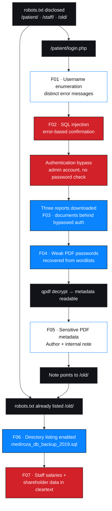
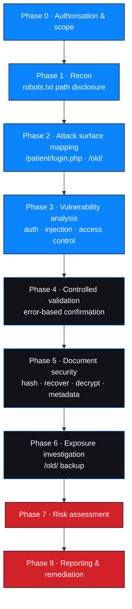

# Networkwalks — Mediroza General Hospital Penetration Testing

**Batch B082 / B083 · Week 4 — Final Project**
**Black-box web application security assessment of `https://medirozahospital.com`**

[](https://github.com/aasz253/Networkwalks-Mediroza-General-Hospital-Penetration-Testing)
[](https://github.com/aasz253/Networkwalks-Mediroza-General-Hospital-Penetration-Testing)
[](https://github.com/aasz253/Networkwalks-Mediroza-General-Hospital-Penetration-Testing)
[](https://github.com/aasz253/Networkwalks-Mediroza-General-Hospital-Penetration-Testing)
[](https://github.com/aasz253/Networkwalks-Mediroza-General-Hospital-Penetration-Testing)
[](https://github.com/aasz253/Networkwalks-Mediroza-General-Hospital-Penetration-Testing)
[](./LICENSE)

---

> ### ⚠️ Read this first — status, source and redaction policy
>
> **What is documented here.** All four milestones were completed against a
> Networkwalks training environment that the provider states is authorised for
> testing. The technical record for each milestone is the Networkwalks lab
> solution, which documents request/response outputs for every step. Seven
> findings are documented, three of them Critical.
>
> **What is NOT here, deliberately.**
>
> | Withheld | Why |
> | --- | --- |
> | The three recovered PDF passwords (literal values) | Credentials are never published. Strength is characterised instead — see [M2](milestones/M2-data-extraction/results.md). |
> | Employee salary figures | Personal / financial data. Only the **schema** and data classes are shown. |
> | Shareholder names, share percentages, share classes | Confidential corporate data. Masked. |
> | The `INSERT` row contents of the SQL backup | Contains real-shaped personal data. Only table schemas are reproduced. |
> | The downloadable PDF and SQL artifacts themselves | Gitignored ([`.gitignore`](.gitignore)). Not in this repository. |
> | Raw screenshots and logs | Sanitization not yet complete — see [evidence status](#7-evidence-and-documentation-index). |
> | Any claim of client review or approval | Not applicable to a lab engagement; none is claimed. |
>
> **Evidence honesty.** Findings are marked *Documented* — the lab record contains
> the observed outputs. They are **not** marked *Evidence-attached*, because no
> sanitized screenshot or log has been supplied to this repository yet. Both
> columns are tracked separately in
> [`findings/README.md`](findings/README.md).
>
> **Repository safety.** Nothing in this repository sends traffic to the target.
> No exploit automation, no credential-attack tooling, no scanning harness. The
> Python utilities are offline QA and defensive redaction helpers only.

---

## 1. Engagement at a glance

| Field | Detail |
| --- | --- |
| **Project title** | Networkwalks — Mediroza General Hospital Penetration Testing |
| **Engagement ID** | `NW-B083` |
| **Environment** | Networkwalks authorised training target (provider-stated authorisation) |
| **Client of record** | Mediroza General Hospital (fictional lab client) |
| **Authorized target** | `https://medirozahospital.com` |
| **Assessment type** | Black-box web application penetration testing |
| **Methodology** | OWASP WSTG, PTES, OWASP Top 10 / ASVS |
| **Duration** | 5 business days |
| **Batch** | B082 per the source lab record / B083 per the initial project brief — **see [§15](#15-known-discrepancies-and-open-items)** |
| **Project week** | Week 4 — final project |
| **Intern** | Antony Sifuna (`SifunaCodex`) |
| **Focus** | Cybersecurity · Penetration Testing · AI DevSecOps · Vulnerability Assessment · Security Engineering |

### Scope

| In scope | Out of scope |
| --- | --- |
| `robots.txt` and public path disclosure | Any host other than the authorized target |
| `/patient/login.php` authentication flow | Social engineering, phishing, physical |
| `/patient/reports/` document access control | Denial-of-service / stress / load |
| The three patient-report PDFs (`LAB-PDF-01…03`) | Destructive or data-modifying testing |
| Document encryption, password strength, metadata hygiene | Credential attacks against real accounts |
| `/old/` legacy directory and its contents | Internal infrastructure not exposed by the application |
| Exposure assessment of the exposed SQL backup | Persistence, lateral movement, pivoting |

Full scope: [`docs/authorization-and-scope.md`](docs/authorization-and-scope.md) ·
Operating rules: [`docs/rules-of-engagement.md`](docs/rules-of-engagement.md)

---

## 2. Milestones — all four complete

| # | Milestone | Outcome | Status |
| --- | --- | --- | --- |
| **M1** | [Initial Access](./milestones/M1-initial-access/README.md) | `robots.txt` disclosed `/patient/`, `/staff/`, `/old/`. Login page found. **Username enumeration** and **SQL injection** confirmed; authentication bypassed as `admin`. Three reports downloaded. | 🟢 Complete |
| **M2** | [Data Extraction / File Security](./milestones/M2-data-extraction/README.md) | Hashes extracted for all three PDFs. Passwords recovered for all three: two from the built-in top-100 list, one only after escalating to the larger JTR list. Report 3 decrypted with `qpdf` for metadata analysis. | 🟢 Complete |
| **M3** | [Deep Recon & Critical Data Exposure](./milestones/M3-critical-data-exposure/README.md) | `exiftool` on the decrypted report surfaced `Author: j.malik` and the note *"DB backup moved to /old before site migration, do not delete"*. `/old/` had **directory listing enabled** and served a 2019 SQL backup. Staff salary and shareholder tables exposed in cleartext. Chain closed: PDF author ↔ staff record ↔ backup location. | 🟢 Complete |
| **M4** | [Final Penetration Testing Report](./milestones/M4-final-report/README.md) | Seven findings consolidated: 3 Critical, 2 High, 2 Medium. Executive summary, technical findings, risk assessment, prioritised remediation plan with retest criteria. | 🟢 Complete |

<details>
<summary><strong>End-to-end attack chain</strong></summary>



Two independent paths converge on `/old/`: the `robots.txt` disclosure from the
very first reconnaissance step, and the metadata note discovered in M3. That
convergence is the strongest single argument for treating recon as a continuous
activity rather than a phase.

</details>

---

## 3. Findings summary

| # | Finding | Location | Severity | CVSS v4.0 vector | Status |
| --- | --- | --- | --- | --- | --- |
| 1 | [Username enumeration on login page](./findings/verified-findings/NW-B083-M1-F01-username-enumeration.md) | `/patient/login.php` | 🟠 Medium | `AV:N/AC:L/AT:N/PR:N/UI:N/VC:L/VI:N/VA:N/SC:N/SI:N/SA:N` | Documented |
| 2 | [SQL injection → authentication bypass](./findings/verified-findings/NW-B083-M1-F02-sqli-authentication-bypass.md) | `/patient/login.php` | 🔴 Critical | `AV:N/AC:L/AT:N/PR:N/UI:N/VC:H/VI:H/VA:L/SC:H/SI:N/SA:N` | Documented |
| 3 | [Patient documents accessible after login bypass](./findings/verified-findings/NW-B083-M1-F03-document-access-control.md) | `/patient/reports/` | 🔴 High | `AV:N/AC:L/AT:N/PR:L/UI:N/VC:H/VI:L/VA:N/SC:N/SI:N/SA:N` | Documented |
| 4 | [Weak PDF passwords recoverable from wordlists](./findings/verified-findings/NW-B083-M2-F01-weak-document-passwords.md) | `LAB-PDF-01…03` | 🔴 High | `AV:N/AC:L/AT:N/PR:L/UI:N/VC:H/VI:N/VA:N/SC:N/SI:N/SA:N` | Documented |
| 5 | [Sensitive metadata retained in patient PDF](./findings/verified-findings/NW-B083-M3-F01-sensitive-pdf-metadata.md) | `LAB-PDF-03` | 🟠 Medium | `AV:N/AC:L/AT:N/PR:N/UI:N/VC:L/VI:N/VA:N/SC:N/SI:N/SA:N` | Documented |
| 6 | [Directory listing enabled on a legacy web root](./findings/verified-findings/NW-B083-M3-F02-directory-listing-legacy-folder.md) | `/old/` | 🔴 Critical | `AV:N/AC:L/AT:N/PR:N/UI:N/VC:H/VI:N/VA:N/SC:N/SI:N/SA:N` | Documented |
| 7 | [Unencrypted database backup exposed in a legacy web root](./findings/verified-findings/NW-B083-M3-F03-cleartext-database-backup-exposure.md) | `/old/` (backup file) | 🔴 Critical | `AV:N/AC:L/AT:N/PR:N/UI:N/VC:H/VI:N/VA:N/SC:N/SI:N/SA:N` | Documented |

**Severity distribution:** 🔴 Critical 3 · 🔴 High 2 · 🟠 Medium 2 · 🟢 Low 0

**Rating basis.** Severity bands are taken from the engagement's own findings
summary and are consistent with the impact analysis in
[`milestones/M4-final-report/risk-assessment.md`](milestones/M4-final-report/risk-assessment.md).
CVSS v4.0 **vectors** are derived in
[`risk/cvss-assessment.md`](risk/cvss-assessment.md) with a per-metric rationale.
Base scores are deliberately **not** printed here — see
[`risk/cvss-assessment.md`](risk/cvss-assessment.md) §4 for why, and for the exact
calculator input required to close them.

---

## 4. Methodology applied



Procedures: [`methodology/`](methodology/) ·
Framework alignment: [`docs/methodology.md`](docs/methodology.md)

---

## 5. Tools and technologies

Only tooling documented in the engagement record is listed as used.

| Tool | Purpose | Milestone | Status |
| --- | --- | --- | --- |
| `curl` | Fetching `robots.txt` | M1 | ✅ Documented |
| Web browser | Manual navigation of login page and portal | M1, M3 | ✅ Documented |
| Networkwalks Hash Calculator (`networkwalks.com/hash-calculator/`) | Extracting `$pdf$` password hashes from encrypted PDFs | M2 | ✅ Documented |
| Networkwalks Password Cracker (`networkwalks.com/password-cracker/`) | Wordlist-based recovery against `$pdf$` hashes | M2 | ✅ Documented |
| Built-in top-100 password list | First-pass recovery for reports 1 and 2 | M2 | ✅ Documented |
| Instructor-supplied JTR wordlist | Escalation for report 3 | M2 | ✅ Documented |
| `qpdf` | Decrypting report 3 to an unlocked copy for metadata analysis | M2 → M3 | ✅ Documented |
| `exiftool` | Reading PDF metadata (author, comments) | M3 | ✅ Documented |
| `wget` | Downloading the exposed SQL backup from `/old/` | M3 | ✅ Documented |
| Text editor | Inspecting `INSERT` statements in the backup | M3 | ✅ Documented |
| Python 3 (stdlib) | Repository QA + defensive evidence sanitization | Repo | ✅ Verified in this repository |
| Git / GitHub Actions | Version control and documentation gate | Repo | ✅ Verified in this repository |

**Not used, by design:** exploitation frameworks, brute-force or spraying tools,
DoS/load tools, unscoped port scanners, persistence or lateral-movement tooling.
See [`docs/tools-and-technologies.md`](docs/tools-and-technologies.md) §5.

---

## 6. Risk-rating legend

| Severity | Meaning in this engagement |
| --- | --- |
| 🔴 Critical | Unauthenticated remote path to sensitive data or full authentication bypass. Immediate remediation. |
| 🔴 High | Practical path to confidential documents or recoverable credentials. Remediate within days. |
| 🟠 Medium | Meaningful information disclosure that materially assists other attacks. Remediate within weeks. |
| 🟢 Low | Hardening item with no demonstrated data-compromise path. |

Modifiers tracked per finding: **confidence** (High / Medium / Low), **verification
status** (Documented / Evidence-attached), and **data sensitivity** (clinical,
personal, financial). Method:
[`risk/risk-rating-methodology.md`](risk/risk-rating-methodology.md)

---

## 7. Evidence and documentation index

Every artefact uses the ID scheme `NW-B083-<MS>-E<nn>` and is tracked in
[`evidence/evidence-register.csv`](evidence/evidence-register.csv).

| Milestone | Evidence directory | Register rows |
| --- | --- | --- |
| M1 | [`evidence/screenshots/M1/`](evidence/screenshots/M1/) | `NW-B083-M1-E01…E08` |
| M2 | [`evidence/screenshots/M2/`](evidence/screenshots/M2/) | `NW-B083-M2-E01…E06` |
| M3 | [`evidence/screenshots/M3/`](evidence/screenshots/M3/) | `NW-B083-M3-E01…E08` |
| M4 | [`evidence/screenshots/M4/`](evidence/screenshots/M4/) | n/a — reporting artefacts |

| Document | Purpose |
| --- | --- |
| [`evidence/README.md`](evidence/README.md) | Evidence standard, redaction policy, sanitization workflow |
| [`evidence/evidence-register.csv`](evidence/evidence-register.csv) | Master register — 22 documented observations |
| [`risk/risk-register.csv`](risk/risk-register.csv) | Risk register — 7 findings |
| [`reports/remediation-tracker.csv`](reports/remediation-tracker.csv) | Remediation actions with owners and retest criteria |
| [`reports/penetration-testing-report.md`](reports/penetration-testing-report.md) | Full engagement report |
| [`reports/management-summary.md`](reports/management-summary.md) | Non-technical summary |

> **Artifact status.** The register records what the lab record documents. No
> binary artifact has been added to this repository, because none has been through
> manual redaction review. `artifact_present` is therefore `NO` on every row. The
> procedure to close this is in [`evidence/README.md`](evidence/README.md) §5.

---

## 8. Repository map

```mermaid
flowchart TB
    ROOT["Networkwalks-Mediroza-General-Hospital-Penetration-Testing"]
    ROOT --> DOCS["docs/ · engagement governance"]
    ROOT --> MS["milestones/ · M1 M2 M3 M4"]
    ROOT --> FND["findings/ · 7 finding records"]
    ROOT --> EVD["evidence/ · standard + register"]
    ROOT --> RPT["reports/ · client deliverables"]
    ROOT --> MTH["methodology/ · procedures"]
    ROOT --> RSK["risk/ · method + register"]
    ROOT --> DIA["diagrams/ · Mermaid sources"]
    ROOT --> SCR["scripts/ · Python QA + redaction"]
    ROOT --> TPL["templates/ · reusable documents"]
    ROOT --> GH[".github/ · issues + CI gate"]

    classDef r fill:#D22128,color:#ffffff,stroke:#000000;
    classDef b fill:#0A84FF,color:#ffffff,stroke:#000000;
    classDef d fill:#111318,color:#ffffff,stroke:#0A84FF;
    class ROOT r;
    class MS,FND,EVD,RPT b;
    class DOCS,MTH,RSK,DIA,SCR,TPL,GH d;
```



---

## 9. Remediation overview

| # | Theme | Action | Priority | Findings |
| --- | --- | --- | --- | --- |
| R-1 | Authentication error handling | Return one generic message for all failed logins | P2 | F01 |
| R-2 | SQL injection | Parameterised queries / prepared statements everywhere | **P0** | F02, and by extension F03 |
| R-3 | Document access control | Store documents outside the web root; authorise every request | **P0** | F03 |
| R-4 | Document passwords | Strong unique per-document passwords; never rely on secrecy of a weak password | P1 | F04 |
| R-5 | Metadata hygiene | Strip metadata on export/distribution (`exiftool -all=`) | P2 | F05 |
| R-6 | Directory listing | Disable autoindex on all directories | **P0** | F06 |
| R-7 | Backup hygiene | Remove backups from the web root; store encrypted, off-box, with a retention policy | **P0** | F06, F07 |
| R-8 | Defence in depth | Add WAF rules, alerting on bulk access, periodic external exposure review | P3 | All |

Full plan with owners and retest criteria:
[`milestones/M4-final-report/remediation-plan.md`](milestones/M4-final-report/remediation-plan.md)

---

## 10. Skills demonstrated

**Stated honestly.** The left column is what the engagement record documents.
The right column is what this repository itself demonstrates.

| Capability | Documented in the engagement | Demonstrated by this repository |
| --- | --- | --- |
| Reconnaissance | `robots.txt` analysis identified all three significant paths | Continuous-recon lesson encoded in the M3 chain analysis |
| Web application testing | Login flow, error handling, injection testing, access control | Full procedure set in [`methodology/`](methodology/) |
| Vulnerability analysis | 7 findings, each traced to an observed output | Per-metric CVSS v4.0 rationale in [`risk/`](risk/) |
| Authentication assessment | Enumeration + SQLi → full bypass, with the exact query-error signal | Auth procedure in [`methodology/authentication-assessment.md`](methodology/authentication-assessment.md) |
| File / document security | Hash extraction, wordlist recovery, decryption, metadata audit | M2 method with password values withheld by policy |
| Evidence management | Evidence captured per step | ID scheme, 22-row register, sensitivity/redaction/verification fields |
| Risk assessment | 3 Critical / 2 High / 2 Medium, impact-reasoned | CVSS v4.0 metric derivation + explicit no-fabricated-score rule |
| Security reporting | Executive summary and findings summary delivered | Full report in [`reports/`](reports/) |
| Remediation planning | 5 remediation themes supplied by the engagement | Expanded to 8 actions with priorities, owners and retest criteria |
| AI-assisted analysis | `INSERT` rows converted to readable tables with an LLM | Documented with its **data-handling caveat** — see [`milestones/M3-critical-data-exposure/evidence.md`](milestones/M3-critical-data-exposure/evidence.md) §5 |
| Python automation | n/a — not part of the lab | `evidence_sanitizer.py`, `repo_checks.py` |
| Secure development & DevSecOps | n/a | Offline CI gate, `.gitignore` hardening, `SECURITY.md`, secret-pattern linting |
| Professional communication & ethics | Lab-only target; stated authorisation | Redaction policy, no-approval claims, limitations stated plainly |

**Not claimed:** professional penetration-testing employment, red-team experience,
any vulnerability-disclosure history, or handling of real patient data. This is
internship-scale work on a training target plus self-directed documentation and
tooling practice.

---

## 11. Learning outcomes

1. **Disclosure files are an attack map.** `robots.txt` named all three paths that
   mattered. A `Disallow` line is an author's statement about what exists.
2. **Error messages are an authentication control.** Two different responses for
   "no such user" and "wrong password" turned an unauthenticated user into someone
   who knew `admin` was real — the first step of the whole chain.
3. **A database error is proof.** The `mysqli_query()` syntax warning confirmed
   injection with no exploitation required. Minimal validation was sufficient.
4. **Comment syntax is a whole authentication decision.** `admin' --` did not
   "crack" a password; it removed the password condition from the query.
5. **Encryption strength is only as good as the key.** All three PDFs were
   "encrypted", which reads as protection. Two fell to a top-100 list; the third
   needed a bigger list and a symbol-class trick. Nothing about the *documents*
   was strong — only the obscurity of the wordlist.
6. **A bigger wordlist is a lesson about attacker economics, not a dead end.**
   The third password looked strong next to the first two and was not.
7. **Metadata is a data channel.** One `Author` field and one internal comment
   connected a document to a person to a forgotten backup directory.
8. **Recon compounds.** The M3 clue pointed at `/old/`, which recon had already
   flagged on Day 1 and set aside. Neither alone was critical; together they were.
9. **Directory listing turns a mistake into a data breach.** One misconfigured
   folder plus one stale backup equalled a full payroll and shareholder disclosure.
10. **Defence in depth is not decoration.** Three independent controls —
    authentication, web-root placement and autoindex — would each have stopped
    this chain alone.
11. **AI tooling has a data-handling cost.** Pasting production-shaped personal
    data into a third-party LLM is a disclosure event; it must be weighed against
    the time saved.
12. **Writing the report is part of the test.** Findings reported in isolation are
    less useful than the traced chain, and an unstated limitation becomes someone
    else's false assumption.

---

## 12. Authorization, confidentiality and data-handling statement

> **Authorization.** Testing was performed against a Networkwalks training target
> that the provider states is authorised for security testing and used for
> educational purposes. No system outside that authorisation was touched. See
> [`docs/authorization-and-scope.md`](docs/authorization-and-scope.md).
>
> **This repository contains no client data.** Specifically it does **not** contain:
>
> - ❌ Patient records, diagnoses, or any clinical content from the reports
> - ❌ Employee salary figures or payroll row contents
> - ❌ Shareholder identities, share percentages or share classes
> - ❌ The three recovered document passwords (literal values withheld)
> - ❌ Usernames, passwords, tokens, cookies, session material or keys
> - ❌ The PDF or SQL artifacts themselves
> - ❌ Exploit automation, credential-attack tooling, or scanning harnesses
>
> **Synthetic vs. real.** Schema and format illustrations are labelled
> `SYNTHETIC — NOT CLIENT DATA`. Anything resembling real values is masked.
>
> **Prohibited use.** The techniques recorded here must never be applied to a
> system without explicit written permission from its owner. This repository is an
> educational and portfolio artefact.
>
> **No approval claim.** No client review, approval or sign-off is claimed or
> implied. See [`LICENSE`](LICENSE).

---

## 13. Quick start

```bash
git clone https://github.com/aasz253/Networkwalks-Mediroza-General-Hospital-Penetration-Testing.git
cd Networkwalks-Mediroza-General-Hospital-Penetration-Testing

# Documentation QA: links, CSV structure, evidence refs, secret patterns, CVSS vectors
python3 scripts/repo_checks.py

# Self-test the redaction utility
python3 scripts/evidence_sanitizer.py --self-test

# Produce a sanitized copy of a text-based evidence file (never overwrites the input)
python3 scripts/evidence_sanitizer.py \
  --input scripts/sample-data/synthetic-sample-log.txt \
  --output-dir /tmp/nw-sanitizer-demo
```

Python **3.8+**, standard library only. **No network access** is performed by any
script here. Contribution workflow: [`CONTRIBUTING.md`](CONTRIBUTING.md)

---

## 14. About (repository description)

> Documentation repository for a Networkwalks Week-4 final penetration testing
> project: a black-box assessment of `https://medirozahospital.com` across four
> milestones — initial access, document-encryption assessment, deep reconnaissance
> and critical data exposure, and final reporting. Documents 7 findings (3
> Critical, 2 High, 2 Medium) traced as a single attack chain from `robots.txt`
> disclosure to cleartext payroll and shareholder data. Includes OWASP/PTES
> methodology, CVSS v4.0 vector derivation, an evidence-management standard with a
> redaction policy, and Python automation for documentation QA and defensive
> evidence sanitization. Recovered passwords and personal data are withheld by
> policy; no client-sensitive data is committed.

---

## 15. Known discrepancies and open items

Recorded rather than hidden. Each needs a decision before this repository is
presented as final.

| # | Item | Detail | Action needed |
| --- | --- | --- | --- |
| 1 | **Batch number** | The source lab record is headed **B082**; the project brief specifies **B083**. Repository ID is `NW-B083`. | Confirm with the instructor. If B082 is correct, IDs, the README badge and every filename should be migrated to `NW-B082` in one pass. |
| 2 | **CVSS base scores** | Vectors are derived with rationale; numeric base scores are not printed. | Compute with the FIRST CVSS v4.0 calculator and record in [`risk/risk-register.csv`](risk/risk-register.csv). Rationale in [`risk/cvss-assessment.md`](risk/cvss-assessment.md) §4. |
| 3 | **Evidence artifacts** | 22 observations are registered; **0** binary artifacts supplied. | Capture, sanitize, manually review, then update `artifact_present`. Procedure in [`evidence/README.md`](evidence/README.md) §5. |
| 4 | **Technology fingerprint** | Server, framework, CMS and runtime were never fingerprinted — the lab path did not require it. | Record as a limitation, or fingerprint in a follow-up engagement. |
| 5 | **Remediation ownership** | Priorities and retest criteria are defined; named owners are not. | Assign owners and dates in [`reports/remediation-tracker.csv`](reports/remediation-tracker.csv). |
| 6 | **Client report format** | The engagement supplied its own findings-summary and remediation text. | Confirm whether M4 should follow that format exactly or this repository's expanded format. |

---

## 16. Licence

See [`LICENSE`](LICENSE). Documentation authored by **Antony Sifuna**
(`SifunaCodex`), Networkwalks batch B082/B083, Week 4. Networkwalks and the lab
client name are the property of their respective owners. This is an individual
intern portfolio artefact, not an official or endorsed publication.
