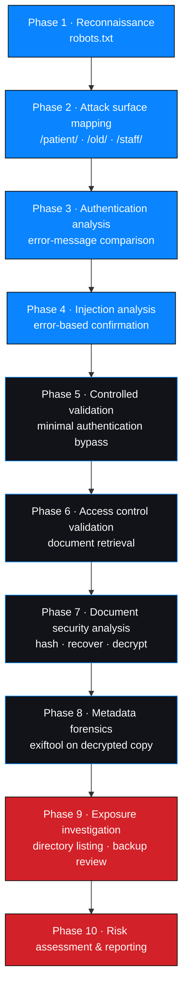
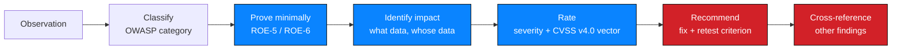

# Methodology

**Engagement ID:** `NW-B083` · **Environment:** Networkwalks authorised training target

---

## 1. Method selection

The engagement was **black-box**, time-boxed to five business days, and operated by
an intern against a training target. Those three facts determined the method.

| Constraint | Methodological consequence |
| --- | --- |
| Black-box | Findings rest on observable behaviour. Root causes are stated as *probable*, never confirmed — no source or log access existed. |
| 5 days, 4 milestones | Fixed scope per milestone. Effort followed the evidence, not a wish list. |
| Intern operator | Heavy reliance on documented, repeatable steps; manual verification over automation. |
| Training target | Techniques could be exercised safely, so the method could include real validation rather than speculation. |
| Synthetic personal data present | Evidence handling and data minimisation still applied in full — the habit is the point. |

### Frameworks

| Framework | Role |
| --- | --- |
| **OWASP WSTG** | Test-case structure — auth, injection, access control, misconfiguration |
| **OWASP ASVS** | Control framing for remediation advice |
| **OWASP Top 10** | Risk categorisation: A01 Broken Access Control, A02 Cryptographic Failures, A03 Injection, A05 Security Misconfiguration |
| **PTES** | Phase model |
| **NIST SP 800-115** | Testing discipline |
| **CVSS v4.0** | Severity framework |

---

## 2. Method as executed

Step-level execution: [`testing-timeline.md`](./testing-timeline.md)

---

## 3. The method that mattered: follow the disclosure

The engagement's results came from one habit — **taking every disclosed signal
seriously and refusing to discard it**.

| Signal | First seen | Acted on | Outcome |
| --- | --- | --- | --- |
| `Disallow: /patient/` | M1 Step 1 | Immediately | Located the login page |
| `Disallow: /old/` | M1 Step 1 | **M3 Step 3**, two milestones later | Led to the SQL backup |
| `Disallow: /staff/` | M1 Step 1 | Recorded, not exercised | Observation only |
| Distinct login error messages | M1 Step 3 | Immediately | Confirmed `admin` exists |
| `mysqli_query()` error text | M1 Step 4 | Immediately | Confirmed injection |
| `Author: j.malik` | M3 Step 1 | M3 Step 5 | Closed the identity chain |
| `DB backup moved to /old` comment | M3 Step 1 | M3 Step 3 | Led to the same place as `robots.txt` |

This is the core transferable lesson. `/old/` was disclosed in the first minute of
the engagement and mattered on the fourth day.

---

## 4. Vulnerability analysis approach

Each weakness was carried through a fixed chain rather than being reported on
discovery.

Applied to each finding:

| Finding | Observation | Minimal proof | Impact established |
| --- | --- | --- | --- |
| F01 | Two error strings | Compare one known-absent vs. one present account | Username enumeration |
| F02 | Quote in username field | Database syntax error | Login query is injectable |
| F03 | Portal behind bypassed login | Download one document set | Documents reachable pre-authorisation |
| F04 | Passwords on lab PDF files | Recover keys from wordlists | Document protection ineffective |
| F05 | PDF metadata fields | Read author and comment on decrypted copy | Internal identity and path disclosed |
| F06 | `/old/` returns a file index | Request the directory | Unauthenticated file enumeration |
| F07 | `.sql` served and downloaded | Read two `INSERT` statements | Payroll and shareholder data in cleartext |

---

## 5. Root-cause reasoning

Black-box testing cannot confirm root cause, so each finding states a **probable**
cause and flags what would confirm it.

| Finding | Probable root cause | To confirm |
| --- | --- | --- |
| F01 | Login handler branches on user existence and returns distinct messages | Code review of the authentication controller |
| F02 | Query built by string concatenation with unescaped input | Code review; confirm whether a shared query helper exists |
| F03 | Documents stored inside the web root and served as static files | Server/filesystem configuration review |
| F04 | Passwords chosen for convenience; no password policy applied to document keys | Policy and generation-process review |
| F05 | No metadata-stripping step in the document export/distribution path | Export pipeline review |
| F06 | `Options +Indexes` / autoindex left enabled on the legacy vhost or directory | Web server configuration review |
| F07 | Backup written into a directory inside the web root and never cleaned up | Backup/sync job review; retention policy audit |

A single likely systemic contributor appears in F06 and F07 together: **no
lifecycle ownership for migration leftovers.** That is a process root cause, and
process root causes are the ones that stop the weakness recurring.

---

## 6. Risk-based prioritisation

Effort followed the highest-expected-impact paths rather than a fixed checklist.

| Priority | Path | Rationale |
| --- | --- | --- |
| 1 | `robots.txt` → login page | Unauthenticated, and `robots.txt` had already promised sensitive paths |
| 2 | Authentication error handling | Zero-cost information that directly enables a targeted attack |
| 3 | SQL injection on the login | Highest-impact weakness class; single request to confirm |
| 4 | Document retrieval post-bypass | Converts an abstract bypass into concrete data exposure |
| 5 | Document encryption and metadata | The documents were the crown jewel; their protection was the natural next question |
| 6 | `/old/` | Already disclosed; checked once the metadata note independently pointed at it |

---

## 7. Deviations and limitations

Stated plainly so a reader does not over-read the results.

| Deviation / limitation | Reason |
| --- | --- |
| No technology fingerprinting (server, framework, CMS) | The lab path did not require it; the engagement followed the provided route |
| No internal network, server or log access | Black-box scope |
| Root causes stated as probable | No source or log access |
| No bulk extraction from the exposed backup | Data minimisation ([RoE §3](rules-of-engagement.md#3-what-minimal-validation-looked-like-in-practice)) |
| `/staff/` not exercised | Out of exercised scope; recorded as an observation |
| No dates or hour log | Not captured in the source record; left blank rather than estimated |
| CVSS v4.0 base scores not printed | Vectors derived with rationale; numeric scoring deferred to the official calculator — [`../risk/cvss-assessment.md`](../risk/cvss-assessment.md) §4 |
| No sanitized evidence artifacts attached | Sanitization is a human-judgement step not yet completed — [`../evidence/README.md`](../evidence/README.md) §5 |

---

## 8. What would have come next

Had more time been available, the following would have been the next steps in
descending value:

1. Fingerprint the stack and re-run the WSTG catalogue against the specific
   framework's known weaknesses.
2. Test the authentication mechanism for vertical privilege boundaries across
   roles, and object-level authorisation on document identifiers — the backup
   suggests documents are addressable by a predictable path.
3. Assess whether the injection is reachable from other parameters, including any
   search or report filter.
4. Review whether the same backup pattern exists elsewhere on the host.
5. Verify TLS configuration, cookie attributes and security headers — none of
   which the lab route exercised.
6. Retest after remediation, against the criteria in the
   [remediation tracker](../reports/remediation-tracker.csv).

---

## 9. Related documentation

| Document | Purpose |
| --- | --- |
| [`authorization-and-scope.md`](./authorization-and-scope.md) | Scope boundaries |
| [`rules-of-engagement.md`](./rules-of-engagement.md) | Constraints and validation limits |
| [`testing-timeline.md`](./testing-timeline.md) | Executed step record |
| [`../methodology/`](../methodology/) | Per-domain procedures |
| [`../risk/risk-rating-methodology.md`](../risk/risk-rating-methodology.md) | Rating method |
| [`../methodology/reporting.md`](../methodology/reporting.md) | Reporting and evidence standards |
