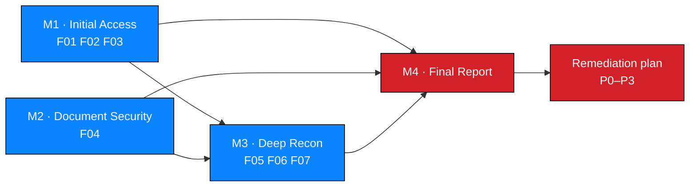

# Project Overview

**Engagement ID:** `NW-B083` · **Project week:** Week 4 (final project)
**Intern:** Antony Sifuna (`SifunaCodex`) · **Batch:** B082 / B083 — see [§9](#9-batch-discrepancy)

---

## 1. Summary

This repository documents a **black-box web application penetration test** of
`https://medirozahospital.com`, a Networkwalks authorised training target. The
engagement ran across four milestones in Week 4 of the internship and produced
**seven findings — three Critical, two High, two Medium** — which form a single
connected attack chain rather than seven isolated defects.

The chain, in one line: a `robots.txt` file named the sensitive paths, a login
page leaked which usernames existed, a SQL injection in that login removed the
password check, and the documents behind it were encrypted with dictionary-grade
passwords whose metadata pointed at a legacy folder whose directory listing served
a cleartext database backup containing staff salaries and shareholder data.

---

## 2. Context and why it matters

| Consideration | Consequence for this engagement |
| --- | --- |
| Healthcare-sector website in scope | Findings touching patient documents, payroll or governance data are treated as high severity regardless of exploitation elegance. |
| Documents are the primary asset | Document security properties — encryption, key strength, metadata, access control, storage location — became the assessment backbone rather than a side check. |
| Payroll and shareholder data exist server-side | Their exposure is a confidentiality incident with contractual and personal consequences, not merely an information-disclosure finding. |
| Legacy infrastructure is common after migrations | The `/old/` folder is the kind of artefact that survives for years because deleting it requires ownership nobody has. |

---

## 3. Milestones and outcomes

| Milestone | Focus | Outcome | Directory |
| --- | --- | --- | --- |
| **M1** | Initial Access | `robots.txt` → `/patient/login.php` → username enumeration → SQL injection → authentication bypass → three documents downloaded | [`../milestones/M1-initial-access/`](../milestones/M1-initial-access/README.md) |
| **M2** | Data Extraction / File Security | `$pdf$` hashes extracted; all three passwords recovered via wordlists; report 3 decrypted for metadata analysis | [`../milestones/M2-data-extraction/`](../milestones/M2-data-extraction/README.md) |
| **M3** | Deep Reconnaissance & Critical Data Exposure | PDF metadata note → `/old/` → directory listing → SQL backup → salary and shareholder data exposed; chain closed | [`../milestones/M3-critical-data-exposure/`](../milestones/M3-critical-data-exposure/README.md) |
| **M4** | Penetration Testing Report | 7 findings consolidated with severity, impact and remediation | [`../milestones/M4-final-report/`](../milestones/M4-final-report/README.md) |



---

## 4. Findings at a glance

| ID | Finding | Severity | Milestone |
| --- | --- | --- | --- |
| `NW-B083-M1-F01` | Username enumeration on login page | 🟠 Medium | M1 |
| `NW-B083-M1-F02` | SQL injection enabling authentication bypass | 🔴 Critical | M1 |
| `NW-B083-M1-F03` | Patient documents accessible after login bypass | 🔴 High | M1 |
| `NW-B083-M2-F01` | Weak document passwords recoverable from wordlists | 🔴 High | M2 |
| `NW-B083-M3-F01` | Sensitive metadata retained in a patient PDF | 🟠 Medium | M3 |
| `NW-B083-M3-F02` | Legacy folder with directory listing enabled | 🔴 Critical | M3 |
| `NW-B083-M3-F03` | Staff salaries and shareholder data in cleartext backup | 🔴 Critical | M3 |

Full records: [`../findings/verified-findings/`](../findings/verified-findings/)

---

## 5. Objectives

### 5.1 Engagement objectives

1. Discover the public attack surface and identify sensitive paths.
2. Assess the authentication mechanism for logic and implementation weaknesses.
3. Assess access control protecting patient documents.
4. Assess the security properties of the three patient-report PDFs: encryption,
   key strength, metadata hygiene and storage location.
5. Investigate exposure of staff compensation and shareholder information.
6. Deliver a prioritised report with actionable remediation.

All six were addressed. Objective 5 produced the highest-impact finding.

### 5.2 Learning objectives

| # | Objective | Evidenced in |
| --- | --- | --- |
| LO-1 | Treat public disclosure files as an attack map | [M1 recon](../milestones/M1-initial-access/reconnaissance.md) |
| LO-2 | Recognise and prove username enumeration | [M1 §Step 3](../milestones/M1-initial-access/vulnerability-analysis.md) |
| LO-3 | Confirm injection with minimal, non-destructive validation | [M1 §Step 4](../milestones/M1-initial-access/vulnerability-analysis.md) |
| LO-4 | Understand that comment syntax can remove an authorisation decision | [M1 §Step 5](../milestones/M1-initial-access/proof-of-concept.md) |
| LO-5 | Evaluate document encryption by key strength, not by presence | [M2 results](../milestones/M2-data-extraction/results.md) |
| LO-6 | Extract and act on document metadata as a data channel | [M3 exposure analysis](../milestones/M3-critical-data-exposure/exposure-analysis.md) |
| LO-7 | Recognise directory listing and stale backups as critical exposures | [M3 F06](../milestones/M3-critical-data-exposure/exposure-analysis.md) |
| LO-8 | Trace a full attack chain rather than reporting isolated defects | [M4 technical findings](../milestones/M4-final-report/technical-findings.md) |
| LO-9 | Derive CVSS v4.0 ratings from evidence with per-metric rationale | [CVSS assessment](../risk/cvss-assessment.md) |
| LO-10 | Handle sensitive output safely, including the LLM data-handling caveat | [M3 evidence §5](../milestones/M3-critical-data-exposure/evidence.md) |
| LO-11 | Automate documentation QA and defensive redaction in Python | [Scripts](../scripts/README.md) |

---

## 6. Deliverables

| # | Deliverable | Location |
| --- | --- | --- |
| D-1 | Engagement overview | This document |
| D-2 | Authorization, scope, rules of engagement | [Scope](../docs/authorization-and-scope.md), [RoE](../docs/rules-of-engagement.md) |
| D-3 | Methodology | [Engagement methodology](../docs/methodology.md), [Procedures](../methodology/) |
| D-4 | Testing timeline and executed log | [Timeline](../docs/testing-timeline.md) |
| D-5 | Tool inventory | [Tools](../docs/tools-and-technologies.md) |
| D-6 | M1 attack surface and findings | [M1](../milestones/M1-initial-access/README.md) |
| D-7 | M2 document security assessment | [M2](../milestones/M2-data-extraction/README.md) |
| D-8 | M3 exposure analysis, redacted evidence | [M3](../milestones/M3-critical-data-exposure/README.md) |
| D-9 | M4 full report | [Report](../reports/penetration-testing-report.md) |
| D-10 | Management summary | [Management summary](../reports/management-summary.md) |
| D-11 | Remediation tracker (CSV) | [Tracker](../reports/remediation-tracker.csv) |
| D-12 | Risk register (CSV) | [Register](../risk/risk-register.csv) |
| D-13 | Evidence register (CSV) | [Register](../evidence/evidence-register.csv) |
| D-14 | Seven finding records | [Findings](../findings/verified-findings/) |
| D-15 | Documentation QA and redaction tooling | [Scripts](../scripts/README.md) |

---

## 7. Current status

| Item | Status |
| --- | --- |
| Milestones M1–M4 | ✅ Complete |
| Findings documented | ✅ 7 (3 Critical, 2 High, 2 Medium) |
| Per-finding CVSS v4.0 vector + rationale | ✅ Derived |
| CVSS v4.0 numeric base scores | 🟡 Vectors ready; scores to be computed with the FIRST calculator — [rationale](../risk/cvss-assessment.md) |
| Evidence register populated | ✅ 22 rows |
| Sanitized evidence **artifacts** | ❌ Not supplied — procedure in [evidence §5](../evidence/README.md) |
| Recovered passwords published | ❌ Intentionally withheld — [M2 results](../milestones/M2-data-extraction/results.md) |
| Salary / shareholder values published | ❌ Intentionally withheld — [M3 §4](../milestones/M3-critical-data-exposure/data-classification.md) |
| Technology fingerprint of target | ❌ Not performed — recorded as a [limitation](../reports/penetration-testing-report.md) |
| Remediation owners assigned | ❌ Pending — [tracker](../reports/remediation-tracker.csv) |

---

## 8. Standards referenced

| Standard | Use |
| --- | --- |
| OWASP WSTG | Test-case structure for authentication, injection and access control |
| OWASP ASVS | Control framing for remediation advice |
| OWASP Top 10 | Risk categorisation (A03 Injection, A01 Broken Access Control, A02 Cryptographic Failures, A05 Security Misconfiguration, A02/A04 data exposure) |
| PTES | Phase model |
| NIST SP 800-115 | Testing discipline |
| CVSS v4.0 | Severity framework |

---

## 9. Batch discrepancy

The source lab record is headed **Batch B082**. The project brief that initiated
this repository specifies **B083**. Both are recorded here rather than silently
reconciled.

- Repository identifier, filenames and evidence IDs use **`NW-B083`**.
- If B082 is correct, migrate IDs to `NW-B082` in one pass:
  ```bash
  grep -rl 'NW-B083' . --exclude-dir=.git | xargs sed -i 's/NW-B083/NW-B082/g'
  ```
- Also update the README badge and this section.
- **Required before final submission:** confirm with the instructor which batch
  this project is credited to.

---

## 10. Navigation

| Document | Purpose |
| --- | --- |
| [authorization-and-scope.md](authorization-and-scope.md) | Authorisation basis and scope boundaries |
| [rules-of-engagement.md](rules-of-engagement.md) | Operating constraints and stop conditions |
| [methodology.md](methodology.md) | Phase model as applied |
| [testing-timeline.md](testing-timeline.md) | Executed day-by-day record |
| [tools-and-technologies.md](tools-and-technologies.md) | Tooling used, with status |
| [ethical-considerations.md](ethical-considerations.md) | Confidentiality, redaction, disclosure handling |
| [glossary.md](glossary.md) | Terms and ID conventions |
