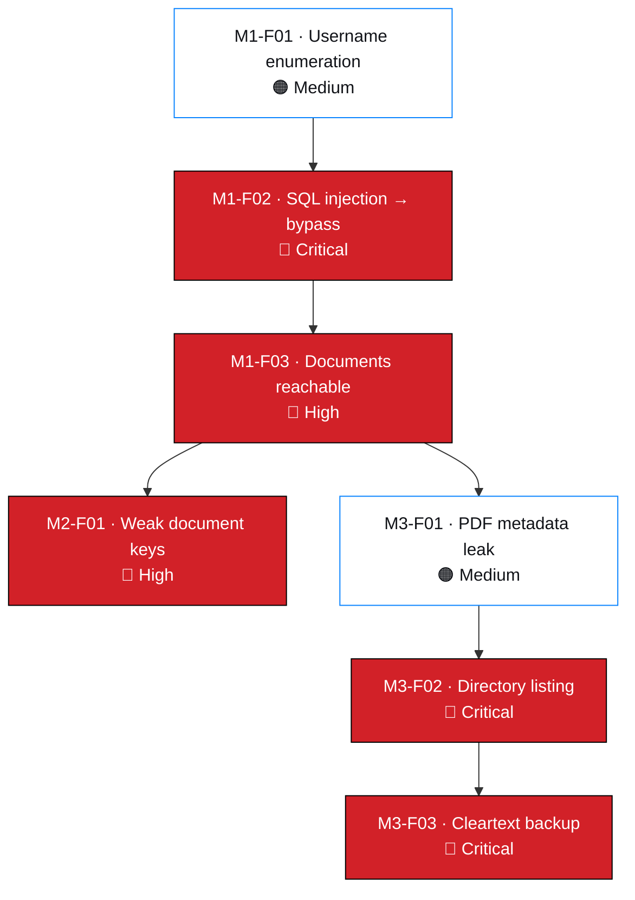

# Findings

Complete finding records for engagement `NW-B083`.

---

## 1. Status model

Two independent axes are tracked, because they answer different questions.

| Axis | Question | Values |
| --- | --- | --- |
| **Verification status** | How well is this substantiated? | `Documented` · `Evidence-attached` · `Verified` |
| **Rating status** | How firm is the severity rating? | `Confirmed` · `Provisional` |

### Verification status

| Status | Definition | Current count |
| --- | --- | --- |
| **Documented** | The engagement record contains the observed output for the finding | **7** |
| **Evidence-attached** | A sanitised artifact exists in [`../evidence/`](../evidence/README.md) and is referenced from the record | **0** |
| **Verified** | Evidence-attached **and** independently reviewed against the finding claim | **0** |

### Rating status

| Status | Definition | Current count |
| --- | --- | --- |
| **Provisional** | A severity band is assigned but one or more rating inputs are missing or uncertain | **3** |
| **Confirmed** | Every CVSS v4.0 metric input that determines the severity band is directly evidenced; any inferred input is named in the record | **4** |

> **What `Confirmed` does and does not mean.** It means every metric input that
> decides the band can be traced to an observation in the engagement record, and any
> input that rests on inference is named explicitly rather than buried — `M1-F02`
> is the example: the authentication bypass was executed, so confidentiality is
> directly evidenced, while `VI` is inferred from an administrative session and is
> disclosed as such in its record. It does **not** mean a base
> score has been calculated — none has, deliberately (see
> [`../risk/cvss-assessment.md`](../risk/cvss-assessment.md) §4). It also does not
> mean the finding is `Verified`; verification is a separate axis defined above.

> **Why no finding is `Verified`.** Verification requires an attached, sanitised,
> reviewed artifact. Twenty-two observations are registered; zero artifacts have
> been supplied. The analysis is complete and the reasoning is auditable, but
> "we observed this" and "here is the artifact" are different claims, and only one
> of them is currently supported. See
> [`../evidence/README.md`](../evidence/README.md#5-closing-the-evidence-gap).

---

## 2. Finding register

| ID | Title | Component | Severity | Rating | Verification | Confidence | Record |
| --- | --- | --- | --- | --- | --- | --- | --- |
| `NW-B083-M1-F01` | Username enumeration on login page | `/patient/login.php` | 🟠 Medium | Confirmed | Documented | High | [Record](./verified-findings/NW-B083-M1-F01-username-enumeration.md) |
| `NW-B083-M1-F02` | SQL injection enabling authentication bypass | `/patient/login.php` | 🔴 **Critical** | Confirmed | Documented | High | [Record](./verified-findings/NW-B083-M1-F02-sqli-authentication-bypass.md) |
| `NW-B083-M1-F03` | Patient documents accessible after login bypass | `/patient/reports/` | 🔴 High | Provisional | Documented | High | [Record](./verified-findings/NW-B083-M1-F03-document-access-control.md) |
| `NW-B083-M2-F01` | Weak document passwords recoverable from wordlists | `LAB-PDF-01…03` | 🔴 High | Provisional | Documented | High | [Record](./verified-findings/NW-B083-M2-F01-weak-document-passwords.md) |
| `NW-B083-M3-F01` | Sensitive metadata retained in a patient PDF | `LAB-PDF-03` | 🟠 Medium | Confirmed | Documented | High | [Record](./verified-findings/NW-B083-M3-F01-sensitive-pdf-metadata.md) |
| `NW-B083-M3-F02` | Directory listing enabled on a legacy web root | `/old/` | 🔴 **Critical** | Provisional | Documented | High | [Record](./verified-findings/NW-B083-M3-F02-directory-listing-legacy-folder.md) |
| `NW-B083-M3-F03` | Unencrypted database backup exposed in a legacy web root | `/old/` (backup file) | 🔴 **Critical** | Confirmed | Documented | High | [Record](./verified-findings/NW-B083-M3-F03-cleartext-database-backup-exposure.md) |

**Counts:** 🔴 Critical 3 · 🔴 High 2 · 🟠 Medium 2 · 🟢 Low 0
**CVSS v4.0:** 7 vectors derived · **0 base scores computed** — see
[`../risk/cvss-assessment.md`](../risk/cvss-assessment.md) §4

---

## 3. Why three ratings are provisional

| Finding | Missing input | Effect if resolved differently |
| --- | --- | --- |
| `M1-F03` | Whether documents are reachable with **no session at all**, and whether identifiers are predictable — determines `PR:L` vs `PR:N` | Band would move between High and Critical |
| `M2-F01` | Whether other holders of a document key exist; result of a rule-based mutation pass | Band unlikely to move below High; a mutation pass would likely recover more keys |
| `M3-F02` | What **else** `/old/` contained — the listing was never fully enumerated, and `VC` is coupled to the contents | Could move **upward** or **downward**; a directory of static assets alone would not warrant Critical |

> Two of the three could become worse rather than better. A provisional rating is
> not a comfortable midpoint; it is an incomplete measurement.

`M3-F03` is **confirmed**: the backup was downloaded, restored and read, and every
metric follows from that observation. Its residual uncertainty — data currency and
whether any third party retrieved the file — affects *notification scope*, not the
rating.

---

## 4. Chain of findings

**`NW-B083-M1-F02` is the root defect.** F01 made it cheap to target; F03 and M2-F01
are its consequences; M3-F01 branched from a document F03 exposed.

---

## 5. Adding a finding

1. Copy [`finding-template.md`](./finding-template.md) to
   `verified-findings/NW-B083-<MS>-F<nn>-<slug>.md`.
2. Fill every section. Where evidence is missing, write
   `PENDING VERIFICATION — required: <exactly what is needed>`. Do not delete the
   section.
3. Add a row to [`../risk/risk-register.csv`](../risk/risk-register.csv).
4. Add a row to this register and to the README findings table.
5. Register every supporting artifact in
   [`../evidence/evidence-register.csv`](../evidence/evidence-register.csv).
6. Set verification status honestly. `Documented` is a legitimate and accurate
   status today.

### ID discipline

| Rule | Reason |
| --- | --- |
| IDs are never reused | A withdrawn ID must not be reassigned, or old evidence appears to support a new finding |
| Withdrawn findings keep their record | An auditable trail of what was tested and refuted is part of the assessment |
| IDs are stable across documents | Cross-references in the report must keep resolving |
| Milestone prefix reflects where the finding was discovered | Not where it was exploited |

---

## 6. Confidentiality

> **No finding record in this directory contains a credential, personal data value,
> salary figure, shareholder record or patient content.**
>
> Document passwords are characterised by strength class only. Salary and
> shareholder data appear as schema and data class only. The identified
> individual is masked as `j.m***`. See
> [`../docs/ethical-considerations.md`](../docs/ethical-considerations.md) §3–5.

---

## 7. Templates and references

| Document | Purpose |
| --- | --- |
| [`finding-template.md`](./finding-template.md) | Structure for a new finding |
| [`../templates/vulnerability-report-template.md`](../templates/vulnerability-report-template.md) | Extended report template |
| [`../templates/remediation-template.md`](../templates/remediation-template.md) | Remediation record format |
| [`../risk/cvss-assessment.md`](../risk/cvss-assessment.md) | Vector derivation for all 7 findings |
| [`../evidence/README.md`](../evidence/README.md) | Evidence standard |
| [`../methodology/reporting.md`](../methodology/reporting.md) | Writing standards |
