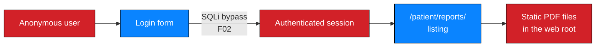

# NW-B083-M1-F03 — Patient documents accessible after login bypass

| Field | Value |
| --- | --- |
| **Finding ID** | `NW-B083-M1-F03` |
| **Milestone** | M1 — Initial Access |
| **Affected component** | `https://medirozahospital.com/patient/reports/` |
| **Severity** | 🔴 **High** |
| **Rating status** | **Provisional** |
| **Verification status** | Documented |
| **Confidence** | High |
| **OWASP category** | A01 — Broken Access Control |
| **CWE** | CWE-284 — Improper Access Control; CWE-552 — Files or Directories Accessible to External Parties |
| **Evidence IDs** | `NW-B083-M1-E06`, `NW-B083-M1-E07`, `NW-B083-M1-E08` |
| **Status** | Open |

---

## 1. Description

Patient report documents are served as static files from within the web root rather
than through an authorising endpoint. Combined with the authentication bypass in
`NW-B083-M1-F02`, an unauthenticated party obtained an authenticated session and
downloaded all three documents. The document store relies on the login check as its
only access control.

---

## 2. Affected component

| Field | Value |
| --- | --- |
| Location | `/patient/reports/` |
| Type | Document store served as static content |
| Authentication to reach it | Yes — **defeated by `NW-B083-M1-F02`** |
| Contents | Three password-protected PDFs (`LAB-PDF-01`…`03`) |
| Data at risk | Patient report documents — clinical content, not read during the assessment |

---

## 3. Preconditions

| # | Precondition | Present in this engagement? |
| --- | --- | --- |
| 1 | Network access to the host | ✅ Yes |
| 2 | A valid authenticated session | ✅ Obtained via `NW-B083-M1-F02` — **not** via a credential |

> **This is the finding's weakness as well as its substance.** The only thing
> standing between an anonymous user and patient documents was a login check that a
> single HTTP request defeated.

---

## 4. Technical evidence

### 4.1 Observation

| Step | Action | Observed result |
| --- | --- | --- |
| 1 | Authenticate using the bypass | Portal loaded, three reports listed |
| 2 | Download all three | `patient_report_1.pdf`, `patient_report_2.pdf`, `patient_report_3.pdf` retrieved |

| Evidence ID | Observation | Artifact |
| --- | --- | --- |
| `NW-B083-M1-E06` | Portal rendered after the bypass | ❌ Not attached |
| `NW-B083-M1-E07` | Download of `LAB-PDF-01` | ❌ Not attached |
| `NW-B083-M1-E08` | Downloads of `LAB-PDF-02` and `LAB-PDF-03` | ❌ Not attached |

### 4.2 Expected vs. observed

| | Expected | Observed |
| --- | --- | --- |
| **Document location** | Outside the web root; served only through an authorising endpoint | Inside the web root, served as static files |
| **Authorisation** | Checked server-side on every request | Checked once, at login. The files themselves are not protected |
| **Direct request without a session** | 401/403 | **Not tested** — see §5 |
| **Document identifiers** | Non-guessable, or authorisation-checked per object | **Not tested** — see §5 |

### 4.3 Mechanism



The documents are **files on a web server**, not rows behind an authorisation
check. Once any session exists, the files are simply fetched. There is no second
decision point between the session and the bytes.

**Probable root cause:**

| Probable cause | Confidence | To confirm |
| --- | --- | --- |
| Documents stored inside the web root and served directly by the web server | High — the files were retrieved as static content | Review filesystem layout and web server configuration |
| No per-request authorisation on document delivery | Medium-high | Review the delivery path and any middleware |
| No object-level authorisation on document identifiers | Unknown — not tested | Review the identifier scheme and add per-object checks |

---

## 5. Reproduction summary

> Authorized training environment only. Reached through the already-substantiated
> bypass in `NW-B083-M1-F02`.

| Step | Action | Observed result |
| --- | --- | --- |
| 1 | Authenticate via the bypass | Session established |
| 2 | Request the report listing | Three reports listed |
| 3 | Download each | All three retrieved |

| Bound | Limit |
| --- | --- |
| Requests required | 4 |
| Authentication required | Yes — via the bypass |
| Side effects | **None.** Files downloaded; nothing modified on the server |

**The documents were not opened.** Their content was never read or reproduced.
Only their security properties were assessed, in M2.

### 5.1 Explicitly not tested — and therefore not claimed

| Question | Status | Why it matters |
| --- | --- | --- |
| Are documents retrievable **without any session**, by direct URL? | ⬜ **Not tested** | If yes, this is a Critical standalone finding rather than a consequence of F02 |
| Are document identifiers predictable? | ⬜ **Not tested** | Predictable identifiers would mean horizontal authorisation failure (IDOR) |
| Does authorisation differ by role? | ⬜ **Not tested** | Requires two accounts of differing privilege |
| Were documents cached or indexed elsewhere? | ⬜ **Not tested** | Determines whether exposure extends beyond this session |

> **This is why the rating is provisional.** The vector below assumes documents
> require an authenticated session (`PR:L`). If a direct unauthenticated request
> succeeds, `PR` becomes `N` and the severity rises to Critical. **The engagement
> did not test this, so the lower rating is recorded and the uncertainty is stated
> rather than resolved by assumption.**

---

## 6. Security impact

| Dimension | Assessment |
| --- | --- |
| Confidentiality | **Severe.** Patient report documents obtained without a credential |
| Integrity | Not demonstrated; no write path was exercised |
| Availability | None observed |
| Data sensitivity | 🔴 **Clinical** — patient reports |
| Business consequence | Regulatory exposure under health-data regimes; potential patient harm through disclosure; reputational damage in a care setting |
| Detection likelihood | **Low.** Document downloads are indistinguishable from legitimate use unless bulk-download alerting exists — **not observed, not tested** |

### 6.1 Cross-finding effect

| Relationship | Detail |
| --- | --- |
| Enabled by `NW-B083-M1-F02` | The bypass was the only barrier crossed |
| Enabled `NW-B083-M2-F01` | The retrieved documents had weak keys — but the documents were **already** in the attacker's hands, so the weak keys added nothing |
| Enabled `NW-B083-M3-F01` | `LAB-PDF-03`'s metadata, found after decryption, started the M3 chain |

> **An uncomfortable observation worth recording.** Because the documents were
> already retrieved through the bypass, the weak document passwords in M2 were
> **not** a real additional barrier. They mattered as a finding about the
> organisation's document-security posture, and because the metadata clue was only
> reachable after decryption. Had the files been served unencrypted, the M3 chain
> would have started a milestone earlier.

---

## 7. Severity

| Attribute | Value |
| --- | --- |
| Band | 🔴 **High** |
| Rationale | Sensitive clinical documents were obtained by an unauthenticated party. Rated High rather than Critical *only* because a session — itself illegitimately obtained — was required, and the rating is provisional pending the unauthenticated-access test in §5.1. |
| Confidence | High that documents were obtained without a credential; **medium** on the precise rating, because `PR` is inferred from the testing path rather than from a direct test |
| Rating status | **Provisional** |
| Provisional reason | `PR` inferred as `L` from the testing path. If a direct unauthenticated request returns the file, `PR:N` applies and the band moves to **Critical**. **The finding could become more severe, not less.** |

---

## 8. CVSS v4.0

**Vector (provisional):** `CVSS:4.0/AV:N/AC:L/AT:N/PR:L/UI:N/VC:H/VI:L/VA:N/SC:N/SI:N/SA:N`

**Base score:** `PENDING — compute with the FIRST CVSS v4.0 calculator`

| Metric | Value | Justification | Certainty |
| --- | --- | --- | --- |
| AV | `N` | Network request | Certain |
| AC | `L` | No special conditions | Certain |
| AT | `N` | No deployment prerequisite | Certain |
| PR | `L` | A session was required — obtained via the bypass. **Inferred from the testing path, not from a direct unauthenticated test** | ⚠️ **Provisional** |
| UI | `N` | No human must act | Certain |
| VC | `H` | Sensitive clinical documents were disclosed in full | Certain |
| VI | `L` | Download-only path exercised. `L` rather than `N` because document replacement would be plausible in the same directory — **untested** | ⚠️ Inferred |
| VA | `N` | No availability effect | Certain |
| SC | `N` | No subsequent system affected | Certain |
| SI | `N` | — | Certain |
| SA | `N` | — | Certain |

### 8.1 How the rating changes with the open test

| If a direct unauthenticated request returns the document | Rating |
| --- | --- |
| `PR` becomes `N` | Band rises to 🔴 **Critical** |
| Vector becomes `CVSS:4.0/AV:N/AC:L/AT:N/PR:N/UI:N/VC:H/VI:L/VA:N/SC:N/SI:N/SA:N` | Recompute |

This single test resolves the provisional rating. It is the highest-value retest in
the engagement.

---

## 9. Remediation

### 9.1 Primary fix

| # | Action | Priority |
| --- | --- | --- |
| 1 | **Move all documents outside the web root** so no URL maps to a file | **P0** |
| 2 | Serve documents only through an authorising endpoint that checks session validity **and** object-level authorisation on every request | **P0** |
| 3 | Verify that a direct request to the old path returns 404 | **P0** |
| 4 | Issue documents via an authorising stream rather than a filesystem path | **P0** |
| 5 | Use non-guessable identifiers as defence in depth — **not** as a substitute for per-object authorisation | P1 |

```php
// VULNERABLE — the web server serves the file directly
// GET /patient/reports/patient_report_1.pdf  ->  200, file bytes

// FIXED — every request passes an authorisation check
session_start();
if (!is_authenticated()) {
    http_response_code(401);
    exit('Unauthorized');
}
$doc = find_document($_GET['id']);           // lookup, not a path
if (!can_access_document($doc, $_SESSION['user'])) {
    http_response_code(403);
    exit('Forbidden');
}
stream_file(STORAGE_PATH . $doc->storage_key, 'application/pdf');
```

> Note the double check: *is the session valid* **and** *may this user access this
> specific document*. Session validity alone is the mistake this finding is about.

### 9.2 Additional hardening

| # | Measure | Addresses |
| --- | --- | --- |
| 1 | Alert on bulk or unusual document downloads | Detection of the abuse pattern |
| 2 | Log document access with user, document and timestamp | Forensic capability |
| 3 | Watermark or mark documents per recipient | Deterrent and attribution |
| 4 | Review whether documents were cached by intermediaries | Limits residual exposure |
| 5 | Treat document passwords as secondary — see `NW-B083-M2-F01` | Removes false assurance |

---

## 10. Retest criteria

| # | Criterion | Method | Pass condition | Result |
| --- | --- | --- | --- | --- |
| 1 | **No session ⇒ no document** | Request a document path with no session | 401 or 403, never file bytes |
| 2 | **Old path removed** | Request the former static path directly | 404 |
| 3 | **Per-object authorisation** | Authenticate as a low-privilege user; request a document belonging to another | 403 |
| 4 | **No predictable identifiers** | Enumerate sequential document identifiers | No document returned without authorisation |
| 5 | **No cross-session leakage** | Request a document using another user's identifier | 403 |
| 6 | Bulk-download alerting | Download the full set in one session | Alert raised and triaged |
| 7 | Access logging | Perform an authorised download | Log records user, document and time |

> **Criterion 1 is the test that resolves this finding's provisional rating.**

---

## 11. Status

| Field | Value |
| --- | --- |
| Status | **Open — P0** |
| Verification status | **Documented** |
| Rating status | **Provisional** — `PR` inferred from the testing path |
| Evidence artifacts attached | 0 of 3 |
| Outstanding to close | 1. Capture and sanitise `E06`–`E08` (redact session cookie, account identifiers, document titles). 2. **Test direct unauthenticated access** and convert the rating to confirmed. 3. Test object-level authorisation with two accounts of differing privilege. |

---

## 12. Confidentiality declaration

- [x] No credential present
- [x] **No patient content reproduced** — the documents were never opened
- [x] No document text, thumbnail or preview published
- [x] Document labels are non-identifying (`LAB-PDF-01…03`)
- [x] Root cause stated as probable — no source access
- [x] No client approval or sign-off claimed
