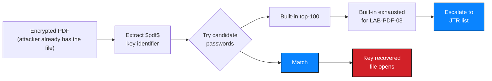

# NW-B083-M2-F01 — Weak document passwords recoverable from wordlists

| Field | Value |
| --- | --- |
| **Finding ID** | `NW-B083-M2-F01` |
| **Milestone** | M2 — Data Extraction / File Security |
| **Affected component** | `LAB-PDF-01`, `LAB-PDF-02`, `LAB-PDF-03` |
| **Severity** | 🔴 **High** |
| **Rating status** | **Provisional** |
| **Verification status** | Documented |
| **Confidence** | High |
| **OWASP category** | A02 — Cryptographic Failures |
| **CWE** | CWE-521 — Weak Password Requirements |
| **Evidence IDs** | `NW-B083-M2-E01` … `NW-B083-M2-E05` |
| **Status** | Open |

---

> 🔒 **Credential values are withheld.** Recovered document passwords are
> characterised by length, character-class composition and dictionary membership.
> The literal values are deliberately not published. See
> [`../../docs/ethical-considerations.md`](../../docs/ethical-considerations.md) §3.1
> and (../../milestones/M2-data-extraction/results.md)(../../milestones/M2-data-extraction/results.md) §3.

---

## 1. Description

All three patient report PDFs were encrypted with user passwords, but every password
was recoverable by dictionary attack. Two fell to the 100 most common passwords in
the world; the third fell only after escalating to a moderately larger wordlist. The
encryption therefore provided no effective protection against any attacker with
basic tooling.

---

## 2. Affected component

| Field | Value |
| --- | --- |
| Location | `LAB-PDF-01`, `LAB-PDF-02`, `LAB-PDF-03` |
| Type | Password-protected PDF documents |
| Authentication to reach them | See `NW-B083-M1-F03` — reachable via the bypass |
| Data at risk | Patient report content — **not read during the assessment** |

---

## 3. Preconditions

| # | Precondition | Present in this engagement? |
| --- | --- | --- |
| 1 | Possession of the encrypted files | ✅ Yes — obtained via `NW-B083-M1-F03` |
| 2 | A wordlist | ✅ Yes — built-in list plus an instructor-supplied list |
| 3 | Any system access, credential or network position | ❌ **Not required.** The attack is entirely offline |

> **The critical structural property:** this attack is **offline**. Application-side
> controls — rate limiting, lockout, MFA, CAPTCHA — provide **zero** protection
> against it. The only relevant variables are key strength and the attacker's
> wordlist.

---

## 4. Technical evidence

### 4.1 Observation

| File | Encryption | Top-100 list | Larger list | Character classes | Dictionary entry |
| --- | --- | --- | --- | --- | --- |
| `LAB-PDF-01` | Present | ✅ **Recovered** | Not required | Digits only | Yes |
| `LAB-PDF-02` | Present | ✅ **Recovered** | Not required | Lowercase only | Yes |
| `LAB-PDF-03` | Present | ❌ Exhausted | ✅ **Recovered** | Symbols only | Yes |

Each recovered key was verified by opening its file — see
(../../milestones/M2-data-extraction/results.md)(../../milestones/M2-data-extraction/results.md) §4.

| Evidence ID | Observation | Artifact |
| --- | --- | --- |
| `NW-B083-M2-E01` | `$pdf$` key identifiers extracted | ❌ Not attached |
| `NW-B083-M2-E02` | `LAB-PDF-01` key recovery | ❌ Not attached |
| `NW-B083-M2-E03` | `LAB-PDF-02` key recovery | ❌ Not attached |
| `NW-B083-M2-E04` | Wordlist exhaustion then recovery for `LAB-PDF-03` | ❌ Not attached |
| `NW-B083-M2-E05` | Decryption of `LAB-PDF-03` | ❌ Not attached |

### 4.2 Expected vs. observed

| | Expected | Observed |
| --- | --- | --- |
| **Key strength** | High-entropy, generated, not human-chosen | All three dictionary-derived; all three single character class |
| **Recovery cost** | Prohibitive without the key | Seconds, for two files |
| **Effective protection** | Confidentiality against a party without the key | **None.** Recovered in this engagement |

### 4.3 Mechanism

PDF password encryption derives a key from the user password and encrypts the
document body. A cracker derives a candidate key from each wordlist entry and
compares it against the material stored in the file.



Two structural observations:

| Observation | Consequence |
| --- | --- |
| The attack requires only the file | Any holder of a copy can attack it indefinitely, at zero cost |
| Every password used **one** character class | None mixed cases, digits and symbols — the pattern of human choice, not generation |

**Probable root cause:**

| Probable cause | Confidence | To confirm |
| --- | --- | --- |
| Document passwords chosen by a person for convenience, with no policy applied to document keys | Medium-high — 3 of 3 weak is a pattern, not chance | Review how document passwords are chosen |
| No key-generation process exists | Medium | Confirm whether a generator is available but unused |
| No key-management process exists — no storage, rotation or revocation | Medium | Review where keys are recorded and transmitted |
| Document passwords treated as the primary control rather than a secondary layer | Medium | Consistent with files also being served as static content |

---

## 5. Reproduction summary

> Authorized training environment only. Entirely offline; **zero** requests to the
> target during this milestone.

### 5a — Key recovery

| Step | Action | Observed result |
| --- | --- | --- |
| 1 | Extract the `$pdf$` key identifier for each file | Three identifiers obtained |
| 2 | Dictionary attack with the built-in top-100 list | `LAB-PDF-01`, `LAB-PDF-02` recovered |
| 3 | Re-attempt `LAB-PDF-03` with the built-in list | `Exhausted wordlist. No match. ACCESS DENIED.` |
| 4 | Re-attempt with the instructor-supplied JTR list | `LAB-PDF-03` recovered |

### 5b — Verification

| Step | Action | Result |
| --- | --- | --- |
| 1 | Open each file with its recovered key | All three opened |
| 2 | Negative control | `LAB-PDF-03` correctly failed on the smaller list — the tool reports failure, so the successes are meaningful |

| Bound | Limit |
| --- | --- |
| Requests to the target | **0** — the files were already held locally |
| Side effects | **None.** No file modified |
| Document content read | **Never.** Only encryption properties and metadata were assessed |

**Explicitly not performed:**

| Action | Reason |
| --- | --- |
| Reading the recovered documents' content | Out of scope; the finding is key recoverability, not content |
| Rule-based mutation attack | Not available in the lab toolset; would strengthen the finding |
| Targeted wordlist from organisational vocabulary | Not attempted; would likely strengthen the finding |
| Reuse testing across the wider estate | Only three files were assessed |
| Publishing recovered keys | Withheld by policy |

---

## 6. Security impact

| Dimension | Assessment |
| --- | --- |
| Confidentiality | **Defeated.** Encryption present on all three files and effective on none |
| Integrity | None. No signature was present, so a tampered document would be undetectable |
| Availability | None |
| Data sensitivity | 🔴 Clinical — patient report content |
| Business consequence | A false sense of protection. The control appeared to be working and delivered nothing |
| Detection likelihood | **None.** Offline attacks leave no trace on any system |

### 6.1 Cross-finding effect

| Relationship | Detail |
| --- | --- |
| Enabled by `NW-B083-M1-F03` | The files had to be obtained first — but they were already in the attacker's hands, so the weak keys added no real barrier |
| Enabled `NW-B083-M3-F01` | **The keys were essential here.** `LAB-PDF-03`'s metadata was unreadable while locked; decryption made the M3 chain possible |

> **The asymmetry is worth noting.** For document *confidentiality*, the weak keys
> were almost irrelevant — the files were already stolen. For document
> *forensics*, they were decisive. A control can be simultaneously irrelevant to one
> objective and essential to another, which is a good reason to evaluate controls
> per objective rather than in general.

---

## 7. Severity

| Attribute | Value |
| --- | --- |
| Band | 🔴 **High** |
| Rationale | Every document key is recoverable by an offline attacker holding a copy, at zero cost and with no detection. Rated High rather than Critical because the documents must first be obtained — which is a separate finding — and because rated impact here is confidentiality of the documents alone. |
| Confidence | High — recovery executed and verified on all three files |
| Rating status | **Provisional** |
| Provisional reason | Two inputs are unknown: (a) whether **other** holders of a document key exist, which would extend the exposure beyond these three files; (b) whether a rule-based mutation pass would recover keys that a static wordlist did not. A mutation pass would most likely **raise** the count of recovered keys. |

---

## 8. CVSS v4.0

**Vector (provisional):** `CVSS:4.0/AV:N/AC:L/AT:N/PR:L/UI:N/VC:H/VI:N/VA:N/SC:N/SI:N/SA:N`

**Base score:** `PENDING — compute with the FIRST CVSS v4.0 calculator`

| Metric | Value | Justification | Certainty |
| --- | --- | --- | --- |
| AV | `N` | Keys are distributed with the documents; a remote holder can attack offline. The *file acquisition* is a separate finding with its own `AV:N` | Certain |
| AC | `L` | Dictionary attack against a known format; seconds of compute | Certain |
| AT | `N` | No deployment prerequisite | Certain |
| PR | `L` | Possession of an encrypted copy was required. Recorded as `L` because acquisition itself required the bypass. **The weakness — weak key strength — needs no privilege at all**, which is why `M2-F01` is rated primarily on key strength rather than on the acquisition path | ⚠️ **Provisional** |
| UI | `N` | No human must act | Certain |
| VC | `H` | All three document keys recovered; the documents' confidentiality is defeated | Certain |
| VI | `N` | No modification path. No PDF signature was present, so integrity was never claimed | Certain |
| VA | `N` | No availability effect | Certain |
| SC | `N` | No subsequent system affected | Certain |
| SI | `N` | — | Certain |
| SA | `N` | — | Certain |

### 8.1 Two honest problems with this vector

| # | Problem | Handling |
| --- | --- | --- |
| 1 | CVSS v4.0's base metrics model an **exploitable weakness in a system**. Weak password strength in a file is a cryptographic failure, and mapping it onto AV/PR is an imperfect fit | The vector is provided as a **structured severity statement**, not as a claim of CVSS-endorsed precision. The band is the authoritative rating |
| 2 | `PR:L` understates the weakness | An attacker needs no privilege to attack a key they already hold. `PR:L` reflects *acquisition*, not the weakness. A reviewer preferring a weakness-only framing should read this as **`PR:N` with `AT:P`** — requiring that a document copy has been obtained |

> Both framings are recorded because a single vector cannot express a control that
> depends on a separate finding. This is disclosed rather than hidden behind a
> single tidy number.

---

## 9. Remediation

### 9.1 Primary fix

| # | Action | Priority |
| --- | --- | --- |
| 1 | **Generate document passwords with a CSPRNG** at full printable-ASCII length (≥20 characters) | **P0** |
| 2 | **Never derive a document key from a name, date, patient identifier or memorable pattern** | **P0** |
| 3 | **Treat the document password as a secondary control.** Access control must carry the security | **P0** |
| 4 | Store keys in a secrets manager; transmit out of band | P1 |
| 5 | Forbid key reuse across documents | P1 |
| 6 | Never place a key in a filename, URL, mail body or chat message | P1 |

```bash
# Key generation, illustrative
python3 -c "import secrets,string; \
print(''.join(secrets.choice(string.printable[:94]) for _ in range(24)))"
# -> store in a secrets manager; never in the repository, a filename, or a URL
```

### 9.2 Additional hardening

| # | Measure | Addresses |
| --- | --- | --- |
| 1 | Apply PDF permission restrictions (print/copy/extract) as defence in depth | Reduces casual onward sharing |
| 2 | Log and alert on bulk document downloads | Detection of abuse |
| 3 | Require a recorded key-management decision before a document can be published | Process gate |
| 4 | Run periodic automated key-strength checks across the document estate | Sustains the standard |
| 5 | Sign documents where authenticity matters | Detects tampering |

---

## 10. Retest criteria

| # | Criterion | Method | Pass condition | Result |
| --- | --- | --- | --- | --- |
| 1 | Keys resist dictionary attack | Re-run recovery with the JTR list **plus** a rule-based mutation pass | No key recovered |
| 2 | Keys resist targeted attack | Attempt recovery with a wordlist built from organisational vocabulary | No key recovered |
| 3 | Key length | Inspect the generation process | ≥20 characters from a CSPRNG |
| 4 | No human-chosen keys | Code and process review | No key derived from a person, date or identifier |
| 5 | No reuse | Compare keys across the estate | Every document has a unique key |
| 6 | Key storage | Review storage and transmission | Keys in a secrets manager; absent from URLs, filenames, mail and chat |
| 7 | Access control independent of the key | Request a document with no session | 401/403 — see `NW-B083-M1-F03` |

> **Report retest results precisely.** ✅ *"No key recovered using the JTR list or a
> rule-based mutation pass."* ❌ *"The passwords are now strong."*
> Unrecovered is not the same as uncrackable.

---

## 11. Status

| Field | Value |
| --- | --- |
| Status | **Open — P0** |
| Verification status | **Documented** |
| Rating status | **Provisional** — reuse scope and mutation result unknown |
| Evidence artifacts attached | 0 of 5 |
| Outstanding to close | 1. Capture and sanitise `E01`–`E05`; **mask every recovered key**; remove any inline password from captured commands. 2. Run a rule-based mutation pass. 3. Assess key reuse across the estate. 4. Resolve the `PR`/`AT` framing in §8.1. |

---

## 12. Confidentiality declaration

- [x] **No recovered password value published** — strength class only
- [x] No `$pdf$` key identifier published
- [x] No password on any command line — shown as `--password='<REDACTED>'`
- [x] **No patient content reproduced** — the documents were never opened
- [x] Documents referred to by non-identifying labels
- [x] Root cause stated as probable — no source or process access
- [x] No cracking harness, script or automation provided
- [x] No client approval or sign-off claimed
