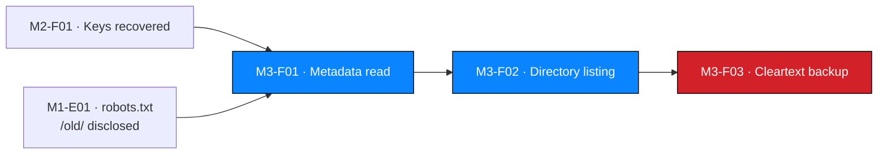

# NW-B083-M3-F01 — Sensitive metadata retained in a patient PDF

| Field | Value |
| --- | --- |
| **Finding ID** | `NW-B083-M3-F01` |
| **Milestone** | M3 — Deep Reconnaissance / Critical Data Exposure |
| **Affected component** | `LAB-PDF-03` (`patient_report_3.pdf`) |
| **Severity** | 🟠 **Medium** |
| **Rating status** | Confirmed |
| **Verification status** | Documented |
| **Confidence** | High |
| **OWASP category** | A05 — Security Misconfiguration |
| **CWE** | CWE-200 — Exposure of Sensitive Information to an Unauthorized Actor |
| **Evidence IDs** | `NW-B083-M3-E01`, `NW-B083-M3-E02` |
| **Status** | Open |

---

> 🔒 The author identifier is masked as `j.m***` throughout this record. The
> `Comments` field is quoted in full because **it is the finding**.

---

## 1. Description

A patient report PDF retained embedded metadata containing an internal staff account
identifier in the `Author` field and an internal operational note in the `Comments`
field. The note named an internal filesystem location holding a database backup and
disclosed that the item predated a site migration. The metadata directly enabled the
Critical findings `NW-B083-M3-F02` and `NW-B083-M3-F03`.

---

## 2. Affected component

| Field | Value |
| --- | --- |
| Location | `LAB-PDF-03` |
| Type | PDF document metadata |
| Authentication to read it | Document password — **recoverable**, see `NW-B083-M2-F01` |
| Data at risk | Internal identity and infrastructure information |

---

## 3. Preconditions

| # | Precondition | Present in this engagement? |
| --- | --- | --- |
| 1 | Possession of the document | ✅ Yes |
| 2 | The document key | ✅ Recovered offline via `NW-B083-M2-F01` |
| 3 | Ability to read metadata | ✅ Required a **decrypted copy** — a locked PDF exposes almost none |

---

## 4. Technical evidence

### 4.1 Observation

```bash
exiftool report3_open.pdf
```

| Field | Value | Masked here |
| --- | --- | --- |
| `Author` | `j.malik` | `j.m***` |
| `Comments` | `DB backup moved to /old before site migration, do not delete` | Quoted in full — this is the finding |

| Evidence ID | Observation | Artifact |
| --- | --- | --- |
| `NW-B083-M3-E01` | `Author` metadata field | ❌ Not attached |
| `NW-B083-M3-E02` | `Comments` metadata field | ❌ Not attached |

### 4.2 Expected vs. observed

| | Expected | Observed |
| --- | --- | --- |
| **`Author`** | Absent, or a generic service account | A real staff account identifier |
| **`Comments`** | Empty, or business-relevant | An internal location, a migration event and a retention instruction |

### 4.3 Mechanism and why the comment mattered more

| Field | What it yields | Value as a lead |
| --- | --- | --- |
| `Author` | An account identifier | 🟠 Moderate — suggests a person, gives no path onward |
| `Comments` | **An internal location, a database backup, a timeframe and a retention belief** | 🔴 **Decisive** — named exactly where to look next |

The `Comments` field carries four separable pieces of attacker value:

| Fragment | Value |
| --- | --- |
| `/old/` | A concrete, actionable internal location |
| `DB backup` | Explicit confirmation that a database backup exists |
| `before site migration` | A timeframe, and evidence of leftover infrastructure |
| `do not delete` | The belief that the item was still needed — i.e. probably never reviewed |

**Probable root cause:**

| Probable cause | Confidence | To confirm |
| --- | --- | --- |
| No metadata-stripping step in the document export or distribution path | High — directly observed | Review the export pipeline |
| `Comments` / `Keywords` used as a working scratch space | Medium-high — the content is an operational note, not document metadata | Review how staff use these fields |
| PDF generated by a tool that writes metadata by default | Medium | Identify the generating tool and its default settings |

---

## 5. Reproduction summary

> Authorized training environment only. Offline analysis of a file already held.

| Step | Action | Observed result |
| --- | --- | --- |
| 1 | Decrypt `LAB-PDF-03` with the recovered key | Unlocked copy produced |
| 2 | Run `exiftool` on the unlocked copy | `Author` and `Comments` fields returned |
| 3 | Read the `Comments` value | Named `/old/`, a backup, a migration, a retention belief |
| 4 | Cross-check `robots.txt` from M1 | `/old/` independently disclosed |
| 5 | Request `/old/` | Directory listing — see `NW-B083-M3-F02` |

| Bound | Limit |
| --- | --- |
| Requests to the target | 1 — step 5 only, and it is that finding's evidence, not this one's |
| Side effects | **None.** The unlocked copy was discarded |
| Document content | **Not read.** Only metadata fields were extracted |

**Explicitly not performed:**

| Action | Reason |
| --- | --- |
| Reading the document's clinical content | Out of scope; not needed to establish the metadata leak |
| Examining the other two documents' metadata | Not required — `LAB-PDF-03` established the control weakness |
| Publishing the full author identifier | Withheld; the role is sufficient |
| Publishing any document content | Prohibited |

---

## 6. Security impact

| Dimension | Assessment |
| --- | --- |
| Confidentiality | Internal identity and infrastructure information disclosed to anyone able to read the document |
| Integrity | None directly. However, absent metadata stripping, **document tampering would also be difficult to detect** — see below |
| Availability | None |
| Data sensitivity | 🟠 Internal — but with a disproportionate effect on this engagement |
| Business consequence | Named an internal system and confirmed a backup existed. Directly enabled two Critical findings |
| Detection likelihood | **None.** Metadata travels with the file and is not logged |

### 6.1 Cross-finding effect — the highest in the engagement

| Relationship | Detail |
| --- | --- |
| **Enabled** `NW-B083-M3-F02` | The `Comments` note named `/old/` |
| **Enabled** `NW-B083-M3-F03` | The same note confirmed a database backup existed there |
| **Corroborated** by `NW-B083-M1-F01` | `/old/` was independently disclosed in `robots.txt` at M1 Step 1 |
| **Dependent on** `NW-B083-M2-F01` | Metadata was unreadable until the document was decrypted |



> **A Medium finding with Critical consequences.** In isolation this is an
> information leak worth a Medium rating. In this engagement it was the entire
> bridge between a recovered document and a Critical data exposure. **Severity
> ratings measure the weakness; they do not always measure the finding's role in a
> chain.** That is why the report presents the chain explicitly rather than as an
> unordered severity-sorted list.

---

## 7. Severity

| Attribute | Value |
| --- | --- |
| Band | 🟠 **Medium** |
| Rationale | Discloses internal identity and infrastructure detail to a party able to read the document. Rated above a generic metadata leak because the content named a live backup location and was independently corroborated. Rated below High because obtaining the document already requires a separate weakness, and the leaked content is internal rather than clinical or personal-finance data. |
| Confidence | High — fields directly observed |
| Rating status | **Confirmed.** Every CVSS metric input is evidenced. |

> **The chain effect is not in the score.** CVSS measures the weakness in isolation.
> This finding's role as the bridge to two Critical findings is captured in the
> narrative and in the [chain analysis](../../milestones/M4-final-report/technical-findings.md),
> not in the vector.

---

## 8. CVSS v4.0

**Vector:** `CVSS:4.0/AV:N/AC:L/AT:N/PR:N/UI:N/VC:L/VI:N/VA:N/SC:N/SI:N/SA:N`

**Base score:** `PENDING — compute with the FIRST CVSS v4.0 calculator`

| Metric | Value | Justification |
| --- | --- | --- |
| AV | `N` | Metadata travels with the file; anyone able to obtain it can read it remotely |
| AC | `L` | Single `exiftool` invocation once the file is held |
| AT | `N` | No prerequisite beyond possession. *Note: possession requires `M2-F01`, a separate weakness* |
| PR | `N` | Reading metadata needs no account or system access |
| UI | `N` | No human must act |
| VC | `L` | Discloses internal identity and infrastructure detail — partial, low-volume confidentiality loss. **Not** `H`: no clinical or personal-finance data is in the metadata |
| VI | `N` | Nothing is modified |
| VA | `N` | No availability effect |
| SC | `N` | No subsequent system affected |
| SI | `N` | — |
| SA | `N` | — |

> `AT:N` with `PR:N` reflects that the metadata weakness itself needs nothing. The
> dependency on obtaining the document is captured in the narrative and in
> `NW-B083-M2-F01`'s vector, not here.

---

## 9. Remediation

### 9.1 Primary fix

Strip metadata as a **pipeline step**, not a manual action:

```bash
# Strip all metadata in place (illustrative)
exiftool -all= patient_report_3.pdf

# Preferred: strip on export, before the document ever reaches a recipient
exiftool -all= -overwrite_original -q "$file"
```

| Requirement | Detail |
| --- | --- |
| Apply in the export path | Every document leaving the system is stripped automatically |
| Do not rely on manual steps | A manual instruction will be skipped under time pressure |
| Verify after stripping | Re-run `exiftool` on output and assert no residual fields |
| Review templates and generating tools | Identify defaults that write metadata |

### 9.2 Verification

```bash
# Must return no author, comment, or path-bearing field
exiftool -a -u -g1 patient_report_3.pdf | grep -Ei 'author|comment|creator|producer|template|path'
```

### 9.3 Additional hardening

| # | Measure | Addresses |
| --- | --- | --- |
| 1 | Configure the generating tool to omit metadata at source | Removes it before stripping |
| 2 | Review whether `Comments` / `Keywords` are needed in the workflow at all | Removes the temptation |
| 3 | Sign documents where authenticity matters | Detects tampering, which metadata stripping alone does not |
| 4 | Check for residual incremental-update content in revised documents | Older content can persist |
| 5 | Apply the same review to every document type leaving the system, not only PDFs | Consistency |

---

## 10. Retest criteria

| # | Criterion | Method | Pass condition | Result |
| --- | --- | --- | --- | --- |
| 1 | No author metadata | `exiftool` on a newly issued document | No `Author`, `Creator` or `LastModifiedBy` |
| 2 | No comment metadata | `exiftool` | No `Comments` or `Keywords` |
| 3 | No internal paths | `exiftool`, inspect `Producer` and template fields | No filesystem path or hostname |
| 4 | Stripping is automatic | Export a test document without manual intervention | Metadata absent |
| 5 | Verified in the pipeline | Review CI/CD or application export code | Strip step present and asserted |
| 6 | Other formats covered | Export each document type | Metadata absent from all |
| 7 | Tamper detection where required | Modify a signed document | Signature verification fails |

---

## 11. Status

| Field | Value |
| --- | --- |
| Status | **Open — P2** |
| Verification status | **Documented** |
| Rating status | **Confirmed** |
| Evidence artifacts attached | 0 of 2 |
| Outstanding to close | 1. Capture and sanitise `E01`/`E02`; mask the author identifier to `j.m***` in every artifact. 2. Review other metadata fields present for additional disclosure. 3. **P2 by priority, P0 by consequence** — this finding caused the two Critical findings, so fixing it is a high-value defence-in-depth action even though its own severity is Medium. |

---

## 12. Confidentiality declaration

- [x] Author identifier **masked** as `j.m***` in all published content
- [x] Individual referenced by **role**, not by name
- [x] `Comments` field quoted because it constitutes the finding — verified to contain no credential
- [x] No patient content reproduced — the document was never opened
- [x] No credential, key, token or cookie present
- [x] Root cause stated as probable — no source or pipeline access
- [x] No fault attributed to an individual — this is a process failure
- [x] No client approval or sign-off claimed
