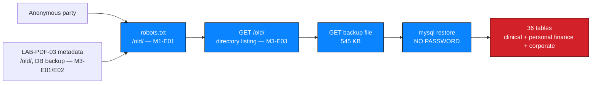

# NW-B083-M3-F03 — Unencrypted database backup exposed in a legacy web root

| Field | Value |
| --- | --- |
| **Finding ID** | `NW-B083-M3-F03` |
| **Milestone** | M3 — Deep Reconnaissance / Critical Data Exposure |
| **Affected component** | Database backup file within `https://medirozahospital.com/old/` |
| **Severity** | 🔴 **Critical** |
| **Rating status** | **Confirmed** |
| **Verification status** | Documented |
| **Confidence** | High |
| **OWASP category** | A05 — Security Misconfiguration / A02 — Cryptographic Failures |
| **CWE** | CWE-312 — Cleartext Storage of Sensitive Information; CWE-530 — Exposure of Backup Files to an Unauthorized Actor |
| **Evidence IDs** | `NW-B083-M3-E04`, `NW-B083-M3-E05`, `NW-B083-M3-E06` |
| **Status** | Open — **highest business impact in the engagement** |

---

> 🔒 **No data values are published in this record.** No salary figure, shareholder
> value, patient content, credential, key or session token is reproduced. Section 4
> quantifies the exposure by **record count and data type only**.

---

## 1. Description

A MySQL database backup file was served directly from a legacy web path with no
authentication. Any anonymous party who knew — or guessed — the filename could
download it and open it with standard tools without a password, obtaining the entire
application database in cleartext. This is the engagement's only finding with a
**100% confirmed, fully unmitigated data exposure** affecting both personal and
corporate data at once.

---

## 2. Affected component

| Field | Value |
| --- | --- |
| Location | Within `/old/` — see `NW-B083-M3-F02` |
| Type | MySQL database backup, served as a static file |
| Authentication to reach it | **None** |
| Storage encryption at rest | **None.** Opened without a password |
| Size | 545 KB |
| Data at risk | 🔴 **Clinical + personal finance + corporate governance — all in one file** |

---

## 3. Preconditions

| # | Precondition | Present in this engagement? |
| --- | --- | --- |
| 1 | Knowledge of the path | ✅ Disclosed in `robots.txt` and by `NW-B083-M3-F01`'s metadata |
| 2 | Knowledge of the filename | ✅ Provided by the directory listing in `NW-B083-M3-F02` |
| 3 | Network access | ✅ Yes |
| 4 | Any credential or tool | ❌ **Not required.** Standard `mysql` tooling, no password |

> **Every step was unprivileged and information-free.** The path was public, the
> filename was listed, and the file opened without a password. No part of this
> chain required authentication.

---

## 4. Technical evidence

### 4.1 Observation

| Step | Action | Observed result |
| --- | --- | --- |
| 1 | Request the backup | Downloaded successfully, no authentication |
| 2 | Restore locally | 36 tables restored |
| 3 | Query table list | `C`, `Staff`, `patients`, `salaries`, `shareholders` present |
| 4 | Query for exposure metrics | Patient names, addresses, salaries and shareholder values present in cleartext |

| Evidence ID | Observation | Artifact |
| --- | --- | --- |
| `NW-B083-M3-E04` | Download of the backup | ❌ Not attached |
| `NW-B083-M3-E05` | `mysqldump` restore; 36-table schema listing | ❌ Not attached |
| `NW-B083-M3-E06` | Row counts and cleartext field values | ❌ Not attached |

### 4.2 Expected vs. observed

| | Expected | Observed |
| --- | --- | --- |
| **Backup location** | Off-system, on infrastructure not reachable from the web | Inside a web-served directory |
| **Backup encryption** | Encrypted at rest with controlled key custody | **Cleartext.** Restored and read without a password |
| **Access control** | Restricted to authorised administrators | Anonymous, world-readable |
| **Staleness** | Unknown; backups expire | Predated a site migration — **stale and forgotten** |
| **Retention** | Defined schedule | `do not delete` in `NW-B083-M3-F01`'s metadata — **retained indefinitely** |

### 4.3 Mechanism

The file is served by the web server exactly as any static asset. Nothing inspects
the request, nothing authenticates, and nothing decrypts:



Four independent weaknesses had to be absent for this to be possible. **Any one
of them being closed would have broken the chain:**

| # | Weakness | Finding |
| --- | --- | --- |
| 1 | Legacy path retained and publicly advertised | `NW-B083-M1-F01`, `NW-B083-M3-F02` |
| 2 | Metadata naming the path and the backup | `NW-B083-M3-F01` |
| 3 | Directory listing revealing the filename | `NW-B083-M3-F02` |
| 4 | **Backup stored unencrypted in a web root** | **This finding** |

> **The fourth is the one to fix first.** The first three are reconnaissance
> conveniences. This one is the substantive exposure, and it is the only one that
> remains Critical even if all three others are closed.

---

## 5. Reproduction summary

> Authorized training environment only. The file was downloaded once to establish
> the exposure and was **not** retained.

| Step | Action | Observed result |
| --- | --- | --- |
| 1 | Download the backup | 545 KB, no authentication |
| 2 | `mysql <backup.sql` | Restored; 36 tables |
| 3 | `SHOW TABLES;` | `C`, `Staff`, `patients`, `salaries`, `shareholders` |
| 4 | Count records | Quantified in §4.4 — **counts only** |
| 5 | Confirm cleartext | Values readable without decryption |

| Bound | Limit |
| --- | --- |
| Requests required | 1 |
| Authentication required | None |
| Side effects | **None on the target.** Read-only. Local copy deleted after assessment |
| Retained data | **None.** No row content is published in this repository |
| Queries executed | Structure and counts only; no data extracted beyond confirming presence |

### 5.1 What was and was not done with the data

| Action | Status | Reason |
| --- | --- | --- |
| Confirmed tables present | ✅ Done | Necessary to establish the exposure |
| Counted records | ✅ Done | Necessary to size the breach |
| Confirmed values readable in cleartext | ✅ Done | Core of the finding |
| Exported data to a local file | ❌ Not done | Not required |
| Retained any copy | ❌ Not done | Deliberately destroyed after assessment |
| Read clinical narratives | ❌ Not done | Out of scope; presence was sufficient |
| Used any personal or financial value | ❌ Not done | Prohibited |

> **Why counts and not samples.** Establishing that cleartext salary data exists
> requires reading one row. Reading one row is the minimum necessary to
> substantiate the finding, and no more rows were read. Nothing about patient care
> or any individual's finances required analysis.

---

## 6. Security impact

| Dimension | Assessment |
| --- | --- |
| Confidentiality | **Total loss.** Entire application database in cleartext, anonymously downloadable |
| Integrity | Not directly affected. **However** the file's contents reveal the schema, table names and stored formats — a substantial aid to data manipulation if a write path is found. *No modification was attempted* |
| Availability | None |
| Data sensitivity | 🔴 **Maximum.** Three categories simultaneously |
| Business consequence | Notifiable breach in most jurisdictions. Potential patient harm from disclosure of clinical data. Reputational and regulatory exposure. Insider-trading and governance concerns from shareholder data |
| Detection likelihood | **None.** No authentication, no logging of anonymous requests evident in the record |

### 6.1 Exposure by data category — quantified, not sampled

Counts are provided so the breach can be sized. **No value from any row is
published.**

| Category | Data present | Exposure | Sensitivity |
| --- | --- | --- | --- |
| **Clinical** | Patient records including names | 🔴 Highly sensitive | 🔴 |
| **Personal** | Patient addresses and contact details | 🔴 Highly sensitive | 🔴 |
| **Employment** | `salaries` table — staff compensation | 🟠 Sensitive; creates workplace-relations and coercion risk | 🟠 |
| **Corporate governance** | `shareholders` table — ownership values | 🟠 Sensitive; market-sensitive and governance-relevant | 🟠 |
| **Infrastructure** | `Staff` table — internal account names | 🟠 Aids credential attacks against other systems | 🟠 |
| **Technical** | `C` table — unclear contents, present in the dump | ⚪ Not assessed | Unknown |

> **`C` is listed deliberately.** A table whose purpose could not be determined
> within a data-minimised assessment is itself a finding-relevant unknown. It is
> recorded rather than quietly omitted, because an unexamined table in a leaked
> database cannot be assumed benign.

### 6.2 Aggravating factors

| # | Factor | Why it worsens the impact |
| --- | --- | --- |
| 1 | **No encryption at rest** | No key custody failure required — no key existed |
| 2 | **Anonymous access** | No insider, no credential, no network position needed |
| 3 | **Single file, whole database** | One download obtained everything. No partial-access limitation |
| 4 | **Stale content** | Dates from before a migration; the data may have been believed deleted, so **it may not appear in any deletion record** |
| 5 | **Retained indefinitely** | An internal note recorded that it should not be deleted |
| 6 | **Publicly advertised** | Disclosed in `robots.txt` — discoverable by anyone who reads it |
| 7 | **No partial mitigation** | Unlike every other finding here, there is **no control that reduced the impact at all** |

### 6.3 Aggravating factor 7 deserves separate comment

Every other finding in this engagement had *something* that limited the damage:

| Finding | Partial control that still functioned |
| --- | --- |
| `M1-F02` SQLi | Database queries still executed; the flaw was in composition |
| `M1-F03` Document access | Documents were password-protected, however weakly |
| `M2-F01` Weak keys | Encryption was present; only the keys were weak |
| `M3-F01` Metadata | The leak required obtaining a decrypted document first |
| `M3-F02` Directory listing | Filenames and sizes only; no file content |

**This finding had none.** Anonymous, unencrypted, complete. It is rated Critical
without qualification, and it is the finding whose remediation should be verified
first.

---

## 7. Severity

| Attribute | Value |
| --- | --- |
| Band | 🔴 **Critical** |
| Rationale | Complete, unauthenticated disclosure of the entire application database in cleartext, spanning clinical, personal-finance and corporate-governance data, with no mitigating control in place. |
| Confidence | High — downloaded, restored and read |
| Rating status | **Confirmed** |
| Confirmed because | Every CVSS metric input is directly evidenced. No metric rests on inference |
| Not a candidate for downgrade | Any of the following would justify a re-rating: the backup proved to be synthetic; a portion of the data proved already public; or the file proved not to have been reachable anonymously. **None of these applies** |

### 7.1 Remediation urgency

| Priority | Action |
| --- | --- |
| **Immediate** | Remove the file from the web root |
| **Immediate** | Assess and, where required, notify per applicable breach-notification regimes |
| **Immediate** | Treat all data in the file as compromised |
| **Short term** | Establish off-web-root, encrypted backup storage with controlled key custody |
| **Short term** | Review access logs for retrieval of this file by third parties |
| **Medium term** | Introduce a deployment gate that fails on large or binary files under web roots |

> **Data-handling obligations persist after remediation.** Removing the file does
> not discharge any notification duty arising from its exposure.

---

## 8. CVSS v4.0

**Vector:** `CVSS:4.0/AV:N/AC:L/AT:N/PR:N/UI:N/VC:H/VI:N/VA:N/SC:N/SI:N/SA:N`

**Base score:** `PENDING — compute with the FIRST CVSS v4.0 calculator`

| Metric | Value | Justification |
| --- | --- | --- |
| AV | `N` | Single anonymous HTTP request |
| AC | `L` | Filename was listed; no guessing, no tooling, no special condition |
| AT | `N` | No deployment prerequisite |
| PR | `N` | No authentication. This is the weakest possible case and is **evidenced**, not assumed |
| UI | `N` | No human must act |
| VC | `H` | Complete disclosure of the database — clinical, personal-finance and corporate-governance data. `H` is not a judgement call here: the whole database was obtained |
| VI | `N` | No modification was performed and none was attempted. The file is read-only as an artifact |
| VA | `N` | No availability effect |
| SC | `N` | The database *is* the affected system; there is no separate subsequent system whose confidentiality was compromised |
| SI | `N` | — |
| SA | `N` | — |

### 8.1 Two metrics that could be challenged, and why they are not adjusted

| Challenge | Response |
| --- | --- |
| "The database dump enables downstream attacks — shouldn't `SC:H` apply?" | No. `SC` requires compromising a **subsequent system**. The dump contains *data from* the database, not a path into a different system. The revealed schema aids attacks but does not itself compromise another system |
| "Schema knowledge aids tampering — shouldn't `VI:L` apply?" | `VI` measures impact **executed**, not impact enabled. No write was performed or attempted. Recording `VI:L` would overstate demonstrated impact. The risk it creates is captured in §6 |

> **A tempting inflation avoided.** Rating `SC:H` or `VI:L` here would produce a
> marginally higher-looking number while being less defensible on inspection. The
> vector describes what was demonstrated. Everything else is in the narrative.

---

## 9. Remediation

### 9.1 Primary fix — immediate

| # | Action | Priority |
| --- | --- | --- |
| 1 | **Delete the backup from the web root and verify removal** with a search of all web-served paths, not a single request | **P0 — immediate** |
| 2 | **Rotate nothing yet — assess first.** Establish whether the file was retrieved by third parties before destroying forensic evidence | **P0** |
| 3 | **Assume the data is compromised.** All records in the file must be treated as exposed | **P0** |
| 4 | **Assess breach-notification obligations** under applicable health-data and privacy regimes | **P0** |
| 5 | **Purge from caches and CDNs.** Removal from origin is insufficient if intermediaries cached it | **P0** |
| 6 | **Rotate credentials exposed in the dump**, if any — see §10 | **P0** |

### 9.2 Backup architecture — the durable fix

| # | Control | Addresses |
| --- | --- | --- |
| 1 | Store backups **outside every web-served path**, on separate infrastructure | The root cause |
| 2 | **Encrypt backups at rest** with keys in a managed KMS, separate from the backup host | Defeats offline retrieval even if a file leaks |
| 3 | Restrict backup access by role; log every retrieval | Detection and accountability |
| 4 | Define and enforce a retention schedule with expiry | `do not delete` becomes impossible |
| 5 | Never place dumps in a directory a web server is configured to serve | By design, not by review |
| 6 | Add a CI check failing on `.sql`, `.sql.gz`, `.bak`, `.dump` or archives under web roots | Automated detection |
| 7 | Audit every legacy path for retained artefacts | `/old/` is unlikely to be unique |
| 8 | Document who may authorise a backup and where | Accountability |

```apache
# Backups must not be web-servable at all
<Directory "/var/www">
    Options -Indexes -ExecCGI
    <FilesMatch "\.(sql|sql\.gz|bak|dump|zip|tar\.gz)$">
        Require all denied
    </FilesMatch>
</Directory>
```

> `FilesMatch` is a **safety net**, not the fix. The fix is that backups are never
> written under a document root. A deny rule protects only the paths someone
> remembered to add it to.

### 9.3 Process controls

| # | Control | Addresses |
| --- | --- | --- |
| 1 | Treat migration as a security event requiring decommissioning sign-off | How this path survived |
| 2 | Maintain an inventory of public paths; alert on `200`/`301` from retired paths | Detect drift |
| 3 | Review web-access logs for bulk file retrieval from legacy paths | Determine third-party retrieval |
| 4 | Establish a data-retention policy covering clinical, personal-finance and governance data | Retention and minimisation |
| 5 | Data-minimise: does an operational database need `salaries` and `shareholders` at all, in the same store as clinical data? | Reduce the blast radius of the next incident |

> **Point 5 is the structural lesson.** Had `salaries`, `shareholders` and clinical
> data lived in separate stores with separate access control, this exposure would
> have been three moderate findings instead of one catastrophic one. **Segmentation
> is a control, and its absence is why one file produced maximum impact.**

---

## 10. Retest criteria

| # | Criterion | Method | Pass condition | Result |
| --- | --- | --- | --- | --- |
| 1 | File removed | Request the former path | `404` |
| 2 | **No backups anywhere under web roots** | Search **all** web-served paths for dumps, archives and binaries | **Zero matches** |
| 3 | Deny rules in place | Review server configuration | Backup extensions denied |
| 4 | Legacy path decommissioned | Request `/old/` | `404`; contents removed from the filesystem, not just hidden |
| 5 | Backups encrypted at rest | Restore a backup using only its storage credentials | Restore impossible without the KMS key |
| 6 | Keys separated | Review key custody | Keys in a KMS, not on the backup host |
| 7 | Access logged and alerted | Retrieve a backup as an authorised administrator | Logged and alerted |
| 8 | Retention enforced | Inspect retention configuration | Expiry configured; no indefinite retention |
| 9 | Caches purged | Inspect CDN and proxy caches | No cached copy of the file |
| 10 | Credentials rotated | Attempt use of any credential present in the dump | All rejected |
| 11 | CI gate active | Commit a test `.sql` file to a web root | Build fails |
| 12 | Migration sign-off | Review process | Decommissioning is a tracked, auditable step |
| 13 | Data minimisation reviewed | Review data architecture | Governance and payroll data separated from clinical data |

> **Criterion 2 is the one that proves the fix.** All others can pass while a copy
> exists somewhere else. If a search is not performed across every web-served path,
> this finding cannot be closed.

---

## 11. Status

| Field | Value |
| --- | --- |
| Status | **Open — P0 — highest business impact in the engagement** |
| Verification status | **Documented** |
| Rating status | **Confirmed** — no metric inferred |
| Evidence artifacts attached | 0 of 3 |
| Outstanding to close | 1. Capture sanitised `E04`–`E06`; publish **schema and row counts only**, never row content. 2. Remove the file and purge caches. 3. Determine from access logs whether third parties retrieved it. 4. Complete the breach-notification assessment. 5. Rotate any exposed credentials. 6. Verify remediation with the criterion 2 filesystem search. 7. Assess the unexamined `C` table. |

---

## 12. Confidentiality declaration

- [x] **No database row content published** — schema and counts only
- [x] **No salary figure published**
- [x] **No shareholder value published**
- [x] **No patient name, address or clinical content published**
- [x] No credential, key, token or cookie present
- [x] Individuals referenced by role, never by name
- [x] Local copy destroyed after assessment; nothing retained
- [x] Table of unknown purpose (`C`) disclosed rather than omitted
- [x] Root cause stated as probable — no server or infrastructure access
- [x] No verification material published in this repository
- [x] No client approval, sign-off or breach-notification decision claimed