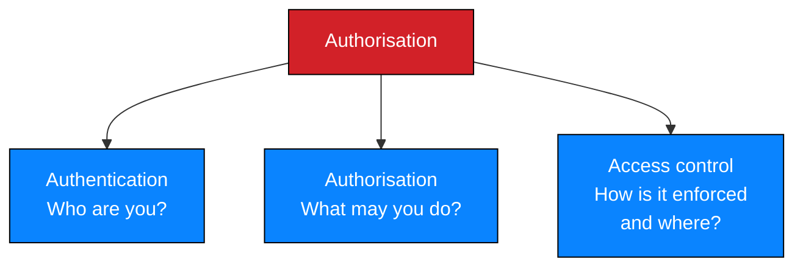

# Procedure 5 — Access control

Testing whether authorisation is enforced where it must be — including places where
no application code runs at all.

> **Authorisation precondition.** Testing of in-scope authorisation logic under
> written authorisation. Object-level testing uses only accounts the client has
> approved for the test.

---

## 1. The core distinction



Most access-control failures are **enforcement-location** failures: the decision is
made somewhere that does not cover the resource.

| Where the check lives | Coverage |
| --- | --- |
| Application endpoint | Covers that endpoint only |
| Middleware | Covers what the middleware wraps — and only what it wraps |
| **Web-server filesystem** | **Covers nothing.** A static file has no check |
| Network perimeter | Covers nothing inside the perimeter |

---

## 2. The static-file blind spot

The highest-value lesson of this engagement.

| Property | Consequence |
| --- | --- |
| A file in a web-served directory is delivered by the web server | No application code runs, so no authorisation runs |
| A session check at login protects only the *listing* page | The file's own URL is unprotected |
| Directory listing removes the need to guess filenames | The filename is handed over |
| Files inside the web root are addressable by default | No mapping is required |

> **Two independent failures produced a data breach.** Documents were placed inside
> the web root, and no per-object authorisation existed. Fixing either alone would
> have stopped it; fixing only the *listing* would not have.

### 2.1 Correct design

| Requirement | Implementation |
| --- | --- |
| Storage outside the document root | Files under a private path, not URL-addressable |
| Delivery through an authorising endpoint | Every request passes a check |
| Two checks, not one | Session valid **and** this user may access this object |
| Non-guessable identifiers | Defence in depth, never a substitute for a check |
| Direct-path requests return 401/403/404 | Verified explicitly in retest |

---

## 3. Test classes

| Class | Question | Engagement result |
| --- | --- | --- |
| Function-level | May an unauthenticated user invoke this function? | ✅ Bypass found (`M1-F02`) |
| Object-level | May user A access user B's object? | ⬜ **Not tested** — one account only |
| Direct object reference | Are object identifiers predictable? | ⬜ **Not tested** |
| Unauthenticated access to a known path | Does a valid URL work with no session? | ⬜ **Not tested** — the reason `M1-F03` is provisional |
| Directory-level | What does the web server expose for this path? | ✅ Listing found (`M3-F02`) |
| Privileged functions | May the low-privilege role reach administrative actions? | ⬜ **Not tested** |

> **Four of six classes were not tested.** The engagement reports what it
> established and lists the remainder as hypotheses. Recording untested classes is
> what keeps a rating provisional and honest.

---

## 4. Directory and path-level checks

| Check | Why |
| --- | --- |
| Request a known path with no session | Establishes whether the session is the only control |
| Inspect response headers for a directory index | Detects autoindex |
| Request a known filename directly | Distinguishes "listed" from "guessed" |
| Search all web-served paths for backups and archives | The finding that cannot be closed by a spot check |
| Check for legacy paths surviving a migration | `/old/` existed because migration left artefacts behind |

### 4.1 Why directory listing deserves separate attention

| Listing exposes | Listing does not expose |
| --- | --- |
| Filenames | File contents |
| Sizes | Whether contents are sensitive |
| Modification dates | — |
| **The removal of guesswork** | — |

Listing is normally a Medium finding. Here it was rated Critical **because of what
it pointed at** — and that coupling is recorded as provisional, because the
directory's full contents were never enumerated.

> If the listing had been disabled and the backup filename had never been
> published anywhere, the filename might still have been guessed. Disabling listing
> is necessary and **not sufficient**.

---

## 5. Unauthenticated access testing

The highest-value single test in the engagement, and it was not performed for
`M1-F03`.

| Step | Action | Interpretation |
| --- | --- | --- |
| 1 | Request a known document URL with all cookies removed | If it returns the file, the finding is Critical and standalone |
| 2 | Request it with a valid session of a different role | Object-level authorisation failure |
| 3 | Try a predictable identifier | Direct object reference |

> Had step 1 been run, `M1-F03` would be confirmed and its `PR` metric would be `N`
> rather than `L`, raising the band from High to Critical. The test is cheap,
> obviously within scope, and its omission is recorded as a genuine gap.

---

## 6. Correct implementation

```php
session_start();

// 1. Session validity
if (!is_authenticated()) {
    http_response_code(401);
    exit('Unauthorized');
}

// 2. Object lookup by identifier — never by client-supplied path
$doc = find_document_by_id($_GET['id'] ?? '');
if ($doc === null) {
    http_response_code(404);
    exit('Not found');
}

// 3. Object-level authorisation for THIS user and THIS document
if (!can_access_document($doc, $_SESSION['user'])) {
    http_response_code(403);
    exit('Forbidden');
}

// 4. Stream from private storage
header('Content-Type: application/pdf');
header('Content-Disposition: attachment; filename="report.pdf"');
readfile(private_storage_path($doc->storage_key));
```

| Pitfall | Consequence |
| --- | --- |
| Checking the session only | Any authenticated user reaches any object — `M1-F03` |
| Building a path from client input | Path traversal and arbitrary file read |
| Storing documents in the web root | A URL bypasses the application entirely |
| Relying on unguessable identifiers | Security by obscurity; changes with any leak |

---

## 7. Reporting access-control findings

| Requirement | Reason |
| --- | --- |
| Distinguish "bypassed a session check" from "no check existed" | Different fixes, different severities |
| Record which control class was tested | Prevents an untested class being implied as safe |
| State the enforcement gap explicitly | The fix belongs at a specific layer |
| Separate the bypass from the payload | `M1-F02` and `M1-F03` are one chain but two defects |

---

## 8. Retest criteria

| # | Criterion | Pass condition |
| --- | --- | --- |
| 1 | No session ⇒ no object | 401/403/404 — never bytes |
| 2 | Old static paths removed | 404 |
| 3 | Object-level authorisation enforced | User A receives 403 for user B's object |
| 4 | Identifiers not predictable | Enumeration returns nothing without authorisation |
| 5 | No cross-session leakage | Another user's identifier yields 403 |
| 6 | Directory listing disabled | No index rendered at any path |
| 7 | No sensitive artefacts in web roots | Filesystem search finds zero dumps, backups or archives |
| 8 | Access logged | Authorised access recorded with user, object and time |
| 9 | Bulk-access alerting | Unusual download volume alerts |

Criterion 7 is the one that proves criterion 6 was not merely cosmetic.

---

## 9. Checklist

- [ ] Authorisation covers access-control testing; test accounts approved
- [ ] Enforcement points mapped, including non-application paths
- [ ] Direct unauthenticated request tested for every known resource
- [ ] Object-level testing performed where two roles were available
- [ ] Directory listings checked at every relevant path
- [ ] Web-served paths searched for backup and archive files
- [ ] Untested control classes recorded as hypotheses
- [ ] Fix specified at the correct enforcement layer
- [ ] Retest criteria distinguish "listing disabled" from "backup unreachable"