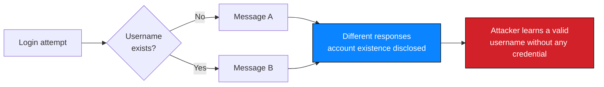
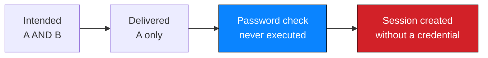

# Procedure 3 — Authentication assessment

Testing authentication mechanisms without credential attacks, and demonstrating a
bypass minimally.

> **Authorisation precondition.** Testing of in-scope authentication functionality
> under written authorisation. Credential attacks, spraying and lockout-inducing
> activity are prohibited — see [`../docs/rules-of-engagement.md`](../docs/rules-of-engagement.md).

---

## 1. Objective

Determine whether the authentication control can be circumvented, and whether it
leaks information that makes circumvention easier.

---

## 2. Assessment order

| # | Step | Purpose |
| --- | --- | --- |
| 1 | Map the login flow | Fields, method, response behaviour |
| 2 | Compare responses across account states | Detect response discrepancy |
| 3 | Review error messages | Do they help an attacker? |
| 4 | Test the input boundary for injection | Is a parameter composed into a query? |
| 5 | Assess rate limiting and lockout | Only if required — do not induce lockout |
| 6 | Assess session management | Cookie attributes, predictable identifiers, logout |
| 7 | Demonstrate a bypass minimally | Prove it, then stop |
| 8 | Record what was not tested | E.g. the untested password parameter |

> Step 2 before step 4 is deliberate. Knowing a valid username first turned the
> injection test from guesswork into a targeted check, and it is why the engagement
> needed no credential attacks at all.

---

## 3. Response-discrepancy testing

### 3.1 Principle

An authentication control should respond identically regardless of which part of the
credential pair was wrong. Any observable difference is a defect.

### 3.2 What was observed

| Input state | Response |
| --- | --- |
| Non-existent username | One message |
| Existing username, wrong password | A different message |



### 3.3 Why it matters beyond tidiness

| Step it enabled | Effect |
| --- | --- |
| Valid username identified | Injection test became targeted |
| Targeted account used | Bypass succeeded on the first attempt |
| Bypass succeeded | Patient documents were reached |

> A Medium finding that materially contributed to two Critical ones. Chain position
> is a first-class risk factor — see
> [`../risk/risk-rating-methodology.md`](../risk/risk-rating-methodology.md) §3.

### 3.4 Correct behaviour

| Requirement | Implementation |
| --- | --- |
| One message for all failures | `Authentication failed.` for every case |
| Constant-time comparison | Identical response path regardless of input |
| Generic wording | No reference to users, accounts, existence or password state |
| Server-side logging | The detail belongs in logs, not in the response |

---

## 4. Input-boundary testing at authentication

### 4.1 Safe sequence

| Order | Input class | Purpose |
| --- | --- | --- |
| 1 | Single metacharacter | Confirm whether input reaches a query |
| 2 | Read the error | Identify the stack and the injection point's position |
| 3 | A comment or terminator that changes the query's meaning minimally | Demonstrate impact |
| 4 | **Stop** | Impact is established |

> No extraction, no schema enumeration, no other-account enumeration, no stacked
> queries, no modification. Every one of those would have added handling risk
> without adding evidentiary value.

### 4.2 Bypass demonstration

| Input | Effect |
| --- | --- |
| A single quote | Statement no longer valid — injection confirmed |
| A closing quote followed by a comment marker | The password condition is removed from the executed statement |



> **The distinction that matters.** No password was guessed, cracked or recovered.
> The check was *deleted from the statement*. This is why the finding is rated on
> authentication defeat rather than on credential strength.

---

## 5. Session management

| Check | Engagement result |
| --- | --- |
| Cookie flags observed | Recorded as an observation; not assessed in depth |
| Predictable session identifiers | **Not tested** |
| Logout invalidates the session | **Not tested** |
| Concurrent-session limits | **Not tested** |
| Re-authentication for sensitive actions | **Not tested** — no such action was reached |

> None of the above is claimed as secure. Untested is recorded as untested.

---

## 6. Rate limiting and lockout

Not assessed, by design. Testing lockout behaviour risks denying a legitimate user
access to a clinical system.

> In a real engagement this is agreed in advance: whether lockout testing is
> permitted, against which accounts, and during what window. Probing a production
> hospital's authentication for account-lockout side effects would be
> irresponsible without that agreement.

---

## 7. Correct implementation

```php
// Uniform response regardless of the failure reason
$user = find_user_by_username($username);   // prepared statement

if ($user && password_verify($password, $user->password_hash)) {
    session_regenerate_id(true);
    $_SESSION['user_id'] = $user->id;
    header('Location: /portal');
    exit;
}

error_log("Failed login for username: {$username}");   // detail to the log
header('Content-Type: text/plain');
echo 'Authentication failed.';                          // identical to the client
exit;
```

| Requirement | Why |
| --- | --- |
| Parameterised query | Removes the injection primitive entirely |
| `password_verify()` | Password hashing belongs in application code, not in SQL |
| Uniform response | Removes the enumeration signal |
| Detail in the log only | Preserves forensics without leaking to an attacker |
| Session ID regenerated on privilege change | Prevents session fixation |

---

## 8. Retest criteria

| # | Criterion | Pass condition |
| --- | --- | --- |
| 1 | All failure modes return one identical response | Byte-identical response body and status |
| 2 | No metacharacter reaches a query unparameterised | No database error on any input |
| 3 | Comment-truncation payloads rejected | Login refused |
| 4 | Passwords verified in application code | `password_verify()` used |
| 5 | Verbose errors disabled | No stack trace or SQL fragment returned |
| 6 | Rate limiting and alerting active | Repeated failures alerted |
| 7 | Session identifier rotates on login | New identifier after authentication |

Criteria 1–5 map to `NW-B083-M1-F01` and `NW-B083-M1-F02`; see
[`../findings/verified-findings/NW-B083-M1-F02-sqli-authentication-bypass.md`](../findings/verified-findings/NW-B083-M1-F02-sqli-authentication-bypass.md) §10.

---

## 9. Checklist

- [ ] Authorisation covers authentication testing
- [ ] No credential attack, spraying or lockout induction performed
- [ ] Response discrepancy tested before injection
- [ ] Single-error-first ordering followed; testing stopped once impact was shown
- [ ] Bypass demonstrated with minimal input, no extraction
- [ ] Session management items recorded as tested or explicitly untested
- [ ] Correct implementation documented for the development team
- [ ] Retest criteria written with observable pass conditions