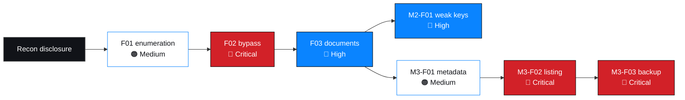

# Procedure 7 — Reporting

How findings are written so a reader can trust them — including when they are
incomplete.

> **Applies to every deliverable**, not only this repository. The principles below
> are the reason seven findings are labelled `Documented` rather than `Verified`.

---

## 1. The two claims

| Claim | Requires | Supportable today |
| --- | --- | --- |
| "We observed this" | Narrative, reasoning, confidence | ✅ |
| "Here is the artifact" | The artifact, sanitised, with provenance | ❌ |

Collapsing these into "verified" is the most common reporting failure. They are
tracked separately here: **7 Documented · 0 Evidence-attached · 0 Verified.**

---

## 2. Structure every finding follows

| Section | Purpose |
| --- | --- |
| Summary header | ID, component, severity, rating status, verification status, confidence |
| Description | What the weakness is, in one paragraph |
| Affected component | Location, type, authentication requirement, data at risk |
| Preconditions | Each marked present, absent or unknown |
| Technical evidence | Observations, expected vs. observed, mechanism, probable cause |
| Reproduction summary | Bounded steps with limits stated, and what was deliberately not done |
| Security impact | Confidentiality / integrity / availability, data class, detectability |
| Severity | Band, rationale, rating status and why |
| CVSS v4.0 | Vector with per-metric rationale and certainty flags |
| Remediation | Primary fix, mandatory companions, process controls |
| Retest criteria | Observable pass conditions per fix |
| Status | What remains outstanding to close |
| Confidentiality declaration | Checked assertions about withheld data |

Template: [`../findings/finding-template.md`](../findings/finding-template.md)

---

## 3. Writing honest findings

### 3.1 Certainty markers

| Marker | Use |
| --- | --- |
| Observed | Directly seen in the engagement record |
| Probable root cause | Inferred; named confirmation step required |
| Hypothesis | Plausible, untested; listed as open |
| Observation | Noted, not assessed as a finding |
| `PENDING` | Required input not available; the exact need is named |
| `UNKNOWN` | Not recorded and not inferable |

> **Never write a plausible value into an empty field.** `PENDING — required: FIRST
> calculator output` is publishable. A remembered score is not.

### 3.2 Provisional ratings

A rating is provisional when a metric input is unknown. Record which input, and
which direction it could move.

| Finding | Unknown input | Direction |
| --- | --- | --- |
| `M1-F03` | Direct unauthenticated access untested | Upward, to Critical |
| `M2-F01` | Mutation attack and key-reuse scope | Likely unchanged band, wider scope |
| `M3-F02` | Directory contents never enumerated | Either direction |

> "Provisional" is not a hedge and not a midpoint. It is an incomplete measurement,
> and the useful part is the stated direction of uncertainty.

### 3.3 Disagreement preserved

Where a defensible alternative reading exists, it is written down next to the chosen
one.

| Case | Treatment |
| --- | --- |
| `M3-F02` rated Critical; a reviewer could say Medium for listing alone | Both stated, with the condition that decides it |
| `M2-F01` CVSS mapping is imperfect for a file-based key weakness | Alternative framing `PR:N/AT:P` given explicitly |
| `M1-F02`'s `VI:H` is inferred | Flagged as the one inferred metric in the engagement |

> A report that never records a disagreement with itself reads as unconsidered.

---

## 4. What was not done

Every finding record contains an explicit not-performed table.

| Category | Why it belongs in the report |
| --- | --- |
| Actions that would have increased risk | Shows proportionality |
| Actions that were unnecessary | Shows minimal validation |
| Questions left open | Prevents false assurance |
| Negative controls | Proves the tooling behaved correctly |

> In this engagement a **negative control** mattered: a third document's recovery
> *failed* on the small wordlist. That failure is what made the two successes
> meaningful. Reporting only the successes would have left the reader unable to
> judge whether the tool worked at all.

---

## 5. Chain reporting

Findings presented as an unordered severity-sorted list conceal the most actionable
information in the set.

Reporting the chain produces three conclusions a flat list cannot:

| Conclusion | Source |
| --- | --- |
| One root defect drives most of the engagement | `M1-F02` |
| A Medium finding was the bridge to two Critical ones | `M3-F01` |
| Fixing one configuration behaviour breaks three links | Web-root placement + backup hygiene |

---

## 6. Redaction in deliverables

### 6.1 Two questions, not one

| Question | Answer |
| --- | --- |
| Must it be redacted for an internal client report? | Yes |
| Must it be redacted for a public repository? | Yes, more aggressively |

### 6.2 Rules

| Rule | Reason |
| --- | --- |
| Credentials withheld entirely, never partially masked | A partial mask is still a disclosure |
| Patient content never reproduced | Clinical data; unnecessary for any finding |
| Salary and shareholder data as schema and counts only | Personal and confidential |
| Individuals masked and referred to by role | Protects a person from a process failure |
| Hashes and key identifiers withheld | Recovery evidence is described qualitatively |
| Synthetic values labelled at point of use | Prevents a future reader mistaking them for real data |
| Identifiers in filenames carry no sensitivity | Filenames leak through directory listings |

### 6.3 The AI-tooling caveat

Where an external tool was used to analyse engagement data, the report states the
data-handling consequence plainly.

| Element | Statement |
| --- | --- |
| What was sent | Production-shaped personal data from the exposed backup |
| Where it went | A third-party LLM service |
| Why it was done | To convert rows into a readable structure |
| The consequence | **That transmission was itself a disclosure event** |
| The lesson | Weigh time saved against data handling, every time |

> This is recorded in the M3 evidence documentation rather than quietly omitted. A
> reader deciding whether to use AI tooling on their own data needs the downside
> stated by someone who already used it.

---

## 7. Limitations

Stated once, prominently, and repeated where a reader might otherwise assume
otherwise.

| # | Limitation | Consequence for the reader |
| --- | --- | --- |
| 1 | No evidence artifacts supplied | No finding is `Verified` |
| 2 | No CVSS base scores computed | Vectors must be scored independently |
| 3 | No fingerprinting performed | Stack is inference only |
| 4 | No timestamps or tool versions recorded | Artifacts cannot be independently dated |
| 5 | Four access-control classes untested | Absence of findings there is not assurance |
| 6 | Rate limiting and lockout not tested | Behaviour under attack is unknown |
| 7 | Backup data currency unknown | Notification scope cannot be finalised |
| 8 | One table's purpose undetermined | Cannot be assumed benign |
| 9 | Remediation unretested | Fixes are recommended, not confirmed |
| 10 | No client review obtained | Nothing here is approved or signed off |

---

## 8. Language rules

| Rule | Example |
| --- | --- |
| No result inflation | "Recovered with the top-100 list", not "trivially broken" |
| No implication without a test | "Not tested", not "appears safe" |
| No unstated precision | "36 tables", not "the whole database" without qualification |
| No blame | "No metadata-stripping step in the export path", not a person's name |
| No approval implication | "Documented in the engagement record", never "confirmed by the client" |
| No dramatisation of routine steps | Report what was done, not how exciting it felt |

---

## 9. Retest reporting

| Rule | Reason |
| --- | --- |
| Retest criteria must be observable | "Improved security" is not testable |
| Report exactly what was attempted | Otherwise absence of a finding is meaningless |
| Distinguish unrecovered from uncrackable | ✅ "No key recovered with the JTR list or a mutation pass" · ❌ "The passwords are now strong" |
| A fix is not demonstrated until retested | Recommendation and verification are different acts |

---

## 10. Publication checklist

- [ ] Every finding has a status consistent with its artifacts
- [ ] No credential, patient content, salary figure or shareholder value present
- [ ] Individuals masked and referred to by role
- [ ] Every provisional rating states the unknown input and its direction
- [ ] Every finding states what was not done
- [ ] Limitations listed and visible, not buried
- [ ] No base score, date, owner or sign-off invented
- [ ] No third-party service used to process data without stating the consequence
- [ ] All cross-references resolve
- [ ] Repository QA passes: [`../scripts/repo_checks.py`](../scripts/repo_checks.py)

---

## 11. Checklist

- [ ] Structure matches the finding template
- [ ] Certainty markers applied consistently
- [ ] Provisional ratings name the unknown input and direction
- [ ] Alternative readings recorded where they exist
- [ ] Not-performed tables present in every record
- [ ] Chain relationships documented, not just severities
- [ ] Redaction policy applied; two-channel standard met
- [ ] Limitations visible and honest
- [ ] Retest criteria observable, with reporting guidance
- [ ] No approval, score, date or owner invented