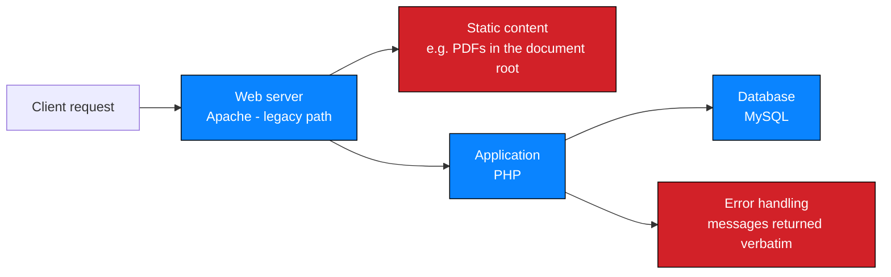

# Procedure 2 — Web application testing

Application mapping, request handling, error behaviour and technology inference.

> **Authorisation precondition.** Active testing of in-scope application
> functionality under written authorisation, with data-handling rules agreed in
> advance.

---

## 1. Objective

Understand how the application handles requests, and identify where its trust
decisions are made.

---

## 2. Request-handling model

Mapping this before testing exposes two distinct trust boundaries:

| Boundary | Where the application makes a decision | Where it does not |
| --- | --- | --- |
| **Application boundary** | The login form, and any endpoint that checks a session | Static files — no code runs, so no check occurs |
| **Infrastructure boundary** | The web server's configuration | Where a backup file sits, whether indexing is on |

> The engagement's most serious finding existed entirely **outside** the
> application boundary. Testing that stops at the login form would never have
> reached it.

---

## 3. Procedure

| # | Step | Action | Output |
| --- | --- | --- | --- |
| 1 | Map reachable functionality | Manual navigation of unauthenticated surfaces | Functional inventory |
| 2 | Capture representative requests | Record method, path, parameters, headers, response code | Request baseline |
| 3 | Probe error handling | Trigger errors at each input and observe the response | Error-behaviour matrix |
| 4 | Review authentication boundaries | Where does the application decide who you are? | Trust-boundary map |
| 5 | Identify parameters | Every input, its type, and where it is used | Parameter inventory |
| 6 | Infer technology | Only from what the application itself returns | Labelled inference |
| 7 | Record untested parameters | Which inputs were never exercised | Hypothesis register |

---

## 4. Error handling as a testing surface

Errors are frequently returned to the client verbatim in training and legacy
applications. Where that occurs they become an information channel.

### 4.1 What the engagement learned from one error

| Detail in the error | What it revealed |
| --- | --- |
| Driver name | Server-side language and DB abstraction |
| Engine reference | Database engine |
| `near '''` position marker | Exactly where input entered the query |
| `at line 1` | Single-line statement construction |

> One returned error confirmed injection **and** identified the query's structure.
> No automated exploitation was needed to establish anything. This is the strongest
> argument for minimal validation: the error did the work.

### 4.2 Handling rules

| Rule | Reason |
| --- | --- |
| Never paste production-shaped data into a third-party service to analyse an error | Disclosure risk — see [`reporting.md`](./reporting.md) §6 |
| Record errors as evidence, verbatim where safe | They are the finding's substance |
| Redact internal hostnames and paths | They aid lateral movement |
| Do not treat error verbosity as a standalone Critical finding | In isolation it is Low/Medium. Its weight comes from what it accompanies |

---

## 5. Technology inference versus fingerprinting

| | Inference | Fingerprinting |
| --- | --- | --- |
| Basis | Something the application returned | Active probes against version endpoints and headers |
| Engagement use | ✅ PHP/MySQL inferred from the `mysqli_query()` error text | ❌ Not performed |
| Confidence | Medium — plausible, unconfirmed | High — explicit version response |
| Reported as | Labelled inference | Observed fact |

> The engagement did **not** fingerprint the server, framework, CMS or runtime, and
> records that as a limitation rather than filling the gap with a guess. Root causes
> are stated as *probable* with a named confirmation step.

---

## 6. Parameter inventory

For each input, record:

| Field | Purpose |
| --- | --- |
| Parameter | Name and location — query, body, header, path |
| Type | Expected format |
| Handling observed | How errors surfaced |
| Tested | ✅ / ❌ |
| Finding | Linked ID, or `n/a` |

> In this engagement the login form's `password` parameter was **not separately
> tested**. It is recorded as untested rather than implicitly safe — the query was
> built by concatenation, so a `password` weakness is likely but unproven. That is
> hypothesis H-6 in the M1 analysis, not a negative result.

---

## 7. Excluded techniques

| Excluded | Reason |
| --- | --- |
| Automated scanners | Unbounded request volume; manual correlation required |
| Fuzzing frameworks | Off-target and availability risk |
| Denial-of-service / stress | Prohibited |
| Parameter pollution campaigns | Beyond the validation objective |
| Source-code review | No access — root causes remain probable |

---

## 8. Common mistakes

| Mistake | Consequence | Practice used here |
| --- | --- | --- |
| Testing only where code runs | Missed the backup entirely | Legacy and static paths assessed directly |
| Assuming a parameter is safe because it was not the one that broke | `password` untested is untested, not safe | Untested parameters recorded as hypotheses |
| Reporting inferred technology as fact | Overstates confidence | Inference labelled; fingerprinting recorded as not performed |
| Treating error verbosity as cosmetic | Missed that the error revealed query structure | Errors analysed as a data channel |
| Continuing after the weakness was proven | Unnecessary data handling | Minimal validation; exploitation halted |

---

## 9. Engagement application

| Output | Where recorded |
| --- | --- |
| Functional and path inventory | [`../milestones/M1-initial-access/attack-surface.md`](../milestones/M1-initial-access/attack-surface.md) |
| Parameter handling and injection testing | [`../milestones/M1-initial-access/vulnerability-analysis.md`](../milestones/M1-initial-access/vulnerability-analysis.md) |
| Controlled validation record | [`../milestones/M1-initial-access/proof-of-concept.md`](../milestones/M1-initial-access/proof-of-concept.md) |
| Technology inference and limitations | [`../milestones/M1-initial-access/README.md`](../milestones/M1-initial-access/README.md) |
| Stack inference | [`../docs/tools-and-technologies.md`](../docs/tools-and-technologies.md) |

---

## 10. Checklist

- [ ] Authorisation and data-handling rules confirmed
- [ ] Functional map built before any injection testing
- [ ] Trust boundaries identified, including infrastructure-only paths
- [ ] Error behaviour probed at each input
- [ ] Every parameter inventoried, including untested ones
- [ ] Technology inference labelled as inference
- [ ] Testing halted once each weakness was substantiated
- [ ] Excluded techniques and reasons recorded