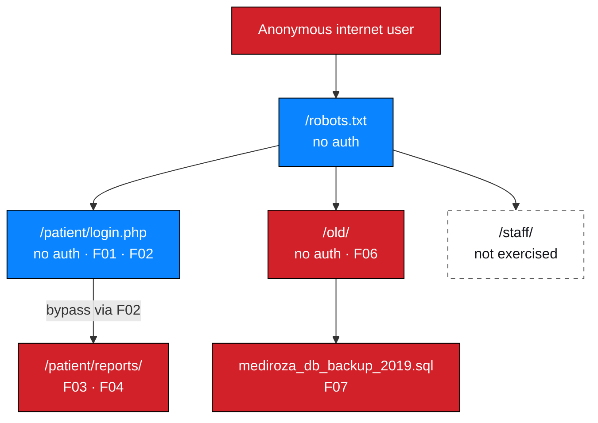

# M1 — Attack Surface Inventory

**Milestone:** Initial Access · **Status:** ✅ Documented

> **Scope note.** This inventory covers the **authorized host only**. No subdomain
> enumeration, port scanning or external asset discovery was performed. Absence of
> a row means "not identified", not "does not exist".

---

## 1. Confirmed attack surface

| # | Path | Type | Auth | Sensitivity | Findings | Tested |
| --- | --- | --- | --- | --- | --- | --- |
| 1 | `/robots.txt` | Static text | None | Low — discloses structure | Contributed to F06/F07 | ✅ |
| 2 | `/patient/` | Entry / redirect | None | Medium — indicates a protected area | Led to F01–F03 | ✅ |
| 3 | `/patient/login.php` | Login form | None | **High** — authentication control | **F01, F02** | ✅ |
| 4 | `/patient/reports/` | Document store | Yes (bypassed) | **Critical** — patient documents | **F03, F04** | ✅ |
| 5 | `/old/` | Directory index | None | **Critical** — legacy area | **F06, F07** | ✅ (M3) |
| 6 | `/staff/` | Unknown | Unknown | Unknown | — | ❌ Not exercised |

---

## 2. Detail per surface element

### 2.1 `/robots.txt`

| Attribute | Value |
| --- | --- |
| Type | Static text file |
| Authentication | None |
| Content | `Disallow: /patient/`, `Disallow: /staff/`, `Disallow: /old/` |
| Weakness | Sensitive path disclosure to unauthenticated users |
| Contributing to | F06, F07 (correlation) |
| Evidence | `NW-B083-M1-E01` |

### 2.2 `/patient/`

| Attribute | Value |
| --- | --- |
| Type | Entry point resolving to the login form |
| Authentication | None |
| Role | Led directly to the authentication surface |
| Evidence | `NW-B083-M1-E02` |

### 2.3 `/patient/login.php`

| Attribute | Value |
| --- | --- |
| Type | Server-side PHP login form |
| Authentication | None (it *is* the authentication control) |
| Parameters | `username`, `password` |
| Behaviour observed | Distinct error messages per failure mode; unsanitised input reaching a SQL query; verbose DB errors returned to the client |
| Findings | **F01** (enumeration), **F02** (injection → bypass) |
| Evidence | `NW-B083-M1-E02`–`E06` |
| Notes | `.php` extension confirms PHP; `mysqli_*` in the error confirms the MySQL extension rather than PDO |

### 2.4 `/patient/reports/`

| Attribute | Value |
| --- | --- |
| Type | Authenticated document store |
| Authentication | Required — defeated via F02 |
| Contents | 3 password-protected PDFs (`LAB-PDF-01`…`03`) |
| Findings | **F03** (access control), **F04** (key strength) |
| Evidence | `NW-B083-M1-E07`, `E08` |
| Notes | Documents were retrieved but **never opened**. Content is out of scope for analysis and is not published. |

### 2.5 `/old/`

| Attribute | Value |
| --- | --- |
| Type | Legacy directory with an autoindex |
| Authentication | **None** |
| Content observed | `mediroza_db_backup_2019.sql` |
| Findings | **F06** (directory listing), **F07** (cleartext backup) |
| Evidence | `NW-B083-M3-E03`, `E04`, `E05`, `E06` |
| Notes | Disclosed in `robots.txt` at M1 Step 1; exercised in M3 after two independent signals pointed at it |

### 2.6 `/staff/`

| Attribute | Value |
| --- | --- |
| Type | **Unknown — not requested** |
| Authentication | Unknown |
| Content | **Not determined. Not assumed.** |
| Findings | None |
| Status | Observation only |

> **Deliberate restraint.** A path name does not justify a request. Testing it
> would require it to be confirmed in scope; it was disclosed in the same file as
> the paths that were in scope, but its content class was never established, and
> no evidence pointed to it. The correct professional action is to record it as an
> untested surface element and recommend it as follow-up — not to explore it
> because it looked interesting.

---

## 3. Parameters observed

| Endpoint | Parameter | Type | Handling observed | Concern |
| --- | --- | --- | --- | --- |
| `/patient/login.php` | `username` | Text | Concatenated into a SQL query; reflected in an error message | **Critical** (F02) |
| `/patient/login.php` | `password` | Text | Compared in the same query; predicate removable by comment | **Critical** (F02) |

No further endpoints were mapped. Crawling, content discovery and parameter
enumeration beyond the login form were **not performed**.

---

## 4. Technology inferences

> **Inferences from an error string — not fingerprinted.** See
> [`../../docs/tools-and-technologies.md`](../../docs/tools-and-technologies.md) §6.

| Layer | Inference | Basis |
| --- | --- | --- |
| Language | PHP | `login.php`, `mysqli_query()` |
| Database | MySQL | `...corresponds to your MySQL server version...` |
| Data-access API | `mysqli` (native) rather than PDO | Function name in the error |
| Framework / CMS | Unknown | Not identified |
| Web server | Unknown | Not identified |
| TLS configuration | Not assessed | — |
| Security headers | Not assessed | — |

---

## 5. Attack surface analysis

**Key observation.** Every element in the critical path — `robots.txt`, the login
page, the portal, `/old/` and the backup — was reachable **without
authentication at any point**. The single control that stood between an anonymous
user and every finding in this report was the login check at
`/patient/login.php`.

---

## 6. Coverage assessment

| Attack-surface class | Coverage | Note |
| --- | --- | --- |
| Public text files | ✅ Full | `robots.txt` retrieved |
| Authentication surface | ✅ Full | Login form tested |
| Document store | ✅ Full | Retrieved post-bypass |
| Legacy areas | ✅ Full | `/old/` reviewed in M3 |
| Staff area | ❌ None | Not exercised |
| Subdomains | ❌ None | Not enumerated — out of scope |
| Ports and services | ❌ None | Not scanned — out of scope |
| JavaScript and client-side assets | ❌ None | Not reviewed |
| API surface | ❌ None | None identified |
| Upload functionality | ❌ None | None identified |
| TLS and header configuration | ❌ None | Not assessed |
| Authentication flows beyond login | ❌ None | No registration, reset or MFA flow was present or tested |

**Overall surface coverage: partial.** Six elements confirmed out of an unbounded
surface. Findings below reflect only what was exercised — absence of further
findings is **not** evidence that further weaknesses do not exist.

---

## 7. Outstanding surface questions

| # | Question | Why it matters | Follow-up |
| --- | --- | --- | --- |
| 1 | What does `/staff/` contain and how is it protected? | Disclosed path, entirely unassessed | Confirm scope, then assess |
| 2 | Are documents addressable by predictable identifiers? | The backup pattern suggests a simple path scheme; predictable document URLs would mean IDOR risk beyond the login bypass | Test object-level authorisation with two accounts |
| 3 | Is the injection reachable from parameters other than `username`? | Any additional injectable parameter widens the attack surface considerably | Review all entry points |
| 4 | Do TLS configuration and response headers meet expectations? | Unassessed; cheap to check; affects several weakness classes | TLS and header review |
| 5 | What is the underlying stack? | Determines which framework-specific weaknesses apply | Fingerprinting |
| 6 | Do other legacy paths exist outside `robots.txt`? | `robots.txt` is not exhaustive | Content discovery, rate-limited and authorised |

---

## 8. Evidence

| Evidence ID | Surface element | Artifact |
| --- | --- | --- |
| `NW-B083-M1-E01` | `/robots.txt` | ❌ Not attached |
| `NW-B083-M1-E02` | `/patient/login.php` | ❌ Not attached |
| `NW-B083-M1-E03`, `E04` | Login error responses | ❌ Not attached |
| `NW-B083-M1-E05` | SQL error output | ❌ Not attached |
| `NW-B083-M1-E06` | Portal post-bypass | ❌ Not attached |
| `NW-B083-M1-E07`, `E08` | Document downloads | ❌ Not attached |
| `NW-B083-M3-E03`, `E04` | `/old/` directory index and backup download | ❌ Not attached |

Registration: [`../../evidence/evidence-register.csv`](../../evidence/evidence-register.csv)
