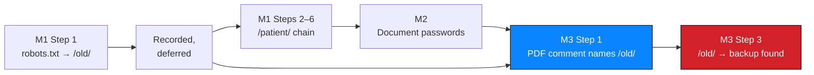

# M1 — Reconnaissance

**Milestone:** Initial Access · **Step:** 1 of 6 · **Status:** ✅ Executed

---

## 1. Objective

Establish what is publicly discoverable about the target without authentication,
and determine where testing should begin.

---

## 2. Action

```bash
curl https://medirozahospital.com/robots.txt
```

Observed output:

```
Disallow: /patient/ Disallow: /staff/ Disallow: /old/
```

Evidence: `NW-B083-M1-E01`

---

## 3. Analysis

### 3.1 What a robots file is for

The robots exclusion protocol is an **advisory** mechanism: it asks compliant
crawlers not to index or fetch listed paths. It is not an access control.

The critical property for an assessor is that its purpose is *exclusion*. Every
`Disallow` line is the site owner's own statement that a path is not intended for
general visibility. That makes a robots file one of the highest-signal documents
on a web server — an uncredentialed, low-cost, high-yield starting point.

### 3.2 What was disclosed

| Path | Signal strength | Handling |
| --- | --- | --- |
| `/patient/` | **Very high** — a patient area implies an authenticated store behind it | Followed immediately |
| `/staff/` | High — implies a staff-facing area with its own access control | Recorded; **not exercised** |
| `/old/` | **Very high** — legacy path, and legacy paths are where backups are left | Recorded; followed in M3 after an independent clue confirmed it |

### 3.3 What was correctly *not* inferred

| Not concluded | Why |
| --- | --- |
| `/staff/` contains staff records | The path name is not evidence of content |
| `/old/` contains a database backup | Discovered in M3 — not assumed in M1 |
| Disabling robots protection would grant access | Directories were reachable regardless of the file's contents |
| Any content inside these paths | Discovered only by requesting them, and only where in scope |

---

## 4. Why this step mattered so much

The final report's critical findings sit in `/old/`, and M1 disclosed `/old/` in
its first request. What made that useful was **not** acting on it immediately —
it was recording it and still having it two milestones later when the PDF metadata
comment named the same location.



Two independent discoveries converged on one location. Either alone was an
observation; together they were a Critical finding.

---

## 5. Value assessment

| Measure | Result |
| --- | --- |
| Requests | 1 |
| Authentication required | None |
| Time | Seconds |
| Significant paths identified | 3 of the 3 that mattered |
| Findings enabled directly | F01, F02, F03 (via `/patient/`) |
| Findings enabled indirectly | F06, F07 (via `/old/`) |

Cost-to-yield: one unauthenticated request led to every Critical finding in the
report.

---

## 6. Reusable lesson

> **Treat every disclosure artefact as an attack map.** Fetch `robots.txt`,
> `sitemap.xml`, `.well-known/`, security.txt, HTTP headers and error pages
> *first*, and **record everything** — including paths that are not relevant yet.
> Reconnaissance that discards a finding because it is not useful *today* throws
> away the correlation that makes it useful later.

---

## 7. Evidence

| Evidence ID | Description | Artifact |
| --- | --- | --- |
| `NW-B083-M1-E01` | Terminal output of `curl https://medirozahospital.com/robots.txt` | ❌ Not attached |

Registration: [`../../evidence/evidence-register.csv`](../../evidence/evidence-register.csv)
