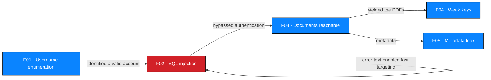

# M1 — Vulnerability Analysis

**Milestone:** Initial Access · **Findings analysed:** `NW-B083-M1-F01`, `NW-B083-M1-F02`
**Status:** ✅ Analysed

---

## 1. Analysis frame

| Weakness class | CWE | OWASP Top 10 (2021) |
| --- | --- | --- |
| Username enumeration | CWE-204 Observable Response Discrepancy | A07 Identification and Authentication Failures |
| SQL injection | CWE-89 Improper Neutralization of Special Elements used in an SQL Command | A03 Injection |

---

## 2. `NW-B083-M1-F01` — Username enumeration on the login page

### 2.1 Description

The authentication handler returns a **different error message depending on which
check failed**, disclosing whether a username exists.

### 2.2 Observation

| Input | Response | Meaning |
| --- | --- | --- |
| `bob` / `test123` | `Username not found` | No such account |
| `admin` / `test123` | `Incorrect password` | Account exists, password wrong |

Two mutually exclusive failure modes produce two distinguishable responses. The
difference is observable by any unauthenticated party and requires no rate,
volume or privilege.

### 2.3 Root cause (probable)

The handler branches on the lookup result — a *not-found* path and a
*wrong-password* path each return their own message. The probable cause is
convenience in the error path rather than an authentication-design decision.

**To confirm:** review the authentication controller for separate branches
producing distinct user-facing messages.

### 2.4 Why the message is wrong, not merely unhelpful

It is tempting to write this up as a cosmetic issue. It is not:

| Property | Consequence |
| --- | --- |
| Differentially observable | Enables offline enumeration of every valid account, one request each |
| No rate limit observed | Enumeration is cheap and fast |
| Distinctive strings | Trivially automated by pattern-matching the two responses |
| Compounds with F02 | Knowing a username converts a blind injection into a targeted one — exactly what happened at M1 Step 4 |

**Root weakness:** *brute-force resistance was designed only as rate limiting, and
assumed account identifiers were secret.* Here the identifier space was exposed.

### 2.5 Severity

| Attribute | Assessment |
| --- | --- |
| Direct impact | Confidentiality of the username namespace |
| Severity band | 🟠 **Medium** |
| Rationale | Directly usable information, but it is information rather than access. Its severity is amplified by the injection found alongside it. |
| Confidence | High — directly observed, twice, deterministically |

CVSS v4.0 derivation: [`../../risk/cvss-assessment.md`](../../risk/cvss-assessment.md)

### 2.6 Remediation

Return **one** message for every failed authentication — identical wording, timing
and formatting regardless of cause:

- ✅ `"Invalid credentials."` for a missing user, a wrong password, or an empty field
- ❌ `"Username not found."`
- ❌ `"Incorrect password."`

Additional measures: normalise response timing between code paths; avoid
redirecting *from* the failure to a distinguishable target; add rate limiting and
lockout with alerting; monitor for enumeration patterns; consider a step-up
challenge for usernames that exist rather than a different error.

---

## 3. `NW-B083-M1-F02` — SQL injection in the login form

### 3.1 Description

The `username` field is incorporated into a SQL query by string concatenation
without parameterisation. A submitted single quote causes a MySQL syntax error,
and a comment marker removes the password comparison from the executed query,
permitting authentication as `admin` without any credential.

### 3.2 Observation

**Stage 1 — injection identified:**

| Input | Response |
| --- | --- |
| `admin'` | `Warning: mysqli_query(): You have an error in your SQL syntax; check the manual that corresponds to your MySQL server version for the right syntax to use near ''' at line 1` |

| Detail | Interpretation |
| --- | --- |
| `mysqli_query()` | PHP, `mysqli` extension — direct query execution, not a prepared statement |
| Syntax error near `'''` | The quote terminated the query's string literal; unterminated syntax followed |
| Error reflected to the client | Verbose database diagnostics exposed to an unauthenticated user |

**Stage 2 — authentication bypass:**

| Input | Result |
| --- | --- |
| `admin' --` / any password | Logged in; portal loaded with three reports listed |

### 3.3 Root cause (probable)

The query is assembled by concatenating request input into a string literal, then
passed to `mysqli_query()` — an API that executes exactly what it is given. Where
a shared query helper or an ORM exists elsewhere in the codebase, this login path
is an outlier that bypassed it.

**To confirm:** review the login handler and check whether parameterised-query
helpers are available but unused here.

### 3.4 Mechanism of the bypass

The intended query has the shape:

```
... WHERE username = '<input>' AND password = '<hash-or-input>'
                    ^^^^^^^^^^^^    ^^^^^^^^^^^^^^^^^^^^^^^^
                     both required  ^^^^^^^^^^^^^^^^^^^^^^^^ removed by --
```

| Fragment | Effect |
| --- | --- |
| `admin` | Literal match against the known-valid account from F01 |
| `'` | Closes the string literal opened by the query's own quoting |
| `--` | Comments out everything remaining in the statement, including the password predicate |

The query's semantics change from `A AND B` to `A`. No password was guessed,
cracked or recovered — the check was deleted from the statement at runtime.

### 3.5 Impact

| Impact area | Assessment |
| --- | --- |
| Authentication | Defeated entirely for any account whose username is known or guessable |
| Confidentiality | Full read access wherever the bypassed account can read |
| Integrity | **Probable but not demonstrated.** No write path was exercised. The same primitive normally permits modification; recorded as *not tested*, not *not possible*. |
| Availability | Not demonstrated. |
| Escalation | The bypass is a foothold, not the ceiling. It led directly to F03, and through the documents to F05–F07. |

### 3.6 Secondary weakness — verbose error disclosure

Database diagnostics are returned verbatim to an unauthenticated client. This
deserves separate treatment, because it is what turned F01 from a guess into a
one-shot attack:

| Benefit to the attacker | Provided |
| --- | --- |
| Fingerprint the database and driver | `MySQL`, `mysqli` |
| Confirm injection without any probing | Syntax error and position marker |
| Locate the injection point | `near ''' at line 1` |
| Infer query structure | Comment marker behaviour |

On a properly parameterised endpoint, the same error would be harmless noise. It
is dangerous **because** the endpoint is injectable. Both must be fixed.

### 3.7 Severity

| Attribute | Assessment |
| --- | --- |
| Severity band | 🔴 **Critical** |
| Rationale | Unauthenticated, remote, low-complexity bypass of authentication on a healthcare application holding patient documents. |
| Confidence | High — bypass executed and its effect observed directly |
| OWASP category | A03 Injection |

CVSS v4.0 derivation: [`../../risk/cvss-assessment.md`](../../risk/cvss-assessment.md)

### 3.8 Remediation

**Primary — remove the primitive:**

```php
// VULNERABLE — input concatenated into the statement
$sql = "SELECT id, role FROM users WHERE username = '" . $username . "' AND password = '" . $hash . "'";
$result = mysqli_query($conn, $sql);

// FIXED — parameterised; the driver sends data and SQL separately
$stmt = mysqli_prepare($conn, "SELECT id, role FROM users WHERE username = ? AND password = ?");
mysqli_stmt_bind_param($stmt, "ss", $username, $hash);
mysqli_stmt_execute($stmt);
```

| # | Requirement |
| --- | --- |
| 1 | Parameterised queries or prepared statements at **every** call site. This includes search, filters, report parameters and any admin tooling — F02 proves the login path, not the whole codebase. |
| 2 | Allow-list validation on identifiers used to build dynamic SQL. |
| 3 | Password verification with `password_verify()` against a `password_hash()`-produced hash, not a SQL comparison. |
| 4 | Disable verbose database errors in production; log server-side only. Set `display_errors=Off` and `log_errors=On`. |
| 5 | Add SAST to CI to detect concatenation into query APIs. |
| 6 | Add a dependency and pattern audit for other query-construction helpers. |
| 7 | Review the whole schema for injection points, since one vulnerable path suggests the pattern may be systemic. |

---

## 4. Hypothesis register

Recorded so the reasoning is auditable, including what was **not** pursued.

| # | Hypothesis | Outcome | Reason |
| --- | --- | --- | --- |
| H-1 | `admin` exists | ✅ Confirmed | Distinct error message — became F01 |
| H-2 | `username` is injectable | ✅ Confirmed | MySQL syntax error — became F02 |
| H-3 | Authentication can be bypassed | ✅ Confirmed | Portal loaded — became F02 |
| H-4 | The password field is also injectable | ⬜ **Not tested** | Injection was proven on `username`; minimal-validation rules ended further probing |
| H-5 | Injection permits data extraction | ⬜ **Not tested** | Not required to substantiate F02; extraction was explicitly out of bounds |
| H-6 | Injection permits data modification | ⬜ **Not tested** | Destructive testing prohibited |
| H-7 | Other accounts are accessible | ⬜ **Not tested** | Only `admin` was attempted; `admin` was sufficient |
| H-8 | Document URLs are predictable (IDOR) | ⬜ **Not tested** | Requires two accounts to test horizontal authorisation properly — see [attack surface §7](./attack-surface.md#7-outstanding-surface-questions) |
| H-9 | `/staff/` contains staff data | ⬜ **Not tested** | Out of exercised scope; recorded as an observation |
| H-10 | Registration or password-reset flows exist | ⬜ **Not tested** | Not present on the pages visited |

> **On withdrawn and untested hypotheses.** H-4 through H-10 were not tested, not
> refuted. A report that implied they had been ruled out would be misleading. Each
> is listed as follow-up work in
> [attack-surface.md §7](./attack-surface.md#7-outstanding-surface-questions) and in
> the report [limitations](../../reports/penetration-testing-report.md).

---

## 5. Cross-finding relationships



**F02 is the root defect of the engagement.** F01 made it targeted; F03 and F04
are its consequences; F05 came from a document F03 exposed.

---

## 6. Findings

| ID | Title | Severity | Record |
| --- | --- | --- | --- |
| `NW-B083-M1-F01` | Username enumeration on login page | 🟠 Medium | [`../../findings/verified-findings/NW-B083-M1-F01-username-enumeration.md`](../../findings/verified-findings/NW-B083-M1-F01-username-enumeration.md) |
| `NW-B083-M1-F02` | SQL injection enabling authentication bypass | 🔴 Critical | [`../../findings/verified-findings/NW-B083-M1-F02-sqli-authentication-bypass.md`](../../findings/verified-findings/NW-B083-M1-F02-sqli-authentication-bypass.md) |
| `NW-B083-M1-F03` | Patient documents accessible after login bypass | 🔴 High | [`../../findings/verified-findings/NW-B083-M1-F03-document-access-control.md`](../../findings/verified-findings/NW-B083-M1-F03-document-access-control.md) |

---

## 7. Evidence

| Evidence ID | Observation | Artifact |
| --- | --- | --- |
| `NW-B083-M1-E03` | `Username not found` for a non-existent account | ❌ Not attached |
| `NW-B083-M1-E04` | `Incorrect password` for an existing account | ❌ Not attached |
| `NW-B083-M1-E05` | `mysqli_query()` syntax error | ❌ Not attached |
| `NW-B083-M1-E06` | Portal rendered after the bypass | ❌ Not attached |

Registration: [`../../evidence/evidence-register.csv`](../../evidence/evidence-register.csv)
