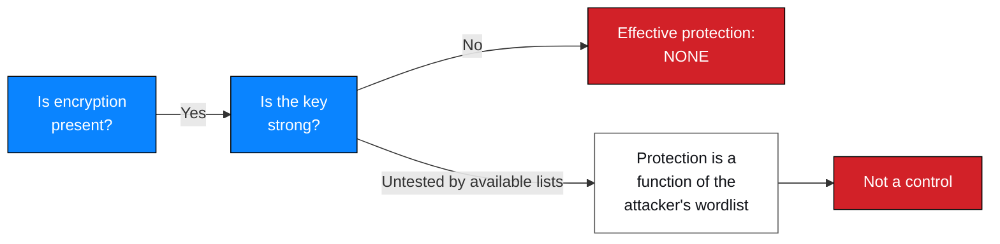

# M2 — Encryption Assessment

**Milestone:** Data Extraction / File Security · **Status:** ✅ Assessed

---

## 1. What was assessed

Whether the encryption applied to the three PDF files is *effective* — not whether
it exists.

Encryption being present is not a finding. It is the absence of a second property
that makes it one.

---

## 2. How PDF password encryption works

| Property | Detail |
| --- | --- |
| Mechanism | Password-based encryption; the document body is encrypted with a key derived from the user password |
| What is stored | The file contains an encrypted body plus enough material to derive and verify a key from a candidate password |
| What "hashing" means here | A cracker derives a candidate key from each guess and compares it against the file's stored material. The password itself is not stored. |
| `$pdf$…` format | The identifier convention used by `hashcat`-family tooling for PDF keys — carries the algorithm identifier, parameters and the derived material |
| Attack model | **Entirely offline.** The attacker needs the file and a wordlist. No service contact, no rate limit, no lockout. |

> **This is the crux of F04.** Because the attack is offline, an application-side
> control — rate limiting, lockout, MFA — provides no protection whatsoever against
> it. The only relevant variables are the key's strength and the attacker's
> wordlist. Every weakness mitigation applied to the *login* in M1 is irrelevant
> here.

---

## 3. Assessment procedure

| # | Step | Activity | Output |
| --- | --- | --- | --- |
| 1 | Acquire | Receive the three files from the M1-reached portal; hash on receipt | Files in possession |
| 2 | Extract | Obtain the `$pdf$` key identifier for each file | Three key identifiers |
| 3 | Baseline recovery | Dictionary attack with the built-in top-100 list | Two of three recovered |
| 4 | Escalation | For the remaining file, escalate to the instructor-supplied JTR list | Third recovered |
| 5 | Verify | Confirm each recovered key actually opens its file | All three verified |
| 6 | Characterise | Assess strength properties without publishing values | Strength profile |
| 7 | Follow-up | Decrypt one file to enable metadata reading | Fed [M3](../M3-critical-data-exposure/) |

Steps 3–5 are recorded in [`results.md`](./results.md). Tools are recorded in
[`tools-and-methods.md`](./tools-and-methods.md).

---

## 4. Method strength and its limits

Stating what the method **cannot** show is part of an honest assessment.

| The method demonstrates | The method does not demonstrate |
| --- | --- |
| The key is recoverable by dictionary attack | That the key has any particular entropy value |
| Recovery cost in the attacker's wordlist order | That no other file in the estate is equally weak |
| That a modest attacker resource suffices | That a weak key is *definitely* in a top-100 list — only that it was, here |
| That key strength is the operative variable | Anything about the encryption algorithm itself, which was never the problem |

### 4.1 Dictionary coverage ladder

| List | Size class | Result against the three files |
| --- | --- | --- |
| Built-in top-100 | ~100 candidates | Recovered `LAB-PDF-01`, `LAB-PDF-02`. Failed on `LAB-PDF-03` |
| Instructor-supplied JTR list | Larger | Recovered `LAB-PDF-03` |

> **Interpretation.** `LAB-PDF-03`'s key sits between these two lists. That places
> an upper bound on its weakness and no lower bound. The correct report statement
> is *"recovered using a moderately sized wordlist"*, not *"strong"*.
>
> A key that survives a large wordlist is only **not recovered by that list**.
> Rule-based mutations, targeted wordlists built from the organisation's own
> vocabulary, and dedicated GPU hardware all extend reach considerably. No claim is
> made here about what those would achieve.

---

## 5. Encryption effectiveness assessment

| # | File | Present | Key strength | Effective protection | Verdict |
| --- | --- | --- | --- | --- | --- |
| 1 | `LAB-PDF-01` | ✅ | ❌ Within a top-100 list | None | **Fail** |
| 2 | `LAB-PDF-02` | ✅ | ❌ Within a top-100 list | None | **Fail** |
| 3 | `LAB-PDF-03` | ✅ | ❌ Recovered from a larger list | Negligible | **Fail** |

### 5.1 Root cause (probable)

| Probable cause | Confidence | Basis |
| --- | --- | --- |
| Passwords chosen for convenience or predictability, with no policy or generator applied to document keys | Medium-high | Three of three weak, two extremely so — a pattern, not an accident |
| Document keys treated as the primary control rather than a secondary one | Medium | Consistent with the files also being served as static content from the web root |
| No key-management process: no generator, no storage, no rotation, no revocation | Medium | Typical where the key is chosen by a person each time a document is issued |

**To confirm:** review how document passwords are chosen, communicated and stored;
establish whether a documented process exists.

---

## 6. Threat model

| Attacker | Capability | Outcome |
| --- | --- | --- |
| **Unauthenticated internet user** | Reach the files only via an authentication bypass | Possible — F02 provides the path |
| **Authenticated low-privilege user** | Already past the login | Possible — downloads files directly, then attacks offline |
| **Recipients of a legitimately issued document** | Possess a valid key | No further barrier; no cryptographic integrity |
| **An attacker holding any copy** | Offline access, unlimited attempts | **Keys recovered in seconds** |
| **Passive observer** | Network position | Depends on transport security — **not assessed in this engagement** |

> The last row is an explicit gap. Whether these documents were served over
> correctly configured TLS was never tested. Given that F02 already granted full
> access, the assessment focused on access control rather than transport. Recorded
> as a limitation in
> [`../../reports/penetration-testing-report.md`](../../reports/penetration-testing-report.md).

---

## 7. Secondary observation — protection as obscurity

`LAB-PDF-03` was encrypted. That encryption also **hid its metadata**, including
the `Author` field and the internal note that led to the Critical findings in M3.

| Assumption | Reality |
| --- | --- |
| "The file is password-protected, so its contents are not readable" | True — and irrelevant. A correct key was recoverable from a larger wordlist. |
| "Encrypting the file hides the internal metadata" | True while the key is unknown. Useless as a control: the key is not a secret when it is dictionary-derived. |
| "Password protection is a reason not to worry about where the file is stored" | Backwards. The file was stored as a static asset inside the web root. |

**This is the practical lesson of M2:** any control whose strength depends on
secrecy must be evaluated against an adversary who will eventually obtain the
secret. When the secret is a dictionary word, "eventually" is a few seconds.

---

## 8. Remediation

| ID | Recommendation | Priority | Verification |
| --- | --- | --- | --- |
| R-7 | Generate document passwords with a CSPRNG at full printable-ASCII length | **P0** | Re-run dictionary recovery; key must survive |
| R-8 | Store keys in a secrets manager; transmit out of band | P1 | Key never present in a URL, filename, mail body or chat |
| R-9 | Enforce authorisation server-side; treat the document password as secondary | **P0** | Unauthenticated request for a document returns 401/403 |
| R-10 | Move documents outside the web root | **P0** | Direct path returns 404 |
| R-11 | Set an organisational policy forbidding a shared password across documents | P1 | Spot-check for reuse |
| R-12 | Apply PDF permission restrictions as defence in depth | P2 | Confirm restrictions take effect |
| R-13 | Alert on bulk document downloads | P1 | Threshold test raises an alert |
| R-14 | Establish a documented key-management process with an owner | P2 | Process document exists and is followed |

### 8.1 Retest criteria

| Criterion | Method | Pass condition |
| --- | --- | --- |
| Keys resist dictionary attack | Re-run hash extraction and recovery with the JTR list **plus** a rule-based mutation pass | No key recovered |
| Keys resist targeted attack | Attempt recovery with a wordlist derived from the organisation's own vocabulary and any publicly visible internal naming | No key recovered |
| Access control is server-side | Request a document path with no session | 401/403, not the file |
| Web root contains no documents | Request the document path directly | 404 |
| Keys are unique per document | Compare across the estate | No reuse |
| Bulk download alerts | Download the full document set in one session | Alert raised and reviewed |

> **State retest results precisely.** "Not recovered with the JTR list and a
> mutation pass" is a true and useful statement. "Strong" is not, because
> unrecovered ≠ uncrackable.

---

## 9. Evidence

| Evidence ID | Description | Artifact |
| --- | --- | --- |
| `NW-B083-M2-E01` | `$pdf$` key identifiers extracted | ❌ Not attached |
| `NW-B083-M2-E02` | `LAB-PDF-01` key recovery | ❌ Not attached |
| `NW-B083-M2-E03` | `LAB-PDF-02` key recovery | ❌ Not attached |
| `NW-B083-M2-E04` | `LAB-PDF-03` wordlist exhaustion then recovery | ❌ Not attached |
| `NW-B083-M2-E05` | `qpdf` decryption of `LAB-PDF-03` | ❌ Not attached |

Registration: [`../../evidence/evidence-register.csv`](../../evidence/evidence-register.csv)
Redaction requirements: [`evidence/README.md`](./evidence/README.md) §4
