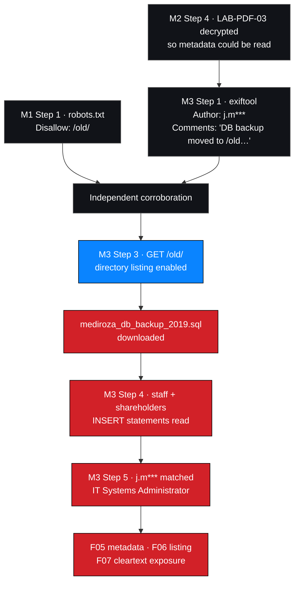

# M3 — Deep Reconnaissance and Critical Data Exposure

**Milestone status:** ✅ Complete · **Steps executed:** 5 of 5
**Findings produced:** `NW-B083-M3-F01`, `NW-B083-M3-F02`, `NW-B083-M3-F03`

---

## 1. Objective and scope

**Objective.** Follow the metadata clue from the decrypted document to its source,
and assess the exposure of staff compensation and shareholder information.

This milestone is framed two ways in the engagement record — *deep reconnaissance*
as the method, and *critical data exposure* as the outcome. Both framings are kept
here, because the method and the result are separately reportable.

### Data-handling rules applied throughout

| Rule | Implementation |
| --- | --- |
| Prove, do not harvest | Only the `staff` and `shareholders` `INSERT` statements were extracted |
| No bulk export | No full database dump, no complete table extraction |
| No content publication | Table **schemas** and **data classes** only. No names, salaries, percentages or share classes |
| Identity masked in publication | The identified account is rendered `j.m***` |
| Corroborate, then stop | One record matched to establish role, then analysis halted |
| LLM disclosure recorded | The AI-tooling step is documented with its data-handling caveat — [evidence §5](./evidence.md) |

**No actual salary figure, shareholder name, share percentage or share class
appears anywhere in this repository.**

---

## 2. Outcome in brief

`exiftool` on the decrypted `LAB-PDF-03` returned two fields:

| Field | Value | Published here |
| --- | --- | --- |
| `Author` | `j.malik` | 🔒 Masked as `j.m***` |
| `Comments` | `DB backup moved to /old before site migration, do not delete` | ✅ Quoted in full — this is the finding |

The comment named `/old/` — a path `robots.txt` had disclosed in the very first
request of M1, two milestones earlier.

`/old/` had **directory listing enabled** and served
`mediroza_db_backup_2019.sql`. The file was a database backup in raw text form.
Its `INSERT` statements contained staff salary records and shareholder data in
**cleartext**, readable by anyone who could reach the URL.

---

## 3. The chain

**Two independent paths converged on `/old/`.** The metadata comment, found on
Day 4, and the `robots.txt` disclosure, found on Day 1. Either alone would have
been an observation. Together they made a Critical finding — and the client would
have had no way of knowing that both existed.

---

## 4. Findings

| ID | Title | Severity | Evidence |
| --- | --- | --- | --- |
| `NW-B083-M3-F01` | Sensitive metadata retained in a patient PDF | 🟠 Medium | `E01`, `E02` |
| `NW-B083-M3-F02` | Legacy folder with directory listing enabled | 🔴 Critical | `E03`, `E04` |
| `NW-B083-M3-F03` | Staff salaries and shareholder data in cleartext backup | 🔴 Critical | `E05`, `E06`, `E07` |

Records: [`../../findings/verified-findings/`](../../findings/verified-findings/)

---

## 5. Why this is the most important milestone

Three properties separate F06 and F07 from everything else in the report.

### 5.1 No authentication was required at any point

| Step | Authentication |
| --- | --- |
| Read the metadata | None — the file was already held |
| Request `/old/` | **None** |
| Download the backup | **None** |
| Read salaries and shareholdings | **None** |

The M1 bypass was not required. An anonymous internet user who guessed the URL, or
who read it in `robots.txt` on Day 1, reached payroll and shareholder data without
touching the login page at all.

### 5.2 The data was high-value

| Data class | Why it matters |
| --- | --- |
| Staff compensation | Personal financial data about identifiable individuals. Enables targeting, extortion and insider recruitment. |
| Job title and department | Org-chart disclosure; maps who holds which system access. |
| Shareholdings and share classes | Confidential corporate governance data. Market-sensitive, and disclosure-controlled in many jurisdictions. |

### 5.3 The exposure was trivially wide

| Property | Value |
| --- | --- |
| URL complexity | None — a short, guessable path |
| Attack cost | One unauthenticated HTTP request |
| Tooling required | A browser |
| Skill required | None |
| Rate limit encountered | None |
| Volume available | The **entire** backup — not a single record |

---

## 6. Data minimisation applied — record of decisions

| Decision point | Rejected | Chosen | Rationale |
| --- | --- | --- | --- |
| After seeing the directory index | Download every file in `/old/` | Download only the backup | The backup is the finding; other files were not assessed |
| After downloading the backup | Read the whole file | Extract only the `staff` and `shareholders` `INSERT` statements | Those two tables constitute the exposure |
| After confirming the tables | Full row extraction | Minimal extraction sufficient to prove readability | A single row proves cleartext exposure |
| After proving readability | Transcribe rows into the report | **Publish schemas only** | Publication is where most engagements leak |
| At the identity correlation | Build a profile of the individual | Match one record, establish role, stop | Role was the point; a profile was not |
| Throughout | Send the data to an LLM | Used once, recorded the caveat | See [evidence §5](./evidence.md) |

> **The principle.** Minimisation decided *at collection time* is a technical
> control. Minimisation decided *before publication* is a promise. Only the first
> one actually limits exposure.

---

## 7. Remediation

| ID | Recommendation | Priority |
| --- | --- | --- |
| R-5 | Strip metadata on document export as a pipeline step | P2 |
| R-6 | **Disable directory listing on every directory** | **P0** |
| R-7 | **Remove all backups from the web root**; store encrypted, off-box, access-controlled | **P0** |
| R-15 | Establish a lifecycle owner for migration leftovers, with a deletion deadline | **P0** |
| R-16 | Add an automated external-exposure scan on a schedule, alerting on `.sql`, `.bak`, `.zip`, `.dump` and directory indexes | **P0** |
| R-17 | Add a CI/CD gate blocking deployment of database dumps or archives into a web root | P1 |
| R-18 | Inventory all personal and financial data held, and document its retention basis | P1 |
| R-19 | Review who had access to the backup and when | **P0** |
| R-20 | Treat the exposure as a potential reportable incident and assess notification duties | **P0** |
| R-21 | Review whether similar backups exist on other hosts | P1 |
| R-22 | Alert on access to legacy paths | P2 |

Full plan: [`../M4-final-report/remediation-plan.md`](../M4-final-report/remediation-plan.md)

---

## 8. Evidence index

| Evidence ID | Description | Finding | Sensitivity | Artifact |
| --- | --- | --- | --- | --- |
| `NW-B083-M3-E01` | `exiftool` output showing the `Author` field | F05 | 🟠 Personal | ❌ |
| `NW-B083-M3-E02` | `exiftool` output showing the internal note in `Comments` | F05 | 🔴 Internal | ❌ |
| `NW-B083-M3-E03` | Directory index at `/old/` listing the backup | F06 | 🔴 Internal | ❌ |
| `NW-B083-M3-E04` | Download of `mediroza_db_backup_2019.sql` | F06, F07 | 🔴 Confidential | ❌ |
| `NW-B083-M3-E05` | `staff` table schema and data classes | F07 | 🔴 Confidential | ❌ |
| `NW-B083-M3-E06` | `shareholders` table schema and data classes | F07 | 🔴 Confidential | ❌ |
| `NW-B083-M3-E07` | Identity correlation against one staff record | F05, F07 | 🔴 Personal | ❌ |
| `NW-B083-M3-E08` | Cross-reference to `NW-B083-M1-E01` (`robots.txt` `/old/` disclosure) | F06 | 🟠 Internal | ❌ |

Policy: [`evidence/README.md`](./evidence/README.md) ·
Handling: [`evidence.md`](./evidence.md)

---

## 9. Milestone conclusion

A comment field inside a document led to a directory that led to a database
backup that contained the compensation of every member of staff and the
shareholding structure of the organisation. None of it required authentication.

The three findings form a causal chain, and the report presents them as one:

| Finding | Role |
| --- | --- |
| **F05** — metadata retained in a patient document | The **lead**. Supplied the internal location and an identity. |
| **F06** — directory listing on a legacy folder | The **amplifier**. Turned a path into a browsable file list. |
| **F07** — cleartext backup in the web root | The **impact**. Payroll and shareholder data, anonymously readable. |

Remediating any one of the three would have broken the chain. All three are
reported, because a client that fixes only the visible symptom will be exposed
again by the next stale artefact.

---

## 10. Documents in this milestone

| Document | Contents |
| --- | --- |
| [`exposure-analysis.md`](./exposure-analysis.md) | Step-by-step discovery record and chain analysis |
| [`impact-assessment.md`](./impact-assessment.md) | Confidentiality and privacy impact, business consequence |
| [`data-classification.md`](./data-classification.md) | Schema and data-class mapping — **no values** |
| [`evidence.md`](./evidence.md) | Redacted evidence narrative, handling standard, LLM caveat |
| [`evidence/README.md`](./evidence/README.md) | Evidence register and redaction requirements |
