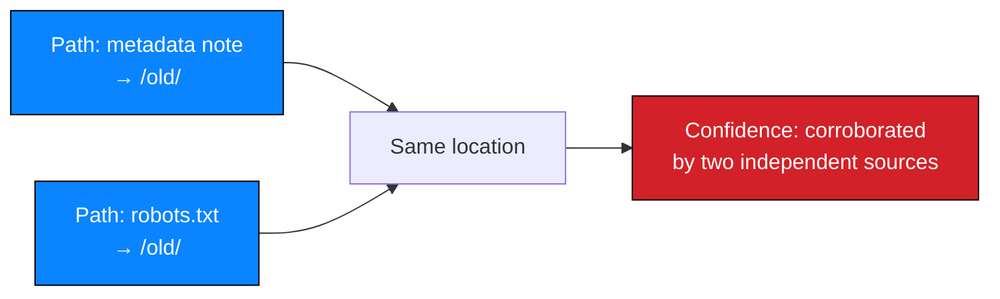
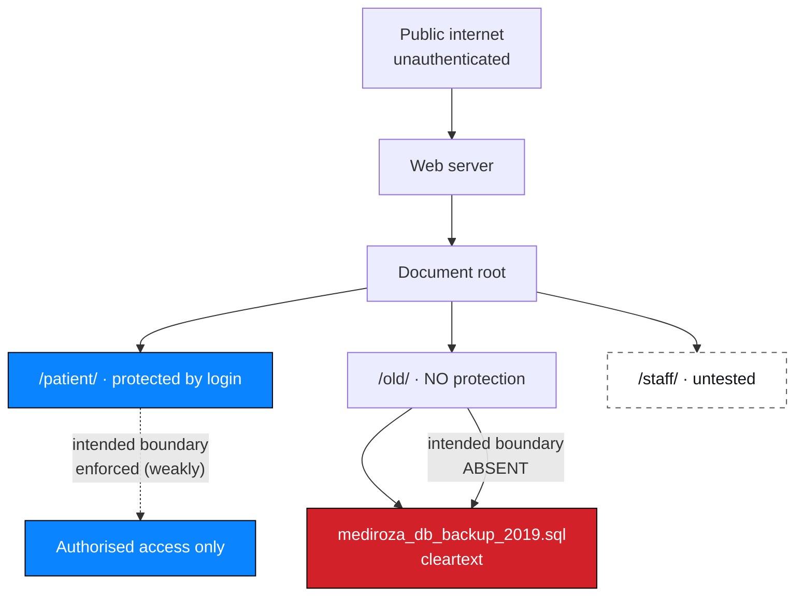

# M3 — Exposure Analysis

**Milestone:** Deep Reconnaissance / Critical Data Exposure · **Status:** ✅ Documented

---

## 1. Discovery summary

| Item | Detail |
| --- | --- |
| Discovery vector | PDF metadata — an internal note in a document's `Comments` field |
| Corroborating vector | `robots.txt` disclosure from M1 Step 1 |
| Target resource | `mediroza_db_backup_2019.sql`, served from `/old/` |
| Authentication required | **None at any stage** |
| Data exposed | Staff compensation records; shareholder register |
| Data format | Cleartext SQL `INSERT` statements |
| Estimated age | 2019, by filename — **age not independently verified** |
| Findings | `NW-B083-M3-F01`, `F02`, `F03` |

---

## 2. Step-by-step record

### Step 1 — Metadata extraction

A locked PDF exposes almost no metadata, which is why [M2 Step 4](../M2-data-extraction/README.md)
produced a decrypted copy of `LAB-PDF-03` first:

```bash
exiftool report3_open.pdf
```

Fields of interest:

| Field | Value | Sensitivity |
| --- | --- | --- |
| `Author` | `j.malik` — 🔒 masked as `j.m***` | 🟠 Identifies a staff account |
| `Comments` | `DB backup moved to /old before site migration, do not delete` | 🔴 Internal operational detail |

### 2.1 Why the comment matters more than the author

| Field | What it yields | Value as a lead |
| --- | --- | --- |
| `Author` | An account identifier | 🟠 Moderate. Suggests a person, but gives no path onward |
| `Comments` | **An internal filesystem location, a migration event, and a retention belief** | 🔴 **Decisive.** It names exactly where to look next |

The comment contains four separable pieces of attacker value:

1. **`/old/`** — a concrete, actionable internal location
2. **`DB backup`** — an explicit statement that a database backup exists
3. **`before site migration`** — a timeframe, and evidence of leftover infrastructure
4. **`do not delete`** — the belief that the artefact was still needed, i.e. it was probably never reviewed

> **Generalisable point.** Free-text metadata fields are used as scratch space, and
> people write what is on their mind. In this engagement, one such note was the
> entire difference between an unreachable backup and a Critical finding.

Evidence: `NW-B083-M3-E01`, `E02`

### Step 2 — Cross-check against reconnaissance

`/old/` had been disclosed in `robots.txt` at **M1 Step 1**:

```
Disallow: /patient/ Disallow: /staff/ Disallow: /old/
```

Evidence: `NW-B083-M3-E08` (cross-referencing `NW-B083-M1-E01`)



| Source | Independence |
| --- | --- |
| PDF `Comments` field | Written by a person into a document |
| `robots.txt` `Disallow` | Served by the web server as configuration |
| **Assessment** | **Independent.** Two different systems, two different authors, one agreement. This is corroboration, not repetition. |

> **The lesson worth taking from M1.** `/old/` was disclosed in the first request
> of the engagement and acted upon in the fourth milestone. Reconnaissance that
> discards a lead because it is not useful *now* discards the corroboration that
> makes it valuable later.

### Step 3 — Requesting the legacy folder

```
https://medirozahospital.com/old/
```

Observed: a **directory index** — the web server rendered a file listing because
no index page existed.

| Item | Value |
| --- | --- |
| Files listed | `mediroza_db_backup_2019.sql` |
| Authentication | **None** |
| Enumeration required | None — the server listed the contents itself |
| Obfuscation | None |

**The weakness.** Directory listing converts a path into a browsable catalogue. It
means an attacker does not need to guess filenames, and — more damagingly — it
converts one *known* path into a *complete inventory* of everything in that
directory.

> **The configuration mistake.** `Options +Indexes` / autoindex is a default that
> nobody deliberately enables for a production directory. It survives because
> disabling it is nobody's job and the directory works fine without anyone noticing.

Evidence: `NW-B083-M3-E03`

### Step 4 — Acquiring and reading the backup

```bash
wget https://medirozahospital.com/old/mediroza_db_backup_2019.sql
```

A `.sql` file is a database backup as raw text: `CREATE` statements defining tables
followed by `INSERT` statements carrying row data. Dense, but trivially readable
once the `INSERT` lines are isolated.

#### 4.1 Minimisation applied at this step

| Action | Performed | Note |
| --- | --- | --- |
| Download the backup | ✅ | This *was* the substantiation of the finding |
| Read the whole file | ❌ | No |
| Extract all tables | ❌ | No |
| Extract `staff` `INSERT` rows | ✅ | Constitutes the exposure |
| Extract `shareholders` `INSERT` rows | ✅ | Constitutes the exposure |
| Retain the extracted rows | ❌ | Used to prove readability, then discarded |
| Publish any value | ❌ | **No salary, name, percentage or share class appears in this repository** |

#### 4.2 What was established

| Question | Answer |
| --- | --- |
| Is the data readable without decryption? | **Yes.** Cleartext SQL. |
| Is it complete enough to be meaningful? | **Yes** — names, job titles, departments, monthly salaries; shareholder names, share percentages, share classes |
| Is it structured? | **Yes** — normal relational `INSERT` rows, immediately queryable |
| Is it anonymised? | **No.** Real identifiers against real values |
| Is it current? | **Unknown.** The filename says 2019. Staleness is **not** established and must not be assumed — see §5 |

Evidence: `NW-B083-M3-E04`, `E05`, `E06`

### Step 5 — Closing the identity chain

`Author: j.malik` was matched against the `staff` table.

| Attribute | Value |
| --- | --- |
| Match | ✅ Positive |
| Role | IT Systems Administrator |
| Consistency | An IT administrator moving a database backup during a site migration is exactly what the `Comments` field described |
| Further analysis | **None.** One record was enough to establish role; no profile was built. |

**What the correlation establishes:**

| # | Proposition | Supported? |
| --- | --- | --- |
| 1 | The PDF author is an employee in the `staff` table | ✅ Yes |
| 2 | That person is the IT Systems Administrator | ✅ Yes |
| 3 | That person moved the backup to `/old/` | ✅ Consistent with role and comment; not directly observed |
| 4 | That person intended the backup to remain | ✅ The note says so |

> **Propositions 3 and 4 are inferences.** A matching name is strong evidence of
> identity, not proof of a specific action at a specific time. The report states
> these as consistent-with rather than proven, and does not attribute intent or
> fault to an individual. **An exposure finding is an organisational control
> failure, not a personal one.**

Evidence: `NW-B083-M3-E07`

---

## 3. Affected security boundary



| Boundary | Intended | Actual |
| --- | --- | --- |
| Internet → web root | Public | ✅ Public |
| Web root → `/patient/` | Authentication required | ⚠️ Required but bypassable — [F02](../../findings/verified-findings/NW-B083-M1-F02-sqli-authentication-bypass.md) |
| Web root → `/old/` | Not publicly reachable | ❌ **No boundary at all** |
| Backup → database | Not reachable by anyone but the DBA | ❌ Reachable anonymously, in cleartext |
| `/staff/` | Protected | ❓ **Unknown — not exercised** |

**The boundary that failed is the one that was never drawn.** No control existed
between the public web root and the backup. There was nothing to bypass because
there was nothing to configure.

---

## 4. Root-cause analysis

Black-box testing cannot confirm root cause. Each cause is stated as **probable**,
with the confirmation step named.

| # | Probable cause | Confidence | To confirm |
| --- | --- | --- | --- |
| 1 | Directory listing (`autoindex`) left enabled on the legacy vhost or directory | High — directly observed behaviour | Review the web server configuration for `Options +Indexes` / `Indexes` |
| 2 | The backup was written into a path inside the web root | High — the file was served by the web server | Review the backup/sync job destination |
| 3 | The backup contains unencrypted, unredacted personal and financial data | High — cleartext observed | Confirm no encryption step exists in the job |
| 4 | No cleanup after the site migration | Medium-high — the note says "moved… do not delete" and the file is dated 2019 | Review migration runbooks and post-migration tasks |
| 5 | No owner accountable for legacy artefacts | Medium — the pattern implies it | Confirm whether any process assigns ownership |
| 6 | No external exposure monitoring | Unknown — **not tested** | Review whether such monitoring exists |
| 7 | A deployment process permits database artefacts into a web-servable path | Medium-high — the file exists there | Review CI/CD configuration and deployment scripts |

### 4.1 The systemic root cause

Causes 4, 5 and 7 are one problem: **migration leftovers have no lifecycle owner.**

| Symptom | Underlying cause |
| --- | --- |
| The backup is still there | Nothing was tasked to remove it |
| It is still in a web-servable path | The migration moved the site, not the data |
| Nobody noticed for an extended period | No owner, therefore no review |

Two further controls would each have broken the chain independently:

| Control | Which finding it prevents |
| --- | --- |
| Directory listing disabled | F06 — an attacker could not enumerate the folder |
| Backups prohibited from the web root | F07 — the file would not be served at all |

Neither was in place. Both are configuration, and both are cheap. That is the
finding for management: **this was not an exotic failure, it was an absent default.**

---

## 5. Limitations of this analysis

| # | Limitation | Consequence |
| --- | --- | --- |
| 1 | Data currency unverified | The filename says 2019. **Staleness must not be assumed** — stale payroll data is still personal financial data, and current roles may be more sensitive, not less. Currency requires client confirmation. |
| 2 | Only two tables extracted | Other tables were not examined; the full extent of exposure is **at least** this large |
| 3 | No assessment of who else has access | Web server logs were not reviewed |
| 4 | No verification of other hosts or paths | Exposure elsewhere is unknown |
| 5 | No file-hash verification of the backup | Its provenance and whether it is the live data set are unconfirmed |
| 6 | No active directory or internal recon | Out of scope; the file's contents describe the org, but pursuing it would be beyond authorisation |
| 7 | No `/staff/` assessment | Out of exercised scope |
| 8 | No determination of who downloaded it before discovery | **Unknown and unknowable from application-layer evidence.** The absence of evidence of prior access is not evidence of absence — a Critical consideration for the client |

---

## 6. Why severity is Critical

| Factor | Assessment |
| --- | --- |
| Attack vector | Remote, anonymous |
| Complexity | Trivial — one HTTP request |
| Privileges required | None |
| User interaction | None |
| Data sensitivity | 🔴 High — personal financial data and confidential corporate governance data |
| Volume | Entire backup, not a single record |
| Stealth required | None |
| Detectability of the attack | Low — a plain GET against a static file |
| Detectability of the *condition* | Very low without external monitoring — nothing alerts on a public file |

Any one of these would be a High. Together they are Critical.

---

## 7. Recommendations

Ordered by effectiveness, not by CVSS:

| Order | Action | Why first |
| --- | --- | --- |
| 1 | **Remove the backup from the web root immediately** | Eliminates the exposure in one action |
| 2 | **Disable directory listing everywhere** | Eliminates F06 and removes the inventory that made this trivial |
| 3 | **Assess notification obligations** | May be time-bound; delaying is itself a decision |
| 4 | **Review access logs for that path** | Determines who may already have downloaded it |
| 5 | Assign an owner and deadline for every legacy artefact | Addresses the systemic cause |
| 6 | Schedule external exposure monitoring | Prevents recurrence |
| 7 | Add a CI/CD gate against web-root artefacts | Prevents recurrence at source |
| 8 | Strip metadata on document export | Removes the lead that started this chain |
| 9 | Inventory personal and financial data with a retention basis | Reduces the blast radius of the next incident |
| 10 | Confirm data currency with the client | Determines whether this is historic or current |

Full plan: [`../M4-final-report/remediation-plan.md`](../M4-final-report/remediation-plan.md)

---

## 8. Evidence

| Evidence ID | Description | Artifact |
| --- | --- | --- |
| `NW-B083-M3-E01` | `Author` metadata field | ❌ Not attached |
| `NW-B083-M3-E02` | `Comments` metadata field — the internal note | ❌ Not attached |
| `NW-B083-M3-E03` | Directory index at `/old/` | ❌ Not attached |
| `NW-B083-M3-E04` | Backup download | ❌ Not attached |
| `NW-B083-M3-E05` | `staff` schema and data classes | ❌ Not attached |
| `NW-B083-M3-E06` | `shareholders` schema and data classes | ❌ Not attached |
| `NW-B083-M3-E07` | Identity correlation | ❌ Not attached |
| `NW-B083-M3-E08` | Cross-reference to the `robots.txt` disclosure | ❌ Not attached |

Registration: [`../../evidence/evidence-register.csv`](../../evidence/evidence-register.csv)
