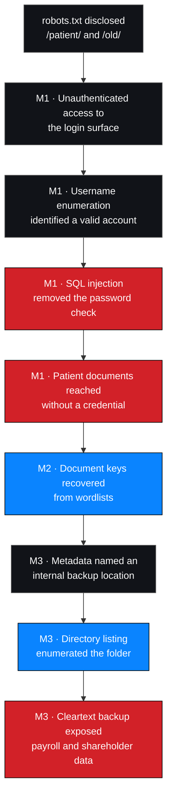

# M4 — Penetration Testing Report

**Milestone status:** ✅ Complete (draft for review)
**Findings consolidated:** 7 — 🔴 Critical 3 · 🔴 High 2 · 🟠 Medium 2

---

## 1. Objective

Consolidate M1, M2 and M3 into a single deliverable: scope, methodology, findings
with evidence and risk ratings, impact analysis, prioritised remediation, retest
requirements, limitations and appendices.

---

## 2. Deliverables in this milestone

| # | Document | Audience | Purpose |
| --- | --- | --- | --- |
| 1 | [`executive-summary.md`](./executive-summary.md) | Management | What was found, why it matters, what to do |
| 2 | [`scope-and-methodology.md`](./scope-and-methodology.md) | Technical / auditor | What was in scope, how it was tested |
| 3 | [`technical-findings.md`](./technical-findings.md) | Technical | Full finding records |
| 4 | [`risk-assessment.md`](./risk-assessment.md) | Technical / management | Severity, CVSS v4.0 vectors, confidence, prioritisation |
| 5 | [`remediation-plan.md`](./remediation-plan.md) | Technical / management | Prioritised actions with owners and retest criteria |
| 6 | [`conclusion.md`](./conclusion.md) | All | Overall assessment, residual risk, sign-off status |
| 7 | [`appendices.md`](./appendices.md) | All | Evidence register, ID schemes, glossary, references |

Additionally:

| Document | Purpose |
| --- | --- |
| [`../../reports/penetration-testing-report.md`](../../reports/penetration-testing-report.md) | The complete report as a single document |
| [`../../reports/management-summary.md`](../../reports/management-summary.md) | One-page non-technical summary |
| [`../../reports/remediation-tracker.csv`](../../reports/remediation-tracker.csv) | Action tracker |

---

## 3. Findings consolidated

| # | ID | Title | Severity | Milestone |
| --- | --- | --- | --- | --- |
| 1 | `NW-B083-M1-F01` | Username enumeration on login page | 🟠 Medium | M1 |
| 2 | `NW-B083-M1-F02` | SQL injection enabling authentication bypass | 🔴 Critical | M1 |
| 3 | `NW-B083-M1-F03` | Patient documents accessible after login bypass | 🔴 High | M1 |
| 4 | `NW-B083-M2-F01` | Weak document passwords recoverable from wordlists | 🔴 High | M2 |
| 5 | `NW-B083-M3-F01` | Sensitive metadata retained in a patient PDF | 🟠 Medium | M3 |
| 6 | `NW-B083-M3-F02` | Legacy folder with directory listing enabled | 🔴 Critical | M3 |
| 7 | `NW-B083-M3-F03` | Staff salaries and shareholder data in cleartext backup | 🔴 Critical | M3 |

Records: [`../../findings/verified-findings/`](../../findings/verified-findings/)

---

## 4. The central message of the report

The seven findings are **not seven independent defects**. They form one chain.

**Every link in this chain is a control that failed.** No exotic technique was
used, no vulnerability was found in a third-party product, and no privilege was
escalated beyond what one bypass granted. Three of the seven were configuration or
process failures — disabled defaults and an artefact nobody owned.

That is the report's most useful conclusion for management: **this was not an
advanced attack, and it is not expensive to fix.**

---

## 5. Root cause concentration

| Root cause | Findings | Fix once and all are addressed? |
| --- | --- | --- |
| Unsanitised input reaching a SQL query | F02 | ✅ Partially — other injectable parameters were not tested |
| Documents served as static files from the web root | F03, F04 | ✅ Yes |
| No metadata stripping in the export path | F05 | ✅ Yes |
| Directory listing enabled | F06 | ✅ Yes |
| Backups permitted inside the web root | F06, F07 | ✅ Yes |
| No owner or lifecycle for migration leftovers | F06, F07 | ✅ Yes — the systemic cause |
| Distinct authentication error messages | F01 | ✅ Yes |
| Verbose database errors returned to the client | F02 | ✅ Yes |

**Seven root causes account for seven findings.** None requires architectural
change. Six are configuration; one is a query pattern.

---

## 6. Prioritisation

| Priority | Actions | Rationale |
| --- | --- | --- |
| **P0 — immediate** | Remove the backup; disable directory listing; parameterise the login query; disable verbose errors; move documents out of the web root | Closes the chain at every exploitable link |
| **P1 — days** | Alerting on bulk access and enumeration; secrets management for document keys; review prior access to the exposed file; CI gate against web-root artefacts | Detection and recurrence prevention |
| **P2 — weeks** | Generic authentication errors; metadata stripping in the export pipeline; rate limiting; SAST in CI | Defence in depth and hygiene |
| **P3 — ongoing** | External exposure monitoring; data inventory and retention; document signing; periodic retest | Programme maturity |

Tracker: [`../../reports/remediation-tracker.csv`](../../reports/remediation-tracker.csv)

---

## 7. Outstanding before this report can be issued

| # | Item | Status |
| --- | --- | --- |
| 1 | Attach sanitised evidence artifacts for all 7 findings | ❌ **Outstanding** — 22 observations registered, 0 artifacts attached |
| 2 | Convert provisional CVSS v4.0 ratings to confirmed scores | ❌ **Outstanding** — vectors derived; compute with the FIRST calculator |
| 3 | Assign remediation owners and target dates | ❌ Outstanding |
| 4 | Reconcile the batch number (B082 vs B083) | ❌ Outstanding |
| 5 | Confirm data currency of the exposed backup with the client | ❌ Outstanding — affects notification scope |
| 6 | Obtain client sign-off on the report and its classification | ❌ Outstanding |
| 7 | Complete the publication checklist before any public release | ❌ Outstanding |

> **Items 1 and 2 are the reason the findings are labelled Documented rather than
> Verified.** Publishing a Critical finding with no attached artifact is
> indefensible in a client report, however sound the reasoning. The analysis here
> is complete; the evidence attachment is not.

---

## 8. Distinguishing verified results from unverified claims

Applied consistently throughout every document in this milestone:

| Category | Content | Treatment |
| --- | --- | --- |
| **Documented** | The seven findings, each tied to an observed output | Reported with evidence IDs; confidence High |
| **Probable root cause** | Why each weakness exists | Labelled *probable*; confirmation step named |
| **Observation** | `/staff/` disclosed but unassessed; verbose errors | Reported as observation, not as a finding |
| **Untested hypothesis** | H-4 to H-10 in [M1 analysis](../M1-initial-access/vulnerability-analysis.md#4-hypothesis-register) | Listed as untested, never as ruled out |
| **Limitation** | No fingerprinting, no dates, no bulk extraction, no evidence artifacts | Stated in [conclusion](./conclusion.md) and the full report |
| **Inference** | PHP/MySQL stack, inferred from an error string | Labelled as inference, not fingerprinting |

---

## 9. Documents in this milestone

| Document | Contents |
| --- | --- |
| [`executive-summary.md`](./executive-summary.md) | Business-level summary |
| [`scope-and-methodology.md`](./scope-and-methodology.md) | Scope, authorisation, method as applied |
| [`technical-findings.md`](./technical-findings.md) | All seven finding records |
| [`risk-assessment.md`](./risk-assessment.md) | Severity, vectors, confidence, prioritisation |
| [`remediation-plan.md`](./remediation-plan.md) | 22 prioritised actions with retest criteria |
| [`conclusion.md`](./conclusion.md) | Overall assessment, residual risk, limitations |
| [`appendices.md`](./appendices.md) | Registers, ID schemes, glossary, references |
