# Appendices

Registers, identifier schemes, glossary and references for engagement `NW-B083`.

---

## Appendix A — Finding register

| ID | Title | Severity | Rating | Verification | Record |
| --- | --- | --- | --- | --- | --- |
| `NW-B083-M1-F01` | Username enumeration on login page | 🟠 Medium | Confirmed | Documented | [Open](../../findings/verified-findings/NW-B083-M1-F01-username-enumeration.md) |
| `NW-B083-M1-F02` | SQL injection enabling authentication bypass | 🔴 Critical | Confirmed | Documented | [Open](../../findings/verified-findings/NW-B083-M1-F02-sqli-authentication-bypass.md) |
| `NW-B083-M1-F03` | Patient documents accessible after login bypass | 🔴 High | Provisional | Documented | [Open](../../findings/verified-findings/NW-B083-M1-F03-document-access-control.md) |
| `NW-B083-M2-F01` | Weak document passwords recoverable from wordlists | 🔴 High | Provisional | Documented | [Open](../../findings/verified-findings/NW-B083-M2-F01-weak-document-passwords.md) |
| `NW-B083-M3-F01` | Sensitive metadata retained in a patient PDF | 🟠 Medium | Confirmed | Documented | [Open](../../findings/verified-findings/NW-B083-M3-F01-sensitive-pdf-metadata.md) |
| `NW-B083-M3-F02` | Directory listing enabled on a legacy web root | 🔴 Critical | Provisional | Documented | [Open](../../findings/verified-findings/NW-B083-M3-F02-directory-listing-legacy-folder.md) |
| `NW-B083-M3-F03` | Unencrypted database backup exposed in a legacy web root | 🔴 Critical | Confirmed | Documented | [Open](../../findings/verified-findings/NW-B083-M3-F03-cleartext-database-backup-exposure.md) |

**Distribution:** 🔴 Critical 3 · 🔴 High 2 · 🟠 Medium 2 · 🟢 Low 0
Machine-readable: [`../../risk/risk-register.csv`](../../risk/risk-register.csv)

---

## Appendix B — Evidence register

22 observations. **Zero artifacts attached.**

| Range | Milestone | Count | Artifacts |
| --- | --- | --- | --- |
| `NW-B083-M1-E01` … `E08` | M1 Initial Access | 8 | 0 |
| `NW-B083-M2-E01` … `E06` | M2 Data Extraction | 6 | 0 |
| `NW-B083-M3-E01` … `E08` | M3 Critical Data Exposure | 8 | 0 |

Full register with data class, redaction requirement and sanitization status:
[`../../evidence/evidence-register.csv`](../../evidence/evidence-register.csv) ·
Procedure to attach artifacts: [`../../evidence/README.md`](../../evidence/README.md) §5

---

## Appendix C — Identifier schemes

```
Finding    NW-B083-<MS>-F<nn>       NW-B083-M1-F02
Evidence   NW-B083-<MS>-E<nn>       NW-B083-M1-E05
Action     R-<nn>                   R-07
Hypothesis H-<nn>                   H-6
Artifact   NW-B083-<MS>-E<nn>_<slug>.<ext>
Milestone  M1 · M2 · M3 · M4
```

| Rule | Reason |
| --- | --- |
| IDs are never reused | Reissue makes old evidence appear to support a newer claim |
| IDs are stable once published | Cross-references must keep resolving |
| Withdrawn findings keep their record | An auditable trail of what was refuted is part of the assessment |
| IDs encode no severity or data class | That metadata belongs in a register column |
| Filenames encode no sensitivity | Filenames leak through directory listings |

---

## Appendix D — Status vocabulary

| Term | Meaning | Count |
| --- | --- | --- |
| **Documented** | The engagement record contains the observed output | 7 |
| **Evidence-attached** | A sanitised, reviewed artifact exists and is referenced | 0 |
| **Verified** | Evidence-attached and independently reviewed against the claim | 0 |
| **Confirmed rating** | Every CVSS metric input is evidenced | 4 |
| **Provisional rating** | One or more metric inputs missing or uncertain | 3 |
| **Observed** | Directly seen in the record | — |
| **Probable root cause** | Inferred; a named confirmation step is required | 7 |
| **Hypothesis** | Plausible and untested | H-4 … H-10 |
| **Not tested** | Explicitly out of the performed set | 9 areas |
| **PENDING** | Required input unavailable; the exact need is named | CVSS scores |
| **UNKNOWN** | Not recorded and not inferable | Dates, tool versions |

---

## Appendix E — Hypothesis register

Untested possibilities carried forward. **None is a finding; none is ruled out.**

| ID | Hypothesis | Would be closed by |
| --- | --- | --- |
| H-1 | Weak document keys exist elsewhere in the estate | Key audit |
| H-2 | Documents carry additional metadata fields | Full metadata review |
| H-3 | Additional legacy paths or web roots exist | Web-root inventory |
| H-4 | The injection is reachable from other parameters | Parameter-by-parameter testing |
| H-5 | The injection permits modification | Controlled demonstration |
| H-6 | The `password` parameter is separately injectable | Direct test of the field |
| H-7 | Other accounts are reachable by the same route | Second-account testing |
| H-8 | Documents are reachable with no session at all | Single unauthenticated request |
| H-9 | Document identifiers are predictable | Enumeration test |
| H-10 | The undetermined table in the backup holds sensitive data | Schema review under authorisation |

Source: [`../M1-initial-access/vulnerability-analysis.md`](../M1-initial-access/vulnerability-analysis.md) §4

---

## Appendix F — Timeline

| Milestone | Focus | Output |
| --- | --- | --- |
| M1 | Reconnaissance, attack surface, authentication | Enumeration and injection findings; documents obtained |
| M2 | Document encryption and key strength | Key recovery for all three; decryption for metadata analysis |
| M3 | Deep reconnaissance and exposure analysis | Metadata lead; directory listing; backup exposure |
| M4 | Consolidation, rating, remediation, reporting | 7 findings; risk assessment; 39-action plan |

Recorded step-by-step execution: [`../../docs/testing-timeline.md`](../../docs/testing-timeline.md)

---

## Appendix G — Data-handling summary

| Category | Published here |
| --- | --- |
| Recovered document passwords | **Withheld** — strength class only |
| `$pdf$` key identifiers | **Withheld** |
| Patient content | **Never published** — documents were not opened |
| Salary figures | **Withheld** — schema and counts only |
| Shareholder names, percentages, classes | **Withheld** — schema and counts only |
| `INSERT` row contents | **Withheld** — table schemas only |
| Identified staff member | **Masked** — `j.m***`, referred to by role |
| Backup file and PDFs | **Not committed** — gitignored |
| Evidence artifacts | **None present** |
| Table of undetermined purpose | **Disclosed as an open question**, not omitted |

Policy: [`../../docs/ethical-considerations.md`](../../docs/ethical-considerations.md) ·
register fields: [`../../evidence/README.md`](../../evidence/README.md) §4

---

## Appendix H — Glossary

| Term | Meaning in this report |
| --- | --- |
| **Attack surface** | The set of reachable endpoints and resources |
| **Authorisation check** | Server-side decision permitting an action |
| **Cleartext** | Data stored or transmitted without encryption |
| **Comment truncation** | Using a comment marker to remove the remainder of a SQL statement, including a security predicate |
| **CSPRNG** | Cryptographically secure pseudorandom number generator |
| **CVSS v4.0** | Common Vulnerability Scoring System, version 4.0 |
| **Data class** | Category of data by sensitivity: none, internal, personal, clinical, financial |
| **Directory listing / autoindex** | A web server rendering a directory's contents when no index file exists |
| **Document root / web root** | The directory tree a web server serves |
| **Enumeration (usernames)** | Determining which account names exist |
| **Exploit vs. primitive** | The primitive is the weakness; the exploit is its use to gain something |
| **Parameterised query** | A query in which data is sent separately from SQL text |
| **Retention** | How long data is kept before deletion |
| **Session cookie** | The token identifying an authenticated browser session |
| **Static file** | A file served directly by the web server, with no application code executing |

Full glossary: [`../../docs/glossary.md`](../../docs/glossary.md)

---

## Appendix I — Framework references

| Framework | Where used |
| --- | --- |
| OWASP WSTG | Test phases — [`../../docs/methodology.md`](../../docs/methodology.md) |
| PTES | Engagement lifecycle — [`../../methodology/`](../../methodology/) |
| OWASP Top 10 (2021) | Finding categories A01, A02, A03, A05, A07 |
| OWASP ASVS | Retest pass conditions |
| CVSS v4.0 | Vectors — [`../../risk/cvss-assessment.md`](../../risk/cvss-assessment.md) |
| FIRST CVSS calculator | <https://www.first.org/cvss/calculator/4.0> |

---

## Appendix J — Tools referenced

| Tool | Purpose | Repository role |
| --- | --- | --- |
| `curl`, `wget` | Retrieval | Referenced only |
| Web browser | Manual navigation | Referenced only |
| Networkwalks Hash Calculator | `$pdf$` identifier extraction | Referenced only |
| Networkwalks Password Cracker | Wordlist recovery | Referenced only |
| `qpdf` | Decryption | Referenced only |
| `exiftool` | Metadata inspection | Referenced only |
| Python 3 (stdlib) | Repository QA, defensive sanitisation | **Shipped** — offline only |
| Git, GitHub Actions | Version control, documentation gate | **Shipped** |

Detail and rejected categories: [`../../docs/tools-and-technologies.md`](../../docs/tools-and-technologies.md)

---

## Appendix K — Repository map

```mermaid
flowchart TB
    ROOT["NW-B083 documentation repository"]
    ROOT --> DOCS["docs/ · governance"]
    ROOT --> MS["milestones/ · M1 M2 M3 M4"]
    ROOT --> FND["findings/ · 7 records + template"]
    ROOT --> EVD["evidence/ · standard + register"]
    ROOT --> RPT["reports/ · client deliverables"]
    ROOT --> MTH["methodology/ · 7 procedures"]
    ROOT --> RSK["risk/ · method + CVSS + register"]
    ROOT --> DIA["diagrams/ · Mermaid sources"]
    ROOT --> SCR["scripts/ · Python QA + redaction"]
    ROOT --> TPL["templates/ · reusable documents"]
    ROOT --> GH[".github/ · CI gate + issue templates"]

    classDef a fill:#0A84FF,color:#ffffff,stroke:#000000;
    classDef b fill:#111318,color:#ffffff,stroke:#0A84FF;
    class ROOT a;
    class MS,FND,EVD,RPT a;
    class DOCS,MTH,RSK,DIA,SCR,TPL,GH b;
```



---

## Appendix L — Open items requiring a decision

| # | Item | Decision needed from | Current handling |
| --- | --- | --- | --- |
| 1 | Batch reference B082 vs B083 | Instructor / provider | Repository uses `NW-B083`; discrepancy documented |
| 2 | CVSS base scores | Assessor | Pending — official calculator required |
| 3 | Evidence artifacts | Assessor / reviewer | `artifact_present=NO` on all 22 rows |
| 4 | Remediation owners and dates | Client | `UNASSIGNED` |
| 5 | Report format conformity | Instructor / client | Expanded format used |
| 6 | Client classification decision | Client | Not made |
| 7 | Breach-notification decision | Client | Out of scope; flagged |
| 8 | Data currency of the backup | Client | Unknown; affects notification scope |
| 9 | Purpose of the undetermined table | Client | Open question H-10 |

Full list: [`../../README.md`](../../README.md) §15

---

## Appendix M — Confidentiality declaration

- [x] No credential published in any form
- [x] No patient content published
- [x] No salary figure published
- [x] No shareholder record published
- [x] No backup row content published
- [x] Identified individual masked and referred to by role
- [x] No evidence artifact present, and none simulated
- [x] No base score, owner, date or sign-off invented
- [x] No client approval claimed
- [x] Synthetic content labelled at point of use