# Executive summary

**Engagement:** Networkwalks — Mediroza General Hospital Penetration Testing
**Engagement ID:** `NW-B083`
**Target:** `https://medirozahospital.com` (authorised training environment)
**Type:** Black-box web application assessment
**Duration:** 5 business days · 4 milestones
**Findings:** 7 — 🔴 Critical 3 · 🔴 High 2 · 🟠 Medium 2
**Verification status:** 7 Documented · 0 Evidence-attached · 0 Verified

---

## 1. What was found

An anonymous party with no credentials, no tools beyond a browser and `curl`, and no
scanning could reach the entire application database.

The path was not subtle. `robots.txt` disclosed three application paths on the first
request of the engagement. The login page revealed which usernames were real. A
single crafted input removed the password check from the login query. Everything
afterwards followed from those three observations.

```mermaid
flowchart LR
    A["robots.txt<br/>3 paths disclosed"] --> B["Login page<br/>enumerated a valid account"]
    B --> C["One crafted input<br/>authentication bypassed"]
    C --> D["Patient documents<br/>downloaded"]
    D --> E["Document keys<br/>recovered from wordlists"]
    E --> F["Metadata named<br/>a backup location"]
    F --> G["Directory listing<br/>revealed the filename"]
    G --> H["Database downloaded<br/>cleartext, anonymously"]

    classDef crit fill:#D22128,color:#ffffff,stroke:#000000;
    classDef step fill:#111318,color:#ffffff,stroke:#555555;
    class C,H crit;
    class A,B,D,E,F,G step;
```

---

## 2. The three Critical findings

| # | Finding | Why it is Critical |
| --- | --- | --- |
| 1 | **SQL injection enabling authentication bypass** | Defeats the authentication control in two requests, with no credential. The login form is the application's front door |
| 2 | **Directory listing on a legacy web root** | Disclosed the location and filename of a database backup to anyone who asked. No guessing required |
| 3 | **Unencrypted database backup in a web root** | The entire database — clinical, personal-finance and corporate-governance data — was downloadable anonymously and opened without a password |

> **The second and third are one incident.** Fixing the directory listing alone would
> have hidden the index. The backup would still have been there, reachable if the
> filename were ever guessed or indexed elsewhere.

---

## 3. Business consequence

| Data exposed | Category | Consequence |
| --- | --- | --- |
| Patient records and contact details | 🔴 Clinical / personal | Notifiable breach. Potential harm to patients. Regulatory exposure |
| Staff compensation data | 🟠 Financial | Employment-relations exposure; coercion risk; insider sensitivity |
| Shareholder and ownership data | 🟠 Corporate governance | Governance and market-sensitivity concerns |
| Internal account and infrastructure names | 🟠 Internal | Credential attacks against other systems |

**The exposure required no privilege, no malware, no exploit framework and no
specialised tooling.** Every other finding in this engagement had at least one
control that partially worked. This one had none.

> **Data-handling obligations survive remediation.** Removing the file does not
> discharge any notification duty arising from its exposure.

---

## 4. What makes this an easy fix

Six of the eight root causes are configuration or process, not code.

| Root cause | Fix | Effort |
| --- | --- | --- |
| Input concatenated into a SQL query | Parameterised statements everywhere | Small — a code pattern change |
| Verbose database errors returned to clients | Disable `display_errors` in production | One configuration line |
| Documents served as static files from the web root | Move to private storage; serve through an authorising endpoint | Small |
| Directory listing enabled | `Options -Indexes` at the top level | One configuration line |
| Backups permitted inside the web root | Store off-web-root, encrypted, with retention | Small, plus process |
| Migration left artefacts nobody owned | Decommissioning as a signed-off step | Process only |
| Distinct login error messages | One generic failure message | Trivial |
| No metadata stripping | Strip on export, automatically | Small |

**None requires architectural change. The most consequential exposure — an
unencrypted database backup served to the internet — is fixed by moving one file.**

---

## 5. Priority actions

| Priority | Actions |
| --- | --- |
| **P0 — immediate** | Remove the backup from the web root and purge caches; assess breach-notification obligations; disable directory listing; parameterise the login query; disable verbose errors; move documents out of the web root behind an authorising endpoint |
| **P1 — days** | Review access logs for retrieval of the backup; rotate any credentials it contained; alerting on bulk document access and enumeration; secrets management for document keys; CI gate preventing artefacts in web roots |
| **P2 — weeks** | Generic authentication errors; metadata stripping in the export pipeline; rate limiting; SAST in CI |
| **P3 — ongoing** | External exposure monitoring; data inventory, minimisation and retention; document signing; periodic retest |

---

## 6. The single most important recommendation

> **Move the backup. Then search every web-served path for others.**

Removing the file is the action. The **filesystem search** is what proves the fix.
Retesting only the known URL would pass while a second copy remained at a filename
nobody had guessed — which is exactly the situation that produced this finding.

---

## 7. Assessment status

| Item | Status |
| --- | --- |
| Findings | 7 documented; **0 verified** — no sanitised evidence artifact has been supplied |
| CVSS v4.0 | 7 vectors derived; **0 base scores computed**, deliberately |
| Evidence | 22 observations registered; **0 artifacts attached** |
| Remediation | Prioritised with retest criteria; **no owners or dates assigned** |
| Remediation retested | **No** — all fixes are recommendations, not verified changes |
| Client review | **None.** No approval or sign-off is claimed |
| Batch reference | Discrepancy open — source record says B082, project brief says B083 |

> **Stating this plainly:** the analysis is complete and the reasoning is auditable.
> The evidence attachment is not. In a client report, a Critical finding with no
> artifact is indefensible however sound the reasoning — which is why the status
> appears on every record rather than once in a preamble.

---

## 8. What was not assessed

| Area | Status |
| --- | --- |
| Object-level authorisation between accounts | Not tested — one account only |
| Unauthenticated access to known document URLs | Not tested — the reason one rating is provisional |
| Predictability of document identifiers | Not tested |
| Session management and identifier rotation | Not tested |
| Rate limiting, lockout and CAPTCHA | Not tested by design — lockout testing risks denying a clinician access |
| Fingerprinting of server, framework, CMS, runtime | Not performed |
| Full enumeration of the legacy directory | Not performed |
| One table's purpose in the backup | Not determined |
| Any host other than the authorized target | Out of scope |

> Untested is not the same as safe. None of the above is claimed as secure.

---

## 9. Bottom line

| Question | Answer |
| --- | --- |
| Could an anonymous party reach patient and financial data? | **Yes, and it was demonstrated.** |
| Was advanced capability required? | **No.** Browser, `curl`, and reading what the application returned |
| Is the exposure still present? | Unknown — this is a point-in-time assessment and no retest has been performed |
| Is remediation cheap? | **Yes.** The critical exposure is one misplaced file; the Critical injection is a code-pattern change |
| Can this repository's findings be treated as verified? | **No.** They are documented. The distinction is deliberate and tracked per finding |

---

## Related documents

| Document | Audience |
| --- | --- |
| [`risk-assessment.md`](./risk-assessment.md) | Technical and management — severity reasoning, vectors |
| [`technical-findings.md`](./technical-findings.md) | Technical — full records |
| [`remediation-plan.md`](./remediation-plan.md) | Owners — actions, priorities, retest criteria |
| [`../../reports/management-summary.md`](../../reports/management-summary.md) | Management — one page |
| [`../../risk/risk-register.csv`](../../risk/risk-register.csv) | Tracking — machine-readable register |