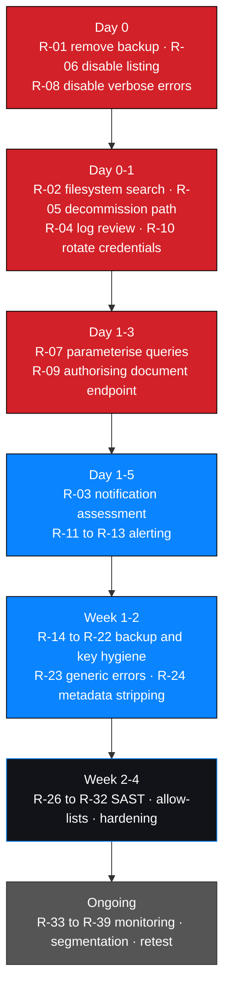

# Remediation plan

Prioritised actions with owners, retest criteria and sequencing.

> **No action below has been performed or verified.** Owners and target dates are
> `UNASSIGNED` because no owner information exists in the engagement record. A
> recommendation is not a fix; a fix is not demonstrated until its retest criteria
> pass.

---

## 1. Priority model

| Priority | Meaning | Window |
| --- | --- | --- |
| **P0** | Immediate. Exploitable now, or a root cause of other findings | Same day |
| **P1** | Detection and recurrence prevention | Days |
| **P2** | Defence in depth and hygiene | Weeks |
| **P3** | Programme maturity | Ongoing |

Sequencing principle: **close the exposed data first, then close the paths that reach
it, then the paths that make it reachable cheaply, then the weaknesses that made it
discoverable.**

---

## 2. P0 — immediate

| # | Action | Fixes | Effort | Owner | Due | Retested |
| --- | --- | --- | --- | --- | --- | --- |
| R-01 | Remove the backup from the web root; purge CDN, proxy and browser caches | `M3-F03` | Minutes | UNASSIGNED | UNASSIGNED | ❌ |
| R-02 | **Search every web-served path** for dumps, archives and binaries | `M3-F03` | Hours | UNASSIGNED | UNASSIGNED | ❌ |
| R-03 | Assess breach-notification obligations; treat all data in the file as compromised | `M3-F03` | Days | UNASSIGNED | UNASSIGNED | ❌ |
| R-04 | Review access logs for retrieval of the file by third parties | `M3-F03` | Hours | UNASSIGNED | UNASSIGNED | ❌ |
| R-05 | Decommission the legacy path; delete contents from the filesystem, not just hide them | `M3-F02`, `M3-F03` | Hours | UNASSIGNED | UNASSIGNED | ❌ |
| R-06 | Disable directory indexing globally: `Options -Indexes` | `M3-F02` | Minutes | UNASSIGNED | UNASSIGNED | ❌ |
| R-07 | Parameterise every query; use `password_verify()` for password checks | `M1-F02` | Days | UNASSIGNED | UNASSIGNED | ❌ |
| R-08 | Disable verbose database errors in production | `M1-F02` | Minutes | UNASSIGNED | UNASSIGNED | ❌ |
| R-09 | Move documents outside the web root; serve through an authorising endpoint with per-object checks | `M1-F03`, `M2-F01` | Days | UNASSIGNED | UNASSIGNED | ❌ |
| R-10 | Rotate any credentials present in the backup | `M3-F03` | Hours | UNASSIGNED | UNASSIGNED | ❌ |

> **R-01 without R-02 does not close the finding.** Removing one URL proves nothing
> about a filesystem. R-02 is the action that proves it.
>
> **R-03 survives remediation.** Removing the file does not discharge any notification
> duty arising from its exposure.

---

## 3. P1 — days

| # | Action | Addresses | Owner | Due | Retested |
| --- | --- | --- | --- | --- | --- |
| R-11 | Alert on bulk and unusual document downloads | `M1-F03`, `M3-F03` detection | UNASSIGNED | UNASSIGNED | ❌ |
| R-12 | Alert on authentication errors and enumeration patterns | `M1-F01`, `M1-F02` detection | UNASSIGNED | UNASSIGNED | ❌ |
| R-13 | Alert on `200`/`301` responses from retired paths | `M3-F02` detection | UNASSIGNED | UNASSIGNED | ❌ |
| R-14 | Store backups off-web-root, encrypted with KMS keys separated from the host | `M3-F03` recurrence | UNASSIGNED | UNASSIGNED | ❌ |
| R-15 | Enforce backup retention with automatic expiry | `M3-F03` recurrence | UNASSIGNED | UNASSIGNED | ❌ |
| R-16 | Log and review document access: user, document, timestamp | Auditability | UNASSIGNED | UNASSIGNED | ❌ |
| R-17 | CI gate failing on `.sql`, `.bak`, `.dump` and archives under web roots | `M3-F03` recurrence | UNASSIGNED | UNASSIGNED | ❌ |
| R-18 | Move backup authoring to infrastructure where a web root is impossible | `M3-F03` root cause | UNASSIGNED | UNASSIGNED | ❌ |
| R-19 | Generate document passwords with a CSPRNG; ≥20 characters, unique per document | `M2-F01` | UNASSIGNED | UNASSIGNED | ❌ |
| R-20 | Store document keys in a secrets manager; transmit out of band | `M2-F01` | UNASSIGNED | UNASSIGNED | ❌ |
| R-21 | Add a deployment process step requiring decommissioning sign-off after migration | `M3-F02`, `M3-F03` systemic cause | UNASSIGNED | UNASSIGNED | ❌ |
| R-22 | Review `robots.txt`; remove retired and sensitive paths | Reconnaissance cost | UNASSIGNED | UNASSIGNED | ❌ |

---

## 4. P2 — weeks

| # | Action | Addresses | Owner | Due | Retested |
| --- | --- | --- | --- | --- | --- |
| R-23 | Return one generic message for every failed login | `M1-F01` | UNASSIGNED | UNASSIGNED | ❌ |
| R-24 | Strip document metadata automatically on export; verify the output | `M3-F01` | UNASSIGNED | UNASSIGNED | ❌ |
| R-25 | Configure the document generator to omit metadata at source | `M3-F01` | UNASSIGNED | UNASSIGNED | ❌ |
| R-26 | SAST in CI detecting concatenation into query APIs | `M1-F02` recurrence | UNASSIGNED | UNASSIGNED | ❌ |
| R-27 | Allow-list any value used to build dynamic SQL | `M1-F02` | UNASSIGNED | UNASSIGNED | ❌ |
| R-28 | Audit sibling parameters and entry points for injection | `M1-F02` scope | UNASSIGNED | UNASSIGNED | ❌ |
| R-29 | Rate limiting on authentication | Brute-force resistance | UNASSIGNED | UNASSIGNED | ❌ |
| R-30 | Apply an allow-list to the document root; deny everything else | `M1-F03`, `M3-F02` | UNASSIGNED | UNASSIGNED | ❌ |
| R-31 | Reduce server version disclosure: `ServerTokens Prod`, `ServerSignature Off` | Hardening | UNASSIGNED | UNASSIGNED | ❌ |
| R-32 | Review all document types for metadata, not only PDFs | `M3-F01` | UNASSIGNED | UNASSIGNED | ❌ |

---

## 5. P3 — ongoing

| # | Action | Addresses | Owner | Due | Retested |
| --- | --- | --- | --- | --- | --- |
| R-33 | Periodic external exposure monitoring for stray artefacts | `M3-F03` recurrence | UNASSIGNED | UNASSIGNED | ❌ |
| R-34 | Maintain an inventory of intended public paths | `M3-F02` recurrence | UNASSIGNED | UNASSIGNED | ❌ |
| R-35 | Segregate clinical, payroll and governance data into separate stores | Blast-radius reduction | UNASSIGNED | UNASSIGNED | ❌ |
| R-36 | Data-minimisation and retention review across all data classes | Blast-radius reduction | UNASSIGNED | UNASSIGNED | ❌ |
| R-37 | Sign documents where authenticity matters | Tamper detection | UNASSIGNED | UNASSIGNED | ❌ |
| R-38 | Periodic retest against the criteria in §6 | All | UNASSIGNED | UNASSIGNED | ❌ |
| R-39 | Formalise evidence handling and sanitization review | Report quality | UNASSIGNED | UNASSIGNED | ❌ |

---

## 6. Retest criteria

Consolidated pass conditions. A criterion passes only when it is **observed**.

### 6.1 P0

| # | Criterion | Pass condition |
| --- | --- | --- |
| T-01 | Former backup URL | `404` |
| T-02 | **Filesystem search of all web-served paths** | **Zero** dumps, backups, archives or large binaries |
| T-03 | CDN, proxy and cache inspection | No cached copy of the file |
| T-04 | Legacy path | `404`, and contents removed from the filesystem |
| T-05 | Directory indexing | No index rendered at any known path; `Options -Indexes` set at the top level |
| T-06 | Deny-by-default configuration | Access outside intended paths returns `403`/`404` |
| T-07 | Login metacharacter | No database error; generic authentication failure |
| T-08 | Login comment-truncation payload | Login refused |
| T-09 | Verbose errors | No driver name, stack trace or SQL fragment in any response |
| T-10 | Password verification | `password_verify()` used; no SQL password comparison |
| T-11 | Document request with no session | `401`/`403`/`404` — never bytes |
| T-12 | Former static document path | `404` |
| T-13 | Cross-account document request | `403` |
| T-14 | Backup restore with storage credentials only | Restore impossible without the KMS key |
| T-15 | Credentials from the dump | All rejected |

### 6.2 P1 and P2

| # | Criterion | Pass condition |
| --- | --- | --- |
| T-16 | Bulk document download | Alert raised and triaged |
| T-17 | Failed login burst | Alert raised and triaged |
| T-18 | Request to a retired path | Alert raised and triaged |
| T-19 | Test backup file committed to a web root | CI build fails |
| T-20 | Document key recovery attempt | No key recovered using a wordlist **and** a rule-based mutation pass |
| T-21 | Newly issued document metadata | Verification command returns no author, comment, producer or path field |
| T-22 | Every failed login | Byte-identical response body and status |
| T-23 | Concatenation into a query API | SAST fails the build |
| T-24 | Server header | No version token present |

### 6.3 P3

| # | Criterion | Pass condition |
| --- | --- | --- |
| T-25 | Full retest of §6.1 and §6.2 | All criteria pass |
| T-26 | Data architecture review | Governance and payroll data not co-located with clinical data |
| T-27 | Exposure monitoring | A stray artefact on a public path is detected |
| T-28 | Document signing | A modified signed document fails verification |

---

## 7. Sequencing

---

## 8. Effort and dependency notes

| Observation | Detail |
| --- | --- |
| Cheapest high-impact fix | R-01 — minutes of work to remove the engagement's most severe exposure |
| Effortiest P0 item | R-07 — parameterising queries across every call site, including audit of untested parameters |
| Blocking dependency | R-09 before R-16 and R-11 become meaningful — you cannot alert on access to a path that serves documents without authorisation |
| Recurrence risk if skipped | R-17 and R-18 — without a deployment gate, the backup returns |
| Process dependency | R-21 — without migration sign-off, the next `/old/` appears |

---

## 9. Tracking

| Field | Value |
| --- | --- |
| Machine-readable tracker | [`../../reports/remediation-tracker.csv`](../../reports/remediation-tracker.csv) |
| Actions | 39 |
| P0 · P1 · P2 · P3 | 10 · 12 · 10 · 7 |
| Owners assigned | **0** |
| Target dates assigned | **0** |
| Actions completed | **0** |
| Actions retested | **0** |

> Every `UNASSIGNED` and every `❌` in this plan is a real gap in the engagement
> record, not an oversight in the document. A plan without owners is a list of
> intentions.

---

## 10. Related documents

| Document | Purpose |
| --- | --- |
| [`../../reports/remediation-tracker.csv`](../../reports/remediation-tracker.csv) | Action tracker |
| [`technical-findings.md`](./technical-findings.md) | Finding records |
| [`risk-assessment.md`](./risk-assessment.md) | Prioritisation rationale |
| [`../../risk/risk-rating-methodology.md`](../../risk/risk-rating-methodology.md) | Priority model |
| [`../../templates/remediation-template.md`](../../templates/remediation-template.md) | Per-action record format |