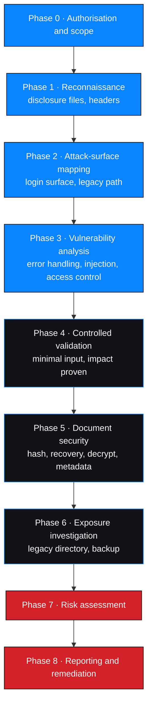

# Scope and methodology as applied

What was in scope, under whose authority, how it was tested, and what that authority
did not permit.

---

## 1. Engagement identification

| Field | Value |
| --- | --- |
| Title | Networkwalks — Mediroza General Hospital Penetration Testing |
| Engagement ID | `NW-B083` |
| Batch | **Discrepancy open** — source lab record says B082, project brief says B083 |
| Target | `https://medirozahospital.com` |
| Environment | Networkwalks authorised training environment (provider-stated authorisation) |
| Client of record | Mediroza General Hospital — fictional lab client |
| Type | Black-box web application assessment |
| Duration | 5 business days |
| Milestones | 4 — M1 initial access, M2 document security, M3 exposure analysis, M4 reporting |
| Assessor | Antony Sifuna (`SifunaCodex`) |

Full overview: [`../../docs/project-overview.md`](../../docs/project-overview.md)

---

## 2. Scope

### 2.1 In scope

| Area | Detail |
| --- | --- |
| Disclosure files | `robots.txt` and other public path disclosures |
| Authentication | `/patient/login.php` login flow and error handling |
| Document delivery | `/patient/reports/` and the three patient-report PDFs (`LAB-PDF-01`…`03`) |
| Document security | Encryption, key strength, metadata hygiene |
| Legacy path | `/old/` and its contents |
| Exposure assessment | The exposed database backup — structure and data classes |

### 2.2 Explicitly out of scope

| Excluded | Reason |
| --- | --- |
| Any host other than the authorized target | Scope boundary |
| Denial-of-service, stress and load testing | Prohibited |
| Destructive or data-modifying testing | Prohibited |
| Credential attacks against real accounts | Prohibited; no credential was needed |
| Social engineering and phishing | Out of scope |
| Physical security | Out of scope |
| Internal infrastructure not exposed by the application | Out of scope |
| Persistence, lateral movement, pivoting | Out of scope |
| Unauthorised extraction of bulk data | Out of scope |

Authorisation: [`../../docs/authorization-and-scope.md`](../../docs/authorization-and-scope.md) ·
operating rules: [`../../docs/rules-of-engagement.md`](../../docs/rules-of-engagement.md)

---

## 3. Method

### 3.1 Phases

### 3.2 Framework alignment

| Framework | Application |
| --- | --- |
| OWASP WSTG | Phase coverage and technique selection |
| PTES | Engagement lifecycle and reporting expectations |
| OWASP Top 10 (2021) | Finding categories — A01, A02, A03, A05, A07 |
| OWASP ASVS | Retest pass conditions |
| CVSS v4.0 | Standardised severity encoding |

Procedures as written: [`../../methodology/`](../../methodology/)

---

## 4. Request profile

Minimal validation, and the engagement's central methodological claim.

| Milestone | Requests to the target | Note |
| --- | --- | --- |
| M1 | Low single digits | Disclosure file, login surface, two injection inputs, document downloads |
| M2 | **0** | Entirely offline — the files were already held |
| M3 | 1–2 | A `HEAD` request to confirm the legacy path, then one download |
| M4 | **0** | Reporting only |

| Principle | How it was honoured |
| --- | --- |
| Prove the weakness, then stop | Injection confirmed with one character; bypass demonstrated with one payload; no extraction |
| Prove the access control, then stop | Documents downloaded to demonstrate reachability; contents not read |
| Prove the encryption state, then stop | Structure, counts and data classes only; no row analysis |
| Never automate exploitation | No exploitation framework, no payload collection, no scanning harness |

> **Zero requests in two of the four milestones.** The most severe finding in this
> engagement — an anonymous cleartext database download — cost one request.

---

## 5. Decision points where less was done than was possible

| Decision | What was not done | Why |
| --- | --- | --- |
| SQLi confirmed via error output | `UNION` extraction, schema enumeration | Impact already proven |
| Bypass achieved | Other account enumeration, administrative functions | `admin` sufficed |
| Documents obtained | Opened and read | Document security, not clinical content |
| Keys recovered | Rule-based mutation, targeted wordlist | Unavailable / unnecessary for the finding |
| Directory listing seen | Recursive crawl | One directory was enough |
| Backup downloaded | Row-level analysis | Presence and cleartext state were sufficient |

> Each of these is a place where a less disciplined engagement would have collected
> more data, increased handling risk, and produced no stronger finding.

---

## 6. Data-handling rules applied

| Rule | Application |
| --- | --- |
| No credential published | Keys and hashes withheld; strength characterised instead |
| No patient content published | Documents never opened; referred to by non-identifying label |
| No financial values published | Salary and shareholder data as schema and counts only |
| Individuals masked | Identified staff member referenced as `j.m***`, by role |
| No bulk data retained | Local copy of the backup destroyed after assessment |
| No third-party processing of client data without disclosure | One AI-tooling transmission, stated plainly as a disclosure event |

Details: [`../../docs/ethical-considerations.md`](../../docs/ethical-considerations.md)

---

## 7. Tools used

| Tool | Purpose |
| --- | --- |
| `curl` | Disclosure-file retrieval and header inspection |
| Web browser | Manual navigation and portal observation |
| Networkwalks Hash Calculator | `$pdf$` key identifier extraction |
| Networkwalks Password Cracker | Wordlist-based key recovery |
| Built-in and instructor-supplied wordlists | Recovery passes |
| `qpdf` | Document decryption for metadata analysis |
| `exiftool` | Metadata inspection |
| `wget` | Backup download |
| Text editor | Schema and statement inspection |
| Python 3 (stdlib) | Repository QA and defensive sanitisation — offline only |
| Git / GitHub Actions | Version control and documentation gate |

Full detail, including rejected categories: [`../../docs/tools-and-technologies.md`](../../docs/tools-and-technologies.md)

---

## 8. Limitations of this assessment

| # | Limitation | Consequence |
| --- | --- | --- |
| 1 | No evidence artifacts supplied | No finding is `Verified` |
| 2 | No CVSS base scores computed | Vectors must be scored independently |
| 3 | No fingerprinting performed | Stack is inference from an error string, not observation |
| 4 | No timestamps or tool versions recorded | Artifacts cannot be independently dated |
| 5 | Four access-control classes untested | Absence of findings is not assurance |
| 6 | Rate limiting, lockout and session management untested | Behaviour under sustained attack is unknown |
| 7 | Legacy directory not fully enumerated | One rating is provisional |
| 8 | Backup data currency unknown | Notification scope cannot be finalised |
| 9 | One table's purpose undetermined | Cannot be assumed benign |
| 10 | Remediation not retested | All fixes are recommendations |
| 11 | No client review obtained | Nothing is approved or signed off |
| 12 | Single point-in-time assessment | Current state unknown |

---

## 9. Related documents

| Document | Purpose |
| --- | --- |
| [`../../docs/authorization-and-scope.md`](../../docs/authorization-and-scope.md) | Authorisation and scope |
| [`../../docs/rules-of-engagement.md`](../../docs/rules-of-engagement.md) | Rules of engagement |
| [`../../docs/methodology.md`](../../docs/methodology.md) | Framework alignment narrative |
| [`../../docs/testing-timeline.md`](../../docs/testing-timeline.md) | Executed timeline |
| [`../../methodology/`](../../methodology/) | Reusable procedures |
| [`technical-findings.md`](./technical-findings.md) | Finding records |
| [`appendices.md`](./appendices.md) | Registers, ID schemes, glossary, references |