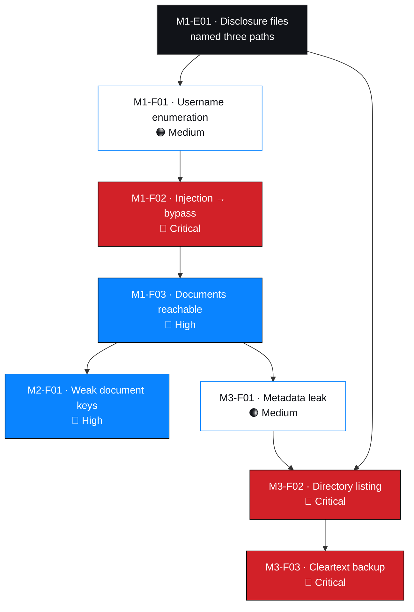

# Technical findings

Consolidated index of all seven findings, with the reasoning that connects them.
Full records live in [`../../findings/verified-findings/`](../../findings/verified-findings/).

> **Verification status applies to every record below: `Documented`, not
> `Verified`.** Twenty-two observations are registered; zero sanitised artifacts have
> been supplied. No numeric CVSS base score is printed. Both omissions are
> deliberate — see [`../../risk/cvss-assessment.md`](../../risk/cvss-assessment.md) §4.

---

## 1. Index

| # | ID | Title | Component | Severity | Rating | CVSS v4.0 vector |
| --- | --- | --- | --- | --- | --- | --- |
| 1 | [`NW-B083-M1-F01`](../../findings/verified-findings/NW-B083-M1-F01-username-enumeration.md) | Username enumeration on login page | `/patient/login.php` | 🟠 Medium | Confirmed | `AV:N/AC:L/AT:N/PR:N/UI:N/VC:L/VI:N/VA:N/SC:N/SI:N/SA:N` |
| 2 | [`NW-B083-M1-F02`](../../findings/verified-findings/NW-B083-M1-F02-sqli-authentication-bypass.md) | SQL injection enabling authentication bypass | `/patient/login.php` | 🔴 **Critical** | Confirmed | `AV:N/AC:L/AT:N/PR:N/UI:N/VC:H/VI:H/VA:L/SC:H/SI:N/SA:N` |
| 3 | [`NW-B083-M1-F03`](../../findings/verified-findings/NW-B083-M1-F03-document-access-control.md) | Patient documents accessible after login bypass | `/patient/reports/` | 🔴 High | **Provisional** | `AV:N/AC:L/AT:N/PR:L/UI:N/VC:H/VI:L/VA:N/SC:N/SI:N/SA:N` |
| 4 | [`NW-B083-M2-F01`](../../findings/verified-findings/NW-B083-M2-F01-weak-document-passwords.md) | Weak document passwords recoverable from wordlists | `LAB-PDF-01…03` | 🔴 High | **Provisional** | `AV:N/AC:L/AT:N/PR:L/UI:N/VC:H/VI:N/VA:N/SC:N/SI:N/SA:N` |
| 5 | [`NW-B083-M3-F01`](../../findings/verified-findings/NW-B083-M3-F01-sensitive-pdf-metadata.md) | Sensitive metadata retained in a patient PDF | `LAB-PDF-03` | 🟠 Medium | Confirmed | `AV:N/AC:L/AT:N/PR:N/UI:N/VC:L/VI:N/VA:N/SC:N/SI:N/SA:N` |
| 6 | [`NW-B083-M3-F02`](../../findings/verified-findings/NW-B083-M3-F02-directory-listing-legacy-folder.md) | Directory listing enabled on a legacy web root | `/old/` | 🔴 **Critical** | **Provisional** | `AV:N/AC:L/AT:N/PR:N/UI:N/VC:H/VI:N/VA:N/SC:N/SI:N/SA:N` |
| 7 | [`NW-B083-M3-F03`](../../findings/verified-findings/NW-B083-M3-F03-cleartext-database-backup-exposure.md) | Unencrypted database backup exposed in a legacy web root | `/old/` (backup file) | 🔴 **Critical** | Confirmed | `AV:N/AC:L/AT:N/PR:N/UI:N/VC:H/VI:N/VA:N/SC:N/SI:N/SA:N` |

**Distribution:** 🔴 Critical 3 · 🔴 High 2 · 🟠 Medium 2 · 🟢 Low 0
**Vectors:** 7 derived · **0 base scores computed**

---

## 2. OWASP Top 10 coverage

| Category | Findings |
| --- | --- |
| A01 Broken Access Control | `M1-F03` |
| A02 Cryptographic Failures | `M2-F01`, `M3-F03` (no encryption at rest) |
| A03 Injection | `M1-F02` |
| A05 Security Misconfiguration | `M3-F01`, `M3-F02`, `M3-F03` |
| A07 Identification and Authentication Failures | `M1-F01`, `M1-F02` |

| Observation |
| --- |
| Three of seven findings are **security misconfiguration**, and the two highest-impact ones are. Configuration beats code as a root cause here |

---

## 3. CWE mapping

| CWE | Findings |
| --- | --- |
| CWE-89 — SQL Injection | `M1-F02` |
| CWE-204 — Observable Response Discrepancy | `M1-F01` |
| CWE-284 / CWE-552 — Improper Access Control / Files Accessible to External Parties | `M1-F03` |
| CWE-521 — Weak Password Requirements | `M2-F01` |
| CWE-200 — Exposure of Sensitive Information | `M3-F01` |
| CWE-548 — Directory Listing | `M3-F02` |
| CWE-312 / CWE-530 — Cleartext Storage / Backup Exposure | `M3-F03` |

---

## 4. The chain

### 4.1 What the chain shows

| Observation | Why it matters |
| --- | --- |
| `M1-F02` is the root defect | Most of the engagement descends from one query |
| Two independent paths reached `/old/` | A disclosure file at step one, and a metadata comment in M3 |
| `M3-F01` is Medium yet decisive | Severity measures the weakness, not its role |
| Four separate controls would each have broken the chain | Authentication, web-root placement, directory listing, backup encryption |

---

## 5. Root cause concentration

| Root cause | Findings | One fix covers all? |
| --- | --- | --- |
| Unparameterised input reaching a SQL query | `M1-F02` | Partially — sibling parameters untested |
| Documents served as static files in the web root | `M1-F03`, `M2-F01` | ✅ Yes |
| No metadata stripping in the export path | `M3-F01` | ✅ Yes |
| Directory listing enabled | `M3-F02` | ✅ Yes |
| Backups permitted inside the web root | `M3-F02`, `M3-F03` | ✅ Yes |
| No owner or lifecycle for migration leftovers | `M3-F02`, `M3-F03` | ✅ Yes — the systemic cause |
| Distinct authentication error messages | `M1-F01` | ✅ Yes |
| Verbose database errors returned to the client | `M1-F02` | ✅ Yes |

> Six of eight are configuration or process. **This was not an advanced attack, and it
> is not expensive to fix.**

---

## 6. Findings that required a judgement call

### 6.1 `M1-F02` — is `VI:H` justified when nothing was written?

| Position | Assessment |
| --- | --- |
| For `H` | A write primitive on an authentication query implies write capability; that is the standard treatment |
| For `N` | No modification was demonstrated, and a strict reading measures execution |

**Chosen: `H`, with the inference flagged** in the record as the only inferred metric
in the engagement. A reviewer requiring demonstrated-only evidence should read `N`.

### 6.2 `M3-F02` — Critical for a directory listing?

| Position | Assessment |
| --- | --- |
| For Critical | The listing disclosed the filename of a database backup — that is what made the worst finding reachable |
| For Medium | Listing alone discloses filenames and sizes only. In isolation this is a Medium finding |

**Chosen: Critical, marked provisional**, because the rating is coupled to the
directory's contents, which were never fully enumerated. Both positions are stated
in the record rather than one being presented as the only defensible answer.

### 6.3 `M3-F03` — should `SC` and `VI` be higher?

| Challenge | Response |
| --- | --- |
| "The dump reveals the schema, aiding tampering — `VI:L`?" | `VI` measures impact executed, not enabled. No write was attempted |
| "The dump compromises a subsequent system — `SC:H`?" | No. The payload belongs to the affected system; `SC` requires reaching a different one |

**Chosen: `VI:N`, `SC:N`.** A higher-looking number would have been less defensible on
inspection. The enabled risk is written up in the narrative instead.

### 6.4 `M2-F01` — does CVSS v4.0 fit a weak key in a file?

| Position | Assessment |
| --- | --- |
| It fits | Weakness strength is a confidentiality-impact property |
| It does not | v4.0's base metrics model exploitable system weaknesses; file key strength is a cryptographic failure |

**Chosen: a vector is provided as a structured severity statement, with the caveat
stated and an alternative framing (`PR:N/AT:P`) given** so a reviewer can read it
either way.

---

## 7. Findings not raised, and why

| Observation | Not a finding because |
| --- | --- |
| `robots.txt` lists application paths | Its purpose is crawler guidance. The consequences are reported as findings; the file is not |
| Server version disclosed in headers | Version disclosure alone is a hardening item. It is reported as an observation that **assisted** the error-based inference in `M1-F02` |
| Verbose database errors | Would be Low/Medium alone; its weight comes from accompanying an injectable endpoint. Recorded as a contributing weakness within `M1-F02` |
| Document metadata revealing a staff identity | A person is not an asset. It is a data point in `M3-F01`, and the individual is masked |
| A table of undetermined purpose in the backup | Recorded as an **open question** rather than a finding — its sensitivity is unknown, not established |

> A finding count is not a quality metric. Padding it with observations inflates the
> report and trains the reader to discount it.

---

## 8. Impact by data class

| Class | Findings | Consequence |
| --- | --- | --- |
| 🔴 Clinical | `M1-F02`, `M1-F03`, `M2-F01`, `M3-F03` | Notifiable breach; potential patient harm |
| 🔴 Personal | `M3-F03` | Privacy exposure; fraud and phishing risk |
| 🟠 Financial | `M3-F03` | Governance, market sensitivity, employment-relations exposure |
| 🟠 Internal | all | Reconnaissance value for further attack |

---

## 9. Verification status of each finding

| Finding | Observations registered | Artifacts attached | Verification |
| --- | --- | --- | --- |
| `M1-F01` | `E03`, `E04` | 0 | Documented |
| `M1-F02` | `E05`, `E06` | 0 | Documented |
| `M1-F03` | `E06`, `E07`, `E08` | 0 | Documented |
| `M2-F01` | `E01`–`E06` | 0 | Documented |
| `M3-F01` | `M2-E05`, `M3-E01`, `M3-E02` | 0 | Documented |
| `M3-F02` | `M3-E03` | 0 | Documented |
| `M3-F03` | `M3-E04`–`M3-E08` | 0 | Documented |

Procedure to change any of these values: [`../../evidence/README.md`](../../evidence/README.md) §5

---

## 10. Cross-references

| Document | Purpose |
| --- | --- |
| [`../../risk/cvss-assessment.md`](../../risk/cvss-assessment.md) | Per-metric vector derivation and scoring policy |
| [`../../risk/risk-register.csv`](../../risk/risk-register.csv) | Machine-readable register |
| [`risk-assessment.md`](./risk-assessment.md) | Risk view for management and technical readers |
| [`remediation-plan.md`](./remediation-plan.md) | Prioritised actions and retest criteria |
| [`../../findings/README.md`](../../findings/README.md) | Status definitions and ID discipline |
| [`../../methodology/reporting.md`](../../methodology/reporting.md) | Why findings are written this way |