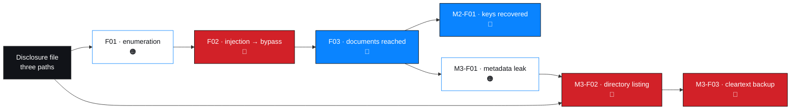

# Penetration testing report

**Single-document deliverable.** Consolidated from
[`../milestones/M4-final-report/`](../milestones/M4-final-report/). For the
section-by-section version with full detail, use those files.

| Field | Value |
| --- | --- |
| Engagement | Networkwalks — Mediroza General Hospital Penetration Testing |
| Engagement ID | `NW-B083` |
| Target | `https://medirozahospital.com` — authorised training environment |
| Type | Black-box web application assessment |
| Duration | 5 business days |
| Findings | 7 — 🔴 Critical 3 · 🔴 High 2 · 🟠 Medium 2 |
| Report state | **Draft for review** |
| Verification | 7 Documented · 0 Evidence-attached · 0 Verified |

---

## 1. Executive summary

An anonymous party could obtain the entire application database — clinical,
personal-finance and corporate-governance data — with a browser and `curl`.

The path was not subtle. A disclosure file named three application paths on the
first request of the engagement. The login page revealed which usernames were real.
One crafted input removed the password check from the login query. Everything
afterwards followed.

| # | Critical finding | Why |
| --- | --- | --- |
| 1 | **SQL injection enabling authentication bypass** | Defeats authentication in two requests, with no credential |
| 2 | **Directory listing on a legacy web root** | Handed out the location and filename of a database backup |
| 3 | **Unencrypted database backup in a web root** | The whole database, cleartext, downloaded anonymously |

Full narrative: [`../milestones/M4-final-report/executive-summary.md`](../milestones/M4-final-report/executive-summary.md)

---

## 2. Scope, authorisation and method

### 2.1 In scope

| Area |
| --- |
| Disclosure files and public path disclosure |
| `/patient/login.php` authentication flow and error handling |
| `/patient/reports/` and the three patient-report PDFs (`LAB-PDF-01`…`03`) |
| Document encryption, key strength, metadata hygiene |
| `/old/` legacy directory and its contents |
| Exposure assessment of the exposed database backup — structure and data classes |

### 2.2 Out of scope

Any other host · denial-of-service and load testing · destructive or modifying
testing · credential attacks · social engineering · physical testing · internal
infrastructure not exposed by the application · persistence and lateral movement ·
unauthorised bulk extraction.

### 2.3 Method

OWASP WSTG phases, PTES lifecycle, OWASP Top 10 categorisation, ASVS retest
criteria, CVSS v4.0 severity encoding. Procedures:
[`../methodology/`](../methodology/)

### 2.4 Request profile

| Milestone | Requests to the target |
| --- | --- |
| M1 | Low single digits |
| M2 | **0** — entirely offline |
| M3 | 1–2 |
| M4 | **0** — reporting only |

> The most severe finding in this engagement — an anonymous cleartext database
> download — cost **one request**.

---

## 3. Findings

### `NW-B083-M1-F01` — Username enumeration on login page 🟠 Medium

| | |
| --- | --- |
| Component | `/patient/login.php` |
| OWASP / CWE | A07 Identification and Authentication Failures / CWE-204 |
| CVSS v4.0 | `AV:N/AC:L/AT:N/PR:N/UI:N/VC:L/VI:N/VA:N/SC:N/SI:N/SA:N` |
| Confidence | High |

The login page returns different responses for a non-existent username and for an
existing one with a wrong password, disclosing which accounts are real.

**Impact.** No data exposed directly, but it made the subsequent injection test
targeted rather than exploratory — and contributed to the bypass.

**Fix.** One generic failure message, identical in body and status for every failure;
detail to the log only.

Record: [`../findings/verified-findings/NW-B083-M1-F01-username-enumeration.md`](../findings/verified-findings/NW-B083-M1-F01-username-enumeration.md)

---

### `NW-B083-M1-F02` — SQL injection enabling authentication bypass 🔴 Critical

| | |
| --- | --- |
| Component | `/patient/login.php` |
| OWASP / CWE | A03 Injection / CWE-89 |
| CVSS v4.0 | `AV:N/AC:L/AT:N/PR:N/UI:N/VC:H/VI:H/VA:L/SC:H/SI:N/SA:N` |
| Confidence | High |

A single quote in the `username` field returns a MySQL syntax error verbatim,
confirming injection. A closing quote followed by a comment marker removes the
password comparison from the executed statement, and the portal loads.

**Impact.** Authentication control defeated with no credential. Everything
downstream — patient documents, weak document keys, the M3 chain — follows from
this. Verbose errors additionally disclose driver, engine and query structure.

**Not done, deliberately.** No `UNION` extraction, no schema enumeration, no other
accounts, no modification, no persistence.

**Fix.** Parameterised statements at every call site; `password_verify()` for
passwords; `display_errors=Off` in production; allow-list any dynamic SQL identifier.

> `VI:H` is the one inferred metric in this engagement — no write was demonstrated.
> A reviewer requiring demonstrated-only evidence should read `N`.

Record: [`../findings/verified-findings/NW-B083-M1-F02-sqli-authentication-bypass.md`](../findings/verified-findings/NW-B083-M1-F02-sqli-authentication-bypass.md)

---

### `NW-B083-M1-F03` — Patient documents accessible after login bypass 🔴 High

| | |
| --- | --- |
| Component | `/patient/reports/` |
| OWASP / CWE | A01 Broken Access Control / CWE-284, CWE-552 |
| CVSS v4.0 | `AV:N/AC:L/AT:N/PR:L/UI:N/VC:H/VI:L/VA:N/SC:N/SI:N/SA:N` |
| Confidence | High · **Rating provisional** |

Patient report PDFs are served as static files from within the web root. After the
bypass, all three were downloaded. The login check was the only control between an
anonymous user and clinical documents.

**Provisional because** direct unauthenticated access to a known document URL was
**never tested**. If it succeeds, `PR` becomes `N` and the band rises to Critical.

**Fix.** Move documents outside the web root; serve through an authorising endpoint
with per-object checks; non-guessable identifiers as defence in depth only.

Record: [`../findings/verified-findings/NW-B083-M1-F03-document-access-control.md`](../findings/verified-findings/NW-B083-M1-F03-document-access-control.md)

---

### `NW-B083-M2-F01` — Weak document passwords recoverable from wordlists 🔴 High

| | |
| --- | --- |
| Component | `LAB-PDF-01`, `LAB-PDF-02`, `LAB-PDF-03` |
| OWASP / CWE | A02 Cryptographic Failures / CWE-521 |
| CVSS v4.0 | `AV:N/AC:L/AT:N/PR:L/UI:N/VC:H/VI:N/VA:N/SC:N/SI:N/SA:N` |
| Confidence | High · **Rating provisional** |

All three documents were encrypted, and every key was recovered. Two fell to a
built-in top-100 password list; the third only after escalating to a larger one.
Every key used a single character class and was a dictionary entry.

> **Keys are withheld by policy.** Strength is characterised, values are not
> published — including in this report.

**Impact.** The encryption provided no protection against any attacker with basic
tooling. The attack is entirely offline, so rate limiting, lockout and MFA provide
zero defence.

**Provisional because** a rule-based mutation pass was not performed and key-reuse
scope is unknown. Both would most likely have recovered **more** keys.

**Negative control recorded.** The third document's recovery *failed* on the smaller
list. That failure is what makes the two successes meaningful.

**Fix.** CSPRNG-generated keys of ≥20 characters, unique per document, held in a
secrets manager; treat the document password as a secondary control only.

Record: [`../findings/verified-findings/NW-B083-M2-F01-weak-document-passwords.md`](../findings/verified-findings/NW-B083-M2-F01-weak-document-passwords.md)

---

### `NW-B083-M3-F01` — Sensitive metadata retained in a patient PDF 🟠 Medium

| | |
| --- | --- |
| Component | `LAB-PDF-03` |
| OWASP / CWE | A05 Security Misconfiguration / CWE-200 |
| CVSS v4.0 | `AV:N/AC:L/AT:N/PR:N/UI:N/VC:L/VI:N/VA:N/SC:N/SI:N/SA:N` |
| Confidence | High |

Embedded metadata in a patient report contained a staff account identifier in the
`Author` field and an operational note in the `Comments` field naming an internal
location, a database backup, a migration event and a retention instruction.

> The individual is masked as `j.m***` and referenced by role only.

**Impact, in isolation.** Internal identity and infrastructure disclosure — Medium.

**Impact, in context.** The note named the directory that led to two Critical
findings. A Medium finding was the bridge to the worst outcome in the engagement.

**Fix.** Strip metadata automatically on export and verify the output; disable
metadata at source in the generating tool; apply the same review to all formats.

Record: [`../findings/verified-findings/NW-B083-M3-F01-sensitive-pdf-metadata.md`](../findings/verified-findings/NW-B083-M3-F01-sensitive-pdf-metadata.md)

---

### `NW-B083-M3-F02` — Directory listing enabled on a legacy web root 🔴 Critical

| | |
| --- | --- |
| Component | `/old/` |
| OWASP / CWE | A05 Security Misconfiguration / CWE-548 |
| CVSS v4.0 | `AV:N/AC:L/AT:N/PR:N/UI:N/VC:H/VI:N/VA:N/SC:N/SI:N/SA:N` |
| Confidence | High · **Rating provisional** |

A path disclosed in the disclosure file at the very first step of the engagement was
reachable and served an automatic index of its contents, with sizes and dates.

**Impact.** Removed the need to guess any filename — and pointed directly at the
database backup. Rated Critical **because of what the index contained**; the
directory's full contents were never enumerated, which is why the rating is
provisional. Directory listing in isolation is a Medium finding, and that reading is
recorded in the finding rather than hidden.

**Fix.** `Options -Indexes` globally; decommission the legacy path entirely; deny by
default with an allow-list of intended roots; monitor for `200`/`301` from retired
paths.

> Disabling the listing does **not** remove the backup. Both actions are P0.

Record: [`../findings/verified-findings/NW-B083-M3-F02-directory-listing-legacy-folder.md`](../findings/verified-findings/NW-B083-M3-F02-directory-listing-legacy-folder.md)

---

### `NW-B083-M3-F03` — Unencrypted database backup exposed in a legacy web root 🔴 Critical

| | |
| --- | --- |
| Component | Database backup file within `/old/` |
| OWASP / CWE | A05 / A02 / CWE-312, CWE-530 |
| CVSS v4.0 | `AV:N/AC:L/AT:N/PR:N/UI:N/VC:H/VI:N/VA:N/SC:N/SI:N/SA:N` |
| Confidence | High |

A MySQL database backup was served directly from a web path with no authentication
and no encryption. It downloaded anonymously and restored without a password,
yielding 36 tables.

**Data exposed — structure and counts only, never values**

| Category | Present | Class |
| --- | --- | --- |
| Patient records, addresses, contact details | ✅ | 🔴 Clinical / personal |
| Staff compensation data | ✅ | 🟠 Financial |
| Shareholder and ownership data | ✅ | 🟠 Corporate governance |
| Internal account and infrastructure names | ✅ | 🟠 Internal |
| One table of undetermined purpose | ✅ | ⚪ Unknown — disclosed as an open question |

**Why this is the engagement's most serious finding**

| Property | Consequence |
| --- | --- |
| No authentication | No access control to defeat |
| No encryption at rest | No key custody failure needed — no key existed |
| One file, whole database | One download obtained everything |
| Stale, pre-migration | May be believed deleted; may not appear in any deletion record |
| Retained indefinitely | An internal note recorded that it should not be deleted |
| No mitigating control | Every other finding had something that partially worked |

**Method.** Structure, counts and data classes only. No row export, no local
retention, no individual value read or used.

**Fix.** Remove immediately and purge caches; search **all** web-served paths for
others; treat all data as compromised; assess notification obligations; review access
logs; rotate any credentials present; store backups off-web-root, KMS-encrypted,
role-restricted, logged, with enforced retention; add a CI gate against artefacts in
web roots; segregate clinical, payroll and governance data into separate stores.

> Removal does not discharge any notification duty arising from the exposure.

Record: [`../findings/verified-findings/NW-B083-M3-F03-cleartext-database-backup-exposure.md`](../findings/verified-findings/NW-B083-M3-F03-cleartext-database-backup-exposure.md)

---

## 4. Attack chain

Two independent weaknesses pointed at the same legacy directory: the disclosure file
at step one, and the metadata comment in M3. Neither alone was critical; together
they made the path unavoidable.

Analysis: [`../milestones/M4-final-report/technical-findings.md`](../milestones/M4-final-report/technical-findings.md) §4

---

## 5. Root cause concentration

| Root cause | Findings | One fix covers all? |
| --- | --- | --- |
| Unparameterised input in a SQL query | `M1-F02` | Partially — sibling parameters untested |
| Documents served as static files in the web root | `M1-F03`, `M2-F01` | ✅ |
| No metadata stripping on export | `M3-F01` | ✅ |
| Directory listing enabled | `M3-F02` | ✅ |
| Backups permitted inside the web root | `M3-F02`, `M3-F03` | ✅ |
| No owner or lifecycle for migration leftovers | `M3-F02`, `M3-F03` | ✅ — systemic cause |
| Distinct authentication error messages | `M1-F01` | ✅ |
| Verbose database errors returned to clients | `M1-F02` | ✅ |

> Six of eight are configuration or process. **This was not an advanced attack, and it
> is not expensive to fix.**

---

## 6. Remediation summary

| Priority | Window | Actions |
| --- | --- | --- |
| **P0** | Same day | Remove the backup and purge caches · search all web-served paths · assess notification · review access logs · decommission the legacy path · disable directory indexing · parameterise all queries · disable verbose errors · move documents behind an authorising endpoint · rotate exposed credentials |
| **P1** | Days | Alerting on bulk access, enumeration and retired paths · off-web-root KMS-encrypted backups with retention · CI gate against web-root artefacts · document-key generation and secrets management · migration sign-off |
| **P2** | Weeks | Generic login errors · automatic metadata stripping · SAST · allow-lists · rate limiting · version-header hardening |
| **P3** | Ongoing | Exposure monitoring · path inventory · data segregation and minimisation · document signing · periodic retest |

39 actions in total. **0 assigned, 0 completed, 0 retested.**

Full plan: [`../milestones/M4-final-report/remediation-plan.md`](../milestones/M4-final-report/remediation-plan.md) ·
tracker: [`remediation-tracker.csv`](./remediation-tracker.csv)

---

## 7. Verification status and limitations

| # | Item | Status |
| --- | --- | --- |
| 1 | Evidence artifacts | **22 observations registered, 0 attached** — no finding is `Verified` |
| 2 | CVSS v4.0 base scores | **Not computed**, deliberately |
| 3 | Unauthenticated access to a known document URL | Not tested — one rating is provisional |
| 4 | Object-level authorisation | Not tested |
| 5 | Rate limiting, lockout, session management | Not tested |
| 6 | Technology fingerprinting | Not performed — stack is inference |
| 7 | Timestamps and tool versions | Not recorded |
| 8 | Full enumeration of the legacy directory | Not performed |
| 9 | Purpose of one table in the backup | Not determined |
| 10 | Remediation retested | No |
| 11 | Client review and sign-off | None |
| 12 | Data currency of the backup | Unknown |

> Untested is not safe. None of the above is claimed as secure.

---

## 8. Confidentiality and data handling

This report contains **no client data**:

- ❌ Recovered document passwords, or any partial form of them
- ❌ Patient records, names, addresses or clinical content
- ❌ Salary figures
- ❌ Shareholder names, percentages or classes
- ❌ Backup row contents — schema and record counts only
- ❌ The PDF or SQL artifacts themselves
- ❌ Evidence artifacts — none present
- ❌ Exploit automation, credential-attack tooling or scanning harnesses

| Category | How it appears instead |
| --- | --- |
| Document keys | Strength class and wordlist class only |
| Patient, salary and shareholder data | Table names and record counts |
| Identified staff member | `j.m***`, referenced by role |
| Undetermined table | Named as an open question |

One AI-tooling transmission is disclosed in the M3 evidence documentation, with its
data-handling consequence stated plainly.

---

## 9. Status and next steps

| Item | Status |
| --- | --- |
| Report state | **Draft for review** |
| Client review | None |
| Approval / sign-off | None claimed |
| Blocking before issue | Evidence artifacts · CVSS scores · owners and dates · batch reconciliation · data currency · client sign-off |
| Recommended next action | Assign owners to the P0 actions and start the filesystem search |

---

## Appendices

| Appendix | Contents |
| --- | --- |
| [`../milestones/M4-final-report/appendices.md`](../milestones/M4-final-report/appendices.md) | Registers, ID schemes, hypotheses, glossary, references, open items |
| [`../risk/risk-register.csv`](../risk/risk-register.csv) | Machine-readable risk register |
| [`../evidence/evidence-register.csv`](../evidence/evidence-register.csv) | Evidence register |
| [`../findings/README.md`](../findings/README.md) | Status definitions and ID discipline |
| [`../docs/glossary.md`](../docs/glossary.md) | Glossary |